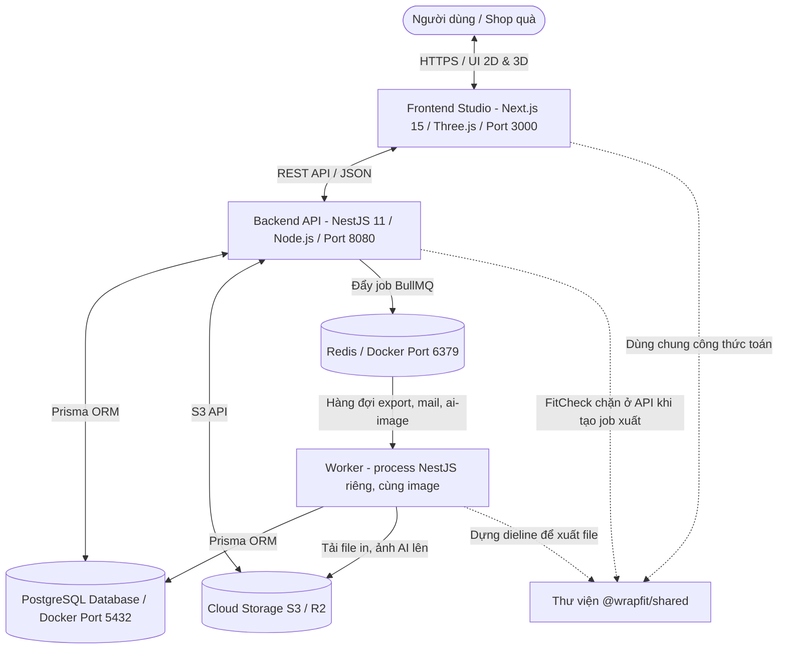

# 🎁 TỔNG QUAN DỰ ÁN (PROJECT OVERVIEW) — WrapFit Platform

> **Khóa học**: EXE101 — Khởi nghiệp đổi mới sáng tạo (FPT University)  
> **Định vị**: Nền tảng Đóng gói Quà tặng Thông minh & Cá nhân hóa (Packaging Personalization & Intelligence Platform)  
> **Slogan**: *"Make Every Present, Present."*  
> **Quy mô đội ngũ**: 6 thành viên (3 IT, 2 Kinh Tế, 1 Marketing)

---

## 1. Triết Lý & Nguồn Cảm Hứng

- **Insight cốt lõi**: *"The gift is personal. Why shouldn't its packaging be?"* (Món quà là thứ mang đậm dấu ấn cá nhân, tại sao bao bì của nó lại rập khuôn công nghiệp?).
- **Vấn đề thực tế**: Khi mua quà tinh tế, người dùng hoặc shop đồ thủ công thường phải mua hộp carton sản xuất sẵn không vừa vặn, nhét đầy rơm giấy hoặc xốp vụn. Nếu muốn đặt hộp riêng, các xưởng in yêu cầu số lượng tối thiểu (MOQ) từ 500 - 1.000 hộp và chi phí làm khuôn dao bế riêng từ 1.500.000đ - 2.000.000đ (1,5 - 2 triệu đồng).
- **Tuyên ngôn định vị**: WrapFit không phải là một Canva tiếp theo. WrapFit là một quy trình làm việc chuyên biệt cho ngành bao bì (*Packaging-specific workflow*).

---

## 2. Luồng Trải Nghiệm Khách Hàng (4 Giai Đoạn)

$$\text{GIFT (Khai báo món quà)} \longrightarrow \text{DESIGN (Thiết kế cá nhân)} \longrightarrow \text{FIT (Kiểm định in ấn)} \longrightarrow \text{PRESENT (Trao quà ý nghĩa)}$$

Bốn giai đoạn trên là giá trị WrapFit mang lại. Trong Studio, người dùng đi qua **sáu bước**, tên bước lấy đúng như trên thanh bước ([StudioStepper](../fe/src/features/studio/components/StudioStepper.tsx)):

| Bước | Nhãn trong Studio | Người dùng làm gì | Giai đoạn |
| :--- | :--- | :--- | :--- |
| 1 | **Kiểu hộp** | Chọn cấu trúc: hộp nắp gài, hộp kéo bao diêm, hộp âm dương, hộp gối, hộp nắp cài, hộp quai xách, khay xách ly, khay chia ngăn, thẻ treo, thiệp gấp đôi, đai giấy bọc hộp. | GIFT |
| 2 | **Kích thước** | Nhập Dài ($L$) × Rộng ($W$) × Cao ($H$) theo `mm` hoặc `cm`, chọn đo lọt lòng hay phủ bì, hoặc chọn nhanh theo món quà. | GIFT |
| 3 | **Giấy** | Chọn giấy và hoàn thiện (cán màng, ép kim, UV…). | DESIGN |
| 4 | **Thiết kế** | Đặt chữ, logo, ảnh, hình khối, hoa văn AI lên từng mặt hộp. FitCheck™ kiểm trực tiếp trên khuôn. | DESIGN, FIT |
| 5 | **Quà & mở hộp** | Xem hộp 3D trong bối cảnh, tạo lời chúc và mã QR mở hộp, tải ảnh mockup, video/GIF hộp gập. | PRESENT |
| 6 | **Đặt in** | Xem kết quả FitCheck, báo giá, duyệt mẫu với khách hoặc xưởng in, đặt in và tải file in. | FIT, PRESENT |

**Điểm vào Studio** ([StudioWorkspace](../fe/src/views/editor/studio/StudioWorkspace.tsx)):

- **Thiết kế mới** mở ở `/editor/demo`, bắt đầu từ bước 1 (Kiểu hộp). Nút "Thiết kế hộp mới" (`?new=1`) luôn bắt đầu lại từ bước 1. Nếu đi từ một mẫu hoặc một trang cấu trúc (link có `template`, `structure` hoặc kích thước), Studio mở thẳng bước 4 (Thiết kế). Bản thiết kế này chỉ lưu trong trình duyệt cho tới khi người dùng đăng nhập và bấm lưu thành dự án.
- **Dự án đã lưu** mở ở `/editor/<id>`, vào thẳng bước 4 (Thiết kế). Kiểu hộp đã được chọn sẵn khi tạo dự án nên bước 1 bị khóa, kèm lời nhắc "Cấu trúc hộp cố định sau khi tạo dự án. Tạo dự án mới để đổi kiểu hộp."
- Bước đang mở được giữ trên địa chỉ (`?step=`), nên tải lại trang vẫn ở đúng bước.

Trạng thái: có mã trên `develop`. Điểm vào được đối chiếu bằng cách đọc mã, chưa mở lại trong trình duyệt ở đợt đồng bộ này (chờ kiểm thực tế, người kiểm: thành viên IT phụ trách Studio).

**Quy tắc FitCheck chính** (nguồn: [prepress.ts](../shared/src/print/prepress.ts), [validator.ts](../shared/src/fitcheck/validator.ts)):

- Chữ, logo cách nét cắt **5 mm** và cách nếp gấp **3 mm**. Thiếu lề là cảnh báo. Cách dưới 1 mm hoặc tràn ra ngoài mặt thì thành lỗi chặn xuất file.
- Nền chạm nét cắt phải tràn ra ngoài **≥ 2 mm**. Trong file PDF, `BleedBox` rộng hơn phôi **3 mm**.
- Ảnh raster tính DPI ở kích thước in: đạt từ **300 DPI**. Từ 150 đến dưới 300 DPI là cảnh báo. Dưới **150 DPI** là lỗi chặn xuất.
- Tải file khi không còn lỗi mức `error`. Mốc ≥ 90 điểm chỉ dùng khi đưa mẫu vào thư viện cộng đồng.

**Khi nào cần thanh toán để lấy file in.** Lưu thiết kế luôn miễn phí. File in (PDF CMYK, PDF in A4/A3, SVG, DXF, gói nhà in ZIP) chỉ mở khi phiên bản thiết kế đó nằm trong một **đơn in đã thanh toán và chưa hủy**. Ở bước 6, thẻ "Gói File Xuất Xưởng" hiện "Cần đặt in" và nút "Thanh toán" (thêm thiết kế vào giỏ in). Sau khi trả tiền, thẻ đổi thành "Đã thanh toán" và nút "Xuất file in ngay". Một số điểm cần nhớ:

- Đổi tên dự án vẫn giữ quyền tải file.
- Sửa thiết kế sau khi thanh toán tạo phiên bản mới. Phiên bản mới cần một đơn in mới.
- Gói Pro không tự mở file in cho dự án mới. Mọi file in đều đi qua giỏ in.
- Thiếu quyền, máy chủ trả `402 ORDER_PAYMENT_REQUIRED`. Chi tiết API ở [03 · Thiết kế API](03_API_DESIGN.md#xuất-file-in).

Trạng thái: có mã trên `develop`. Đã kiểm bằng E2E backend (`export.e2e-spec.ts`, 19/11/2026).

---

## 3. Kiến Trúc Phân Lớp Toàn Diện

- Frontend chạy Next.js 15 (15.5.27, [package.json](../fe/package.json)).
- Worker là một process riêng, xử lý ba hàng đợi `export`, `mail`, `ai-image` ([worker.ts](../be/src/worker.ts)).
- FitCheck chạy lại ở API ngay khi tạo job xuất. Worker dựng file từ bản thiết kế đã lưu cùng job, nên file in đúng là bản đã kiểm và đã thanh toán.
