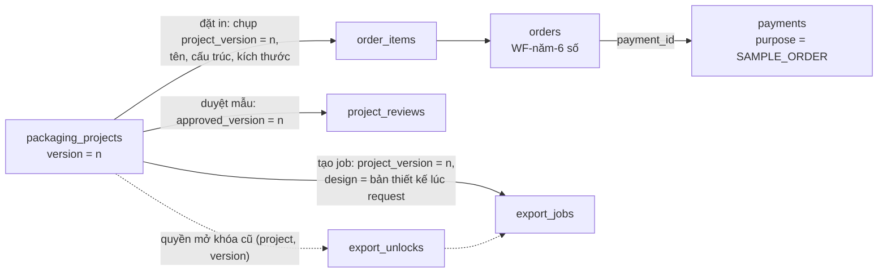

# 🗄️ THIẾT KẾ CƠ SỞ DỮ LIỆU (DATABASE DESIGN) — PostgreSQL & Prisma

> **Phụ trách**: 👤 **IT 3** (Backend & Data Infrastructure)  
> **Nguồn sự thật**: [`be/prisma/schema.prisma`](../be/prisma/schema.prisma) (Schema v2.1, **32 bảng**, đối chiếu ngày 2026-11-19). Lý do thiết kế chi tiết: [`07_SYSTEM_BLUEPRINT_AND_TASK_BREAKDOWN.md`, Mục 4.1](07_SYSTEM_BLUEPRINT_AND_TASK_BREAKDOWN.md).  
> Thay đổi schema luôn đi qua migration: sửa `schema.prisma` rồi chạy `npm run db:migrate -- --name <ten>` trong `be/` (không dùng `prisma db push`).

### Quy ước bắt buộc

Các quy ước dưới đây có từ đợt củng cố DB (2026-10-07) và các đợt sửa sau. Mỗi quy ước ghi kèm lý do, để người sửa schema sau này biết điều gì sẽ hỏng nếu bỏ nó.

- **Thời gian**: mọi cột `DateTime` là `timestamptz(3)` (`@db.Timestamptz(3)`), giá trị lưu theo UTC. Lý do: so sánh mốc thời gian (hết hạn token, dọn thùng rác) không còn phụ thuộc múi giờ của máy chủ, và SQL thuần không phải viết `AT TIME ZONE`.
- **Khóa chính**: `@default(uuid(7))` (UUIDv7, tăng dần theo thời gian, nên index B-tree không bị phân mảnh). Ngoại lệ: `refresh_tokens.id` = `jti` do code sinh.
- **Ràng buộc CHECK** (tiền tố `chk_`) chỉ nằm trong migration, Prisma không thấy chúng: khi đổi tên / đổi kiểu một cột, sửa luôn CHECK của cột đó trong migration mới. Hiện có: email viết thường, `fitcheck_score` 0–100, bộ đếm ≥ 0, `size > 0`, `version` / `formula_version` ≥ 1, `(status = 'DELETED') = (deleted_at IS NOT NULL)`, cột `*_key` chỉ chứa key `users/...`, mỗi tài khoản có `password_hash` hoặc `google_id`, tài khoản Google luôn có `email_verified_at`. Phần thanh toán có thêm CHECK riêng trong migration `20261030000100_billing_core` và các migration sau (ví dụ `orders.total_vnd = subtotal + shipping - discount`, `order_items.quantity` 1–10, `payments.reference` dạng `WF` + 6 ký tự).
- **Chỉ mục một phần** cũng chỉ nằm trong migration: một mã còn hiệu lực cho mỗi `(user_id, purpose)` của `auth_tokens`, một `subscriptions` `ACTIVE` mỗi người dùng, `notifications_unread_idx`.
- **File lưu bằng key, không lưu URL**: `thumbnail_key`, `preview_key`, `avatar_key`, `brand_kit.logoKey`, `content` của phần tử `logo` / `image` / `pattern` trong `canvas_state`, `style.fontUrl` của phần tử chữ và `customFonts[].url`. API vẫn trả URL (`thumbnailUrl`...), dựng từ `STORAGE_PUBLIC_URL` lúc đọc (`be/src/storage/asset-keys.ts`). Lý do: đổi tên miền lưu trữ không phải sửa dữ liệu, và CHECK chặn được URL lạ lọt vào DB.
- **Ảnh và phông dự án đang dùng** nằm ở `project_file_refs`, đồng bộ trong cùng transaction với mỗi lần ghi canvas (`syncProjectFileRefs`). Không tìm key bằng cách quét `canvas_state::text`. Chi tiết ở [mục 4](#4-giữ-file-và-xóa-dự-án).
- **Công thức hộp có phiên bản**: dự án chốt `formula_version` lúc tạo; đổi công thức = thêm phiên bản mới trong `shared/src/parametric/registry.ts`, không sửa phiên bản cũ. Lý do: sửa công thức không được làm xê dịch dieline của dự án đã có.
- **Khóa ngoại luôn có index** (PostgreSQL không tự tạo). Lý do: xóa dòng cha (cascade, `SET NULL`) và kiểm khóa ngoại phải dùng index, nếu không sẽ quét cả bảng con.
- **Chọn hành vi khóa ngoại theo mục đích**, không mặc định `CASCADE`:
  - Dữ liệu chỉ thuộc về dòng cha thì `CASCADE` (snapshot, lượt thích, refs của dự án, dòng hàng của đơn).
  - Dữ liệu cần giữ khi dòng cha mất thì `SET NULL` (`order_items.project_id`, `product_events.user_id` / `project_id`, `notifications.actor_id`).
  - **Bảng có tiền** (`payments`, `credit_lots`, `subscriptions`, `orders`) trỏ tới `users` bằng `RESTRICT`: xóa tài khoản có lịch sử tiền phải đi đường ẩn danh hóa (`users.anonymized_at`), không cascade làm mất chứng từ.
  - `project_file_refs.stored_file_id` là `NO ACTION`, không phải `RESTRICT`. `RESTRICT` kiểm ngay giữa câu lệnh, nên làm hỏng chính việc xóa dự án (refs của dự án và file của dự án bị cascade trong cùng câu lệnh). `NO ACTION` kiểm ở cuối câu lệnh, nên vẫn chặn được việc xóa một file mà dự án khác còn hiển thị.
- **Mốc migration** (thư mục `be/prisma/migrations/`):

  | Mốc | Migration | Nội dung |
  |---|---|---|
  | Củng cố DB (2026-10-08) | `20261008000100_timestamptz_checks_indexes` → `20261008000600_signup_hardening` | `timestamptz(3)`, CHECK, index khóa ngoại, `formula_version`, `auth_tokens`, key thay URL, `project_file_refs`, chống lộ email khi đăng ký |
  | Ví, đơn và thanh toán (2026-10-30, 31) | `20261030000100_billing_core` → `20261031000400_ai_pattern_xu` | `payments`, `credit_lots`, `credit_debits`, `export_unlocks`, `subscriptions`, `orders`, `product_events`, xu Wrap, ảnh AI |
  | Cổng thanh toán (2026-11-10 → 12) | `20261110000100_payment_gateways` → `20261112000100_xu_custom_topup` | `bank_transactions`, `users.is_demo`, `XU_CUSTOM` |
  | Editor và duyệt mẫu (2026-11-14, 15) | `20261114000100_font_uploads` → `20261115000200_beverage_industry` | Phông tải lên, `project_reviews`, `design_comments` |
  | Sửa sau audit backend (2026-11-16, 17) | `20261116000100_order_code_six_digits` → `20261117000100_drop_social_mockups` | Mã đơn 6 chữ số, ẩn danh hóa, `notifications`, xóa `social_mockups` |
  | Sửa sau review backend (2026-11-18) | `20261118000100_font_file_refs`, `20261118000200_export_job_design` | Refs cho phông, job xuất giữ bản thiết kế |

---

## 1. Sơ Đồ Thực Thể Quan Hệ (ERD Diagram)

Sơ đồ chia làm ba phần cho dễ đọc. Mỗi bảng chỉ ghi các cột quan trọng; danh sách cột đầy đủ xem `schema.prisma`.

### 1.1. Người dùng, dự án và file

```mermaid
erDiagram
    User ||--o{ RefreshToken : "đăng nhập trên"
    User ||--o{ AuthToken : "mã một lần qua email"
    PackagingProject ||--o{ ProjectFileRef : "hiển thị ảnh, phông"
    StoredFile ||--o{ ProjectFileRef : "được hiển thị bởi"
    User ||--o{ PackagingProject : "sở hữu"
    User ||--o{ ProjectCollection : "tạo"
    User ||--o{ ProjectLike : "thả tim"
    User |o--o{ User : "giới thiệu (referral)"
    ProjectCollection |o--o{ PackagingProject : "chứa"
    BoxTemplate ||--o{ PackagingProject : "làm mẫu cho"
    BoxTemplate ||--o{ DesignTemplate : "cấu trúc của"
    PackagingProject |o--o{ PackagingProject : "remix (forkedFrom)"
    PackagingProject ||--o{ ProjectSnapshot : "lưu phiên bản"
    PackagingProject ||--o{ ProjectLike : "được thả tim"
    PackagingProject ||--o| UnboxingExperience : "mở hộp 3D qua QR"
    PackagingProject ||--o{ ExportJob : "xuất file in (giữ project_version)"
    User ||--o{ StoredFile : "tải lên"
    User ||--o{ AiGeneration : "gọi AI hoa văn"
    PackagingProject |o--o{ StoredFile : "đính kèm"
    StoredFile ||--o| LibraryAsset : "là tài nguyên thư viện"

    User {
        uuid id PK
        string email UK "viết thường (CHECK)"
        timestamptz email_verified_at "null = chưa đăng nhập được"
        string password_hash "null nếu chỉ đăng nhập Google"
        string google_id UK
        string full_name
        string avatar_url "ảnh ngoài (Google)"
        string avatar_key "ảnh tải lên, ưu tiên hơn avatar_url"
        string shop_name
        enum role "MAKER | PRO_ARTISAN | PRINT_SHOP | ADMIN"
        enum subscription_tier "FREE | PAY_PER_EXPORT | STARTER | PRO_BUSINESS (bộ nhớ đệm)"
        jsonb brand_kit "{ logoKey, colors, fonts, slogan }"
        string referral_code UK
        boolean is_active "false = Admin khóa"
        boolean is_demo "thanh toán qua VNPay sandbox"
        jsonb billing_details "{ company, taxCode, email }"
        int session_version "tăng khi thu hồi mọi phiên"
        timestamptz anonymized_at "đã ẩn danh hóa"
    }

    RefreshToken {
        uuid id PK "= jti của JWT"
        uuid user_id FK
        timestamptz expires_at "AuthMaintenanceTask xóa khi hết hạn"
        timestamptz revoked_at
        uuid replaced_by_id "token thay thế khi xoay vòng"
    }

    AuthToken {
        uuid id PK
        uuid user_id FK
        enum purpose "VERIFY_EMAIL | RESET_PASSWORD | COMPLETE_SIGNUP"
        string token_hash UK "SHA-256 của mã, không lưu mã gốc"
        timestamptz expires_at "24 giờ / 30 phút"
        timestamptz consumed_at "đã dùng hoặc bị thay; tối đa 1 mã còn hiệu lực mỗi mục đích"
    }

    ProjectFileRef {
        uuid project_id PK, FK "cascade theo dự án"
        uuid stored_file_id PK, FK "NO ACTION: file đang dùng không xóa được"
    }

    OrphanedObject {
        string key PK "object chưa xóa được khỏi bucket, thử lại định kỳ"
        int attempts
    }

    BoxTemplate {
        string id PK "tuck-top, sleeve-drawer, ... (11 cấu trúc trong seed)"
        string name
        string category
        jsonb formula_schema
        int formula_version "phiên bản công thức cho dự án mới"
        boolean is_curated
        boolean is_active
    }

    DesignTemplate {
        uuid id PK
        string box_template_id FK
        string title
        enum occasion "TET | CHRISTMAS | WEDDING | VALENTINE | BIRTHDAY | MINIMAL"
        enum industry "COSMETICS | CANDLES | BAKERY | JEWELRY | TEA_AGRI | BEVERAGE"
        jsonb dimensions
        jsonb material_spec
        jsonb canvas_state
        string_array tags
        int uses_count
        int sort_order
        boolean is_active
    }

    ProjectCollection {
        uuid id PK
        uuid user_id FK
        string title
        string color_tag
    }

    PackagingProject {
        uuid id PK
        uuid user_id FK
        string template_id FK
        uuid collection_id FK
        uuid forked_from_id FK
        string slug UK "link công khai /p/[slug]"
        enum status "ACTIVE | ARCHIVED | DELETED"
        enum visibility "PRIVATE | UNLISTED | PUBLIC"
        boolean allow_fork
        jsonb dimensions "{ length, width, height, paperThickness }"
        jsonb material_spec "{ type, gsm, caliper, finish }"
        jsonb canvas_state "xem mục 3; file lưu bằng key"
        int formula_version "chốt lúc tạo"
        int version "+1 mỗi lần nội dung đổi; chặn lưu đè (409), gắn quyền xuất và lần duyệt"
        string thumbnail_key
        jsonb fitcheck_state "{ isValid, score, violations }"
        int fitcheck_score "FitCheck phía server, Thư viện cộng đồng >= 90"
        string_array tags
        enum occasion "bộ lọc Thư viện cộng đồng"
        enum industry
        int views_count
        int likes_count
        timestamptz deleted_at "vào thùng rác, xóa vĩnh viễn sau 30 ngày"
    }

    ProjectSnapshot {
        uuid id PK
        uuid project_id FK
        string name
        jsonb canvas_state
        jsonb dimensions
        string preview_key
        int formula_version "khôi phục mốc thì đặt lại phiên bản công thức"
        boolean is_automatic "xuất in / sao lưu khôi phục; giữ 20 bản mới nhất"
    }

    ProjectLike {
        uuid id PK
        uuid user_id FK "unique cùng project_id"
        uuid project_id FK
    }

    UnboxingExperience {
        uuid id PK
        uuid project_id FK "unique"
        string slug UK
        string recipient_name
        text gift_note "QR: key cố định projects/<id>/unboxing/qr-<slug>.png"
        string audio_track_url
    }

    StoredFile {
        uuid id PK
        uuid user_id FK
        uuid project_id FK "null = không thuộc dự án (avatar, logo Brand Kit)"
        string key UK "users/<userId>/<purpose>/<uuid>.<ext>"
        enum purpose "LOGO | IMAGE | THUMBNAIL | AVATAR | FONT | QR_CODE | EXPORT"
        string content_type
        int size "byte > 0, tính hạn mức theo gói"
        timestamptz confirmed_at "null = chưa xác nhận đã upload"
    }

    LibraryAsset {
        uuid id PK
        enum category "STICKER | LABEL | ILLUSTRATION | BACKGROUND | ICON"
        uuid stored_file_id FK "unique, RESTRICT"
        string license "CC0-1.0, OFL-1.1, MIT, CC-BY-4.0..."
        float max_print_mm "cạnh dài nhất in được ở 300 DPI"
        uuid created_by_id "admin nhập, không có khóa ngoại"
    }

    AiGeneration {
        uuid id PK
        uuid user_id FK
        string theme
        string model
        int input_tokens
        int output_tokens
        int credits "xu đã trừ; 0 = trước khi có xu"
        uuid debit_operation_id "credit_debits.operation_id của lượt trừ"
    }

    ExportJob {
        uuid id PK
        uuid project_id FK
        enum file_type "PDF_CMYK | PDF_A4_PRINT | SVG | DXF | PRINT_PACKAGE"
        enum status "PENDING | PROCESSING | COMPLETED | FAILED"
        int project_version "phiên bản dự án lúc tạo job"
        jsonb design "bản thiết kế worker dựng file; NULL ở job cũ"
        boolean watermarked "job mới luôn false"
        uuid unlock_id FK "quyền mở khóa cũ, job mới để null"
        string storage_key "key trên S3/R2"
        timestamptz completed_at
    }
```

### 1.2. Thanh toán, ví xu, quyền xuất và đơn in

```mermaid
erDiagram
    User ||--o{ Payment : "trả tiền (RESTRICT)"
    Payment ||--o{ BankTransaction : "được khớp với"
    User |o--o{ BankTransaction : "admin đối soát"
    User ||--o{ CreditLot : "sở hữu lô (RESTRICT)"
    Payment |o--o{ CreditLot : "sinh ra"
    CreditLot ||--o{ CreditDebit : "bị trừ bởi"
    User ||--o{ ExportUnlock : "đã trả lượt"
    PackagingProject ||--o{ ExportUnlock : "mở khóa (project, version)"
    ExportUnlock |o--o{ ExportJob : "được dùng cho"
    User ||--o{ Subscription : "kỳ Pro (RESTRICT)"
    Payment |o--o{ Subscription : "tạo / gia hạn"
    User ||--o{ Order : "đặt in (RESTRICT)"
    Payment |o--o{ Order : "trả cho"
    Order ||--|{ OrderItem : "gồm"
    PackagingProject |o--o{ OrderItem : "giữ phiên bản (SET NULL)"
    Order ||--o{ OrderStatusHistory : "nhật ký trạng thái"
    User ||--o| PrintShopMember : "thuộc xưởng"

    Payment {
        uuid id PK
        uuid user_id FK
        enum purpose "PRO_MONTH | SAMPLE_ORDER | XU_500 | XU_1050 | XU_2200 | XU_CUSTOM | EXPORT_* (ngừng bán)"
        int amount_vnd
        string reference UK "WF + 6 ký tự, khớp nội dung chuyển khoản"
        enum status "PENDING | PAID | EXPIRED | CANCELLED"
        enum provider "VIETQR | VNPAY"
        enum confirmed_via "SEPAY_WEBHOOK | VNPAY_IPN | VNPAY_RETURN | SIMULATION | ADMIN"
        jsonb metadata "{ credits } | { periodDays } | { orderId } | { xu }"
        timestamptz expires_at "15 phút"
    }

    BankTransaction {
        uuid id PK
        string external_id UK "id giao dịch SePay, khóa chống lặp"
        int amount_vnd
        string content
        string extracted_reference "mã WF tách từ nội dung"
        enum status "MATCHED | UNMATCHED | RESOLVED | IGNORED"
        enum unmatched_reason "NO_REFERENCE | NOT_FOUND | AMOUNT_MISMATCH | EXPIRED | ALREADY_PAID | ORDER_NOT_PAYABLE"
        uuid payment_id FK
        uuid resolved_by FK "admin đối soát"
    }

    CreditLot {
        uuid id PK
        uuid user_id FK
        enum kind "XU | EXPORT (lượt xuất cũ)"
        enum source "PURCHASE | ADMIN | PLAN_ALLOWANCE"
        int quantity
        int remaining
        timestamptz expires_at "null = không hết hạn (chỉ lô ADMIN)"
        string period_key "chỉ lô PLAN_ALLOWANCE"
        int value_vnd "tiền thật của cả lô"
        uuid payment_id FK
    }

    CreditDebit {
        uuid id PK
        uuid operation_id "các dòng cùng một lần trừ"
        uuid lot_id FK
        int quantity
        enum reason "AI_IMAGE | AI_PATTERN | AI_TOOL | ADMIN_ADJUSTMENT | EXPORT_UNLOCK"
        string ref_id "vd. ai_image_jobs.id"
        timestamptz refunded_at "hoàn đúng một lần"
    }

    ExportUnlock {
        uuid id PK
        uuid project_id FK
        int project_version
        uuid user_id FK
        timestamptz expires_at
        timestamptz refunded_at
    }

    Subscription {
        uuid id PK
        uuid user_id FK
        enum plan "STARTER | PRO_BUSINESS"
        enum status "ACTIVE | EXPIRED"
        timestamptz current_period_end
        uuid payment_id FK
    }

    Order {
        uuid id PK
        string order_code UK "WF-<năm>-<6 chữ số>"
        uuid user_id FK
        string print_shop_id "id xưởng trong PrintShopsService"
        int total_vnd "= subtotal + shipping - discount"
        enum status "PENDING_PAYMENT | PAID | IN_PRODUCTION | SHIPPED | DELIVERED | CANCELLED"
        uuid payment_id FK
    }

    OrderItem {
        uuid id PK
        uuid order_id FK
        uuid project_id FK "null khi dự án đã bị xóa"
        int project_version "phiên bản dự án lúc đặt"
        string project_title
        string structure
        jsonb dimensions
        int quantity "1-10"
        int line_total_vnd
    }

    OrderStatusHistory {
        uuid id PK
        uuid order_id FK
        enum from_status
        enum to_status
        uuid changed_by_id "không có khóa ngoại"
    }

    PrintShopMember {
        uuid user_id PK, FK
        string print_shop_id
    }
```

### 1.3. Ảnh AI, duyệt mẫu, sự kiện và thông báo

```mermaid
erDiagram
    User ||--o{ AiImageJob : "yêu cầu ảnh AI"
    AiImageJob ||--o{ AiImageOutput : "tạo ra"
    StoredFile ||--o| AiImageOutput : "là file của"
    AiImageOutput |o--o{ AiImageJob : "nguồn của công cụ"
    StoredFile |o--o{ AiImageJob : "ảnh tải lên được xử lý"
    PackagingProject ||--o| ProjectReview : "link duyệt mẫu"
    PackagingProject ||--o{ DesignComment : "góp ý"
    User |o--o{ DesignComment : "chủ dự án viết"
    User |o--o{ ProductEvent : "phát sinh (SET NULL)"
    PackagingProject |o--o{ ProductEvent : "thuộc (SET NULL)"
    User ||--o{ Notification : "nhận"
    User |o--o{ Notification : "gây ra (actor)"
    PackagingProject ||--o{ Notification : "về dự án"

    AiImageJob {
        uuid id PK
        uuid user_id FK
        enum kind "GENERATE | UPSCALE | REMOVE_BG | VECTORIZE"
        string model_key
        int xu_cost
        decimal est_cost_usd "chi phí provider ước tính"
        enum status "PENDING | PROCESSING | COMPLETED | FAILED"
        uuid client_request_id "unique cùng user_id: bấm hai lần không trừ hai lần"
        uuid debit_operation_id
        uuid source_output_id FK
        uuid source_file_id FK
    }

    AiImageOutput {
        uuid id PK
        uuid job_id FK
        uuid stored_file_id FK "unique"
        timestamptz keep_until "giữ 30 ngày khi chưa đặt lên thiết kế"
    }

    ProjectReview {
        uuid id PK
        uuid project_id FK "unique"
        string token UK "24 ký tự; null = đã tắt link"
        timestamptz approved_at
        string approved_by "tên người duyệt tự gõ"
        int approved_version "packaging_projects.version lúc duyệt"
    }

    DesignComment {
        uuid id PK
        uuid project_id FK
        uuid author_user_id FK "null = khách qua link duyệt"
        string author_name
        string body
        string panel_id "mặt hộp được ghim"
        float x "mm trên mặt"
        float y
        timestamptz resolved_at
    }

    ProductEvent {
        uuid id PK
        uuid user_id FK
        uuid project_id FK
        enum type "PROJECT_CREATED | EXPORT_BLOCKED_FITCHECK | AUTO_FIX_APPLIED | EXPORT_COMPLETED | STUDIO_ACTIVE"
        jsonb payload
    }

    Notification {
        uuid id PK
        uuid user_id FK "người nhận"
        enum type "PROJECT_REMIXED | EXPORT_COMPLETED"
        uuid project_id FK
        uuid actor_id FK
        int count "lượt remix chưa đọc gộp lại"
        timestamptz read_at
    }
```

### 1.4. Quan hệ phiên bản giữa dự án, đơn và job xuất

`packaging_projects.version` tăng mỗi lần nội dung thiết kế đổi (canvas, kích thước, giấy). Đổi tên dự án không tăng `version`. Ba bảng giữ lại số phiên bản này, nên quyền xuất và lần duyệt luôn gắn với đúng bản thiết kế khách đã thấy:

- **Đơn in giữ phiên bản.** Mỗi `order_items` chụp lại `project_version`, tên, cấu trúc, kích thước và giấy lúc đặt. Sửa hay xóa dự án sau đó không đổi đơn. Khi dự án bị xóa vĩnh viễn, `order_items.project_id` thành `NULL` nhưng dòng hàng vẫn còn.
- **Quyền xuất theo phiên bản.** API cho xuất file khi có đơn đã trả tiền, chưa hủy, có dòng hàng đúng `project_version` hiện tại, hoặc khi `export_unlocks` cũ của đúng `(project_id, project_version)` còn hạn. Sửa thiết kế tạo phiên bản mới, phiên bản đó cần quyền mới. Hợp đồng API: [03 · Xuất file in](03_API_DESIGN.md#xuất-file-in).
- **Job xuất giữ bản thiết kế.** API khóa dòng dự án (`FOR UPDATE`), chạy FitCheck, rồi lưu `project_version` và `design` = `{ title, templateId, formulaVersion, dimensions, canvasState }` (canvas ở dạng lưu trữ, chứa key) cùng job. Worker dựng file từ `design`, không đọc dự án hiện tại, nên lưu thêm giữa lúc request và lúc render không làm lệch file in. Job tạo trước migration `20261118000200_export_job_design` có `design = NULL`; worker còn nhánh tương thích đọc dự án như cũ cho các job này.
- **Duyệt mẫu theo phiên bản.** `project_reviews.approved_version` = `version` lúc khách bấm duyệt. Trạng thái "Đã duyệt in" chỉ đúng khi `approved_version` bằng `version` hiện tại; sửa thiết kế sau đó thì mẫu thành "đã sửa sau khi duyệt".

Trạng thái: có mã trên `develop`; đã kiểm bằng E2E ngày 2026-11-19 (318/318 E2E backend, gồm `export`, `orders`, `reviews`).

---

## 2. Chi Tiết Các Bảng Dữ Liệu

Tổng cộng 32 bảng, xếp theo nhóm. Số thứ tự liên tục trong cả mục.

### 2.1. Người dùng và phiên đăng nhập

1. **`users`**: Hồ sơ người dùng / chủ shop handmade, vai trò (RBAC), gói thuê bao, Brand Kit, mã giới thiệu. `is_active = false` khi Admin khóa tài khoản. `session_version` tăng mỗi lần thu hồi mọi phiên (đặt lại mật khẩu, đăng xuất mọi thiết bị, khóa tài khoản): access / refresh token mang số cũ bị từ chối ngay, không chờ hết hạn. `is_demo` chọn cổng thanh toán (VNPay sandbox cho tài khoản demo). `subscription_tier` chỉ là bộ nhớ đệm do `PlanService.sync` ghi; nguồn thật là `subscriptions` và `credit_lots`. `anonymized_at` khác null khi Admin xóa một tài khoản có lịch sử tiền: dòng được giữ cho thanh toán, đơn và lô xu, mọi thông tin nhận diện bị xóa, email thành `deleted-<id>@deleted.invalid`.
2. **`refresh_tokens`**: Mỗi phiên đăng nhập (thiết bị) là một dòng; hỗ trợ xoay vòng token, đăng xuất từng thiết bị và phát hiện token bị đánh cắp.
3. **`auth_tokens`**: Mã một lần gửi qua email (xác minh email, đặt lại mật khẩu, hoàn tất đăng ký cho email chưa xác minh). Chỉ lưu SHA-256; mã trong link được suy ra từ `id` bằng HMAC phía server nên cả DB lẫn hàng đợi mail đều không chứa link dùng được.

### 2.2. Cấu trúc hộp, mẫu và dự án

4. **`box_templates`**: Cấu trúc hộp cùng công thức tham số (seed tự động khi khởi động backend). MVP ban đầu có 4 cấu trúc: `tuck-top`, `sleeve-drawer`, `lid-base`, `pillow`. Seed hiện có **11 cấu trúc trong DB**: thêm `mailer`, `gable`, `cup-carrier`, `insert`, `hang-tag`, `folded-card`, `belly-band` ([seed](../be/prisma/seed-data.ts)). Bộ công thức v3 trong `shared` có thêm `sticker-label`, chưa có dòng trong DB ([registry](../shared/src/parametric/registry.ts)).
5. **`design_templates`** (thêm ở IT3-07): Mẫu thiết kế "WrapFit Curated" của Thư viện mẫu — cấu trúc hộp + kích thước + chất liệu + canvas dựng sẵn, gắn dịp lễ / ngành hàng, đếm số lần "Dùng mẫu này". Mẫu cộng đồng không nằm ở bảng này mà là các `packaging_projects` `PUBLIC` (có thêm cột `occasion`, `industry` để lọc).
6. **`project_collections`**: Bộ sưu tập / thư mục nhóm dự án theo chiến dịch.
7. **`packaging_projects`**: Toàn bộ thông số hộp, vật liệu, phần tử thiết kế trên từng mặt hộp (cấu trúc ở [mục 3](#3-cấu-trúc-canvas_state)), trạng thái lưu trữ, quyền riêng tư và thống kê cộng đồng. `version` là số phiên bản thiết kế dùng cho chống lưu đè, quyền xuất và duyệt mẫu ([mục 1.4](#14-quan-hệ-phiên-bản-giữa-dự-án-đơn-và-job-xuất)).
8. **`project_snapshots`**: Các mốc phiên bản thiết kế để khôi phục (UC-07). Tối đa 50 mốc thủ công mỗi dự án; mốc tự động (lúc xuất in, sao lưu trước khi khôi phục) giữ 20 bản mới nhất.
9. **`project_likes`**: Lượt thả tim dự án công khai (mỗi người 1 lần / dự án).
10. **`unboxing_experiences`**: Cấu hình trải nghiệm mở hộp 3D qua mã QR.

### 2.3. File, thư viện và xuất file

11. **`stored_files`** (thêm ở IT3-08): Mỗi file người dùng tải lên S3 / R2 qua pre-signed URL, kèm file do backend sinh (QR, file xuất). Dùng để tính hạn mức lưu trữ theo gói và xóa file khỏi bucket khi không còn ai dùng.
12. **`project_file_refs`**: Ảnh và phông tải lên mà mỗi dự án đang hiển thị (canvas, các mốc phiên bản và bản thiết kế của job xuất chưa xong). Khóa ngoại tới `stored_files` là `NO ACTION`, nên không xóa được file còn được hiển thị. Cách giữ file khi xóa dự án ở [mục 4](#4-giữ-file-và-xóa-dự-án).
13. **`orphaned_objects`**: Object trên bucket chưa xóa được (lỗi S3) sau khi dòng DB đã bị xóa; `StorageMaintenanceTask` thử xóa lại, tối đa 10 lần.
14. **`library_assets`**: Tài nguyên thư viện (tem, nhãn, hình minh họa, nền, biểu tượng) admin nhập từ nguồn có giấy phép rõ ràng, dùng chung cho mọi người dùng. Khóa ngoại chính: `stored_file_id` → `stored_files` (unique, `RESTRICT`: dòng này giữ file không bị dọn như upload bỏ quên). Mỗi file được kiểm khi nhập: SVG không có script hay liên kết ra ngoài, ảnh raster đủ điểm ảnh để in 300 DPI ở `max_print_mm`.
15. **`export_jobs`**: Job xuất file in bất đồng bộ (hàng đợi BullMQ `export`); link tải là pre-signed URL sinh lúc yêu cầu. Khóa ngoại chính: `project_id` → `packaging_projects` (cascade), `unlock_id` → `export_unlocks` (`SET NULL`). Job giữ `project_version` và `design` ([mục 1.4](#14-quan-hệ-phiên-bản-giữa-dự-án-đơn-và-job-xuất)). Cột `watermarked` chỉ còn vì tương thích: job mới luôn để `false`; job cũ có thể mang `true`, nhưng worker vẫn dựng PDF sạch.

### 2.4. AI: hoa văn và ảnh

16. **`ai_generations`** (thêm ở IT3-09): Mỗi lần gọi AI sinh hoa văn. Ghi số token (theo dõi chi phí), số xu đã trừ (`credits`) và `debit_operation_id` để hoàn xu khi lượt gọi không có kết quả. Lượt sinh bằng thuật toán dự phòng (không gọi AI) không được ghi.
17. **`ai_image_jobs`**: Một yêu cầu ảnh AI trả bằng xu: tạo ảnh từ mô tả, hoặc một công cụ (phóng to, xóa nền, vector hóa) chạy trên một ảnh AI hay một ảnh tải lên. Xu bị trừ cùng transaction tạo dòng này; worker hoàn xu đúng một lần khi job thất bại do hệ thống. `(user_id, client_request_id)` là unique, nên bấm hai lần không trừ xu hai lần. Khóa ngoại chính: `user_id` → `users` (cascade), `source_output_id` → `ai_image_outputs`, `source_file_id` → `stored_files` (cả hai `SET NULL`).
18. **`ai_image_outputs`**: Một ảnh một job tạo ra. Ảnh chưa đặt lên thiết kế nào được giữ tới `keep_until` (30 ngày) rồi bị dọn như ảnh tải lên. Khóa ngoại chính: `job_id` → `ai_image_jobs`, `stored_file_id` → `stored_files` (unique; xóa file thì dòng này đi theo).

### 2.5. Duyệt mẫu

19. **`project_reviews`**: Link duyệt mẫu của một dự án. Khách hoặc xưởng in mở bằng token bí mật 24 ký tự, không cần tài khoản, góp ý và bấm "Duyệt in". Lần duyệt ghi người duyệt, thời điểm và `approved_version`. Đổi link thì token cũ hết hiệu lực; tắt link chỉ xóa token, giữ lại lần duyệt. Khóa ngoại chính: `project_id` → `packaging_projects` (unique, cascade).
20. **`design_comments`**: Góp ý trên thiết kế, của chủ dự án (`author_user_id`) hoặc của khách qua link duyệt (chỉ có `author_name`). Có thể ghim vào một mặt hộp (`panel_id`) tại một điểm (`x`, `y` tính bằng mm trên mặt). Tối đa 500 góp ý mỗi dự án. Khóa ngoại chính: `project_id` → `packaging_projects` (cascade), `author_user_id` → `users` (`SET NULL`).

### 2.6. Thanh toán, ví, quyền xuất và thuê bao

21. **`payments`**: Một yêu cầu thanh toán: chuyển khoản VietQR được SePay báo về, VNPay sandbox cho tài khoản demo, hoặc giả lập. `reference` là nội dung chuyển khoản. `metadata` chụp lại lúc tạo (số xu, số ngày Pro, mã đơn). Khóa ngoại chính: `user_id` → `users` (`RESTRICT`).
22. **`bank_transactions`**: Mọi giao dịch tiền vào do webhook SePay báo. `external_id` (id giao dịch SePay) là khóa chống lặp: SePay gửi lại không chèn thêm dòng. Giao dịch khớp tự động thì `MATCHED`; không khớp thì `UNMATCHED` kèm lý do, chờ admin gán tay (`RESOLVED`) hoặc bỏ qua (`IGNORED`). Khóa ngoại chính: `payment_id` → `payments` (`SET NULL`), `resolved_by` → `users` (`RESTRICT`).
23. **`credit_lots`**: Một lô xu (hoặc lượt xuất cũ) có hạn dùng. Số dư = tổng `remaining` của các lô chưa hết hạn. Lô `PLAN_ALLOWANCE` là xu của gói theo kỳ, mỗi `period_key` cấp đúng một lần. `value_vnd` là tiền thật của cả lô (0 với xu gói hoặc xu tặng). Khóa ngoại chính: `user_id` → `users` (`RESTRICT`), `payment_id` → `payments` (`SET NULL`).
24. **`credit_debits`**: Một lần trừ có thể lấy từ nhiều lô; các dòng của một lần trừ chung `operation_id`. `refunded_at` bảo đảm hoàn đúng một lần. Khóa ngoại chính: `lot_id` → `credit_lots` (cascade).
25. **`export_unlocks`**: Quyền mở khóa cũ: một lượt xuất mở mọi định dạng sạch của một phiên bản thiết kế `(project_id, project_version)` trong một số ngày. Gói lượt xuất đã ngừng bán; bảng còn để các quyền đã mua dùng tiếp tới khi hết hạn. Khóa ngoại chính: `project_id` → `packaging_projects`, `user_id` → `users` (cả hai cascade).
26. **`subscriptions`**: Một kỳ gói trả tiền (Pro 30 ngày, không tự gia hạn). Mỗi người dùng có tối đa một dòng `ACTIVE`. Khóa ngoại chính: `user_id` → `users` (`RESTRICT`), `payment_id` → `payments` (`SET NULL`).

### 2.7. Đơn in và xưởng in

27. **`orders`**: Đơn in mẫu gửi xưởng đối tác. Mã đơn `WF-<năm>-<6 chữ số>`, năm theo giờ Việt Nam. Một đơn có thể gồm nhiều thiết kế. Xưởng in là danh sách tĩnh trong `PrintShopsService`, nên `print_shop_id` là chuỗi, không có khóa ngoại. `discount_vnd` luôn bằng 0 (đã bỏ mã ưu đãi), cột giữ cho voucher sau này. Khóa ngoại chính: `user_id` → `users` (`RESTRICT`), `payment_id` → `payments` (`SET NULL`).
28. **`order_items`**: Một thiết kế trong đơn. Chụp lại tên, cấu trúc, kích thước, giấy và `project_version` lúc đặt. Khóa ngoại chính: `order_id` → `orders` (cascade), `project_id` → `packaging_projects` (`SET NULL`).
29. **`order_status_history`**: Nhật ký chuyển trạng thái đơn, kể cả lúc tạo (`from_status = null`). `changed_by_id` không có khóa ngoại, nên giữ nguyên khi tài khoản bị xóa. Khóa ngoại chính: `order_id` → `orders` (cascade).
30. **`print_shop_members`**: Tài khoản `PRINT_SHOP` thuộc xưởng nào (một tài khoản, một xưởng). Admin gán bằng seed hoặc SQL ở MVP. Khóa ngoại chính: `user_id` → `users` (cascade, cũng là khóa chính).

### 2.8. Sự kiện và thông báo

31. **`product_events`**: Sự kiện sản phẩm chỉ thêm, không sửa, làm nguồn cho số liệu dashboard (tạo dự án, xuất bị FitCheck chặn, Auto-Fix, xuất xong, thời gian dùng studio). Khóa ngoại chính: `user_id` → `users`, `project_id` → `packaging_projects` (cả hai `SET NULL`, nên tổng số của WrapFit không đổi khi xóa dữ liệu).
32. **`notifications`**: Hộp thư thông báo: "có người remix thiết kế của bạn" và "file in đã xong". Chỉ lưu id; tên người remix đọc lúc hiển thị, nên tài khoản đã xóa hay ẩn danh không còn tên trong hộp thư của ai. Các lượt remix chưa đọc của cùng thiết kế gộp vào một dòng (`count`). Khóa ngoại chính: `user_id` → `users` (cascade), `project_id` → `packaging_projects` (cascade), `actor_id` → `users` (`SET NULL`).

> **Bảng đã xóa.** `social_mockups` không còn trong schema: chưa có code nào ghi vào bảng này, nên migration `20261117000100_drop_social_mockups` đã xóa nó.

---

## 3. Cấu trúc `canvas_state`

`packaging_projects.canvas_state`, `project_snapshots.canvas_state`, `design_templates.canvas_state` và `export_jobs.design.canvasState` cùng một kiểu `CanvasState` ([`shared/src/types/project.ts`](../shared/src/types/project.ts)). Kiểu này do backend nhận, kiểm (`CanvasStateDto`) và lưu nguyên dạng JSON; không cần migration SQL khi thêm trường mới.

- **Quy ước mở rộng.** Mọi trường mới đều tùy chọn và có mặc định giữ nguyên hành vi cũ. `schemaVersion` hiện là `2`; hàm `normalizeCanvas()` trong `shared` nâng dữ liệu cũ khi mở dự án (ví dụ phần tử nền cũ thành `role: "background"`). Nhờ vậy dự án và snapshot cũ vẫn mở được.
- **Cấp `CanvasState`:**
  - `elements[]`: các phần tử. Thứ tự lớp chính là **thứ tự mảng**; nền (`role: "background"`) luôn nằm dưới phần tử `artwork` trên cùng một mặt và cùng một phía.
  - `customFonts[]`: phông người dùng tải lên cho thiết kế này, mỗi mục `{ family, url }`.
  - `backgroundPattern`, `backgroundTheme`, `materialTheme`: mã preset giao diện (`[a-z0-9_-]{1,40}`), không chứa SVG hay CSS thô.
  - `finishes[]`: hoàn thiện của xưởng in (cán màng, ép kim, UV) để báo giá.
- **Cấp phần tử (`CanvasElement`):**
  - Vị trí: `panelId` (mặt hộp), `x`, `y`, `width`, `height` tính bằng mm trên mặt, `rotation` tính bằng độ.
  - `type`: `text`, `logo`, `image`, `pattern`, `barcode` hoặc `shape`. `content` là chữ, hoặc key file với `logo` / `image` / `pattern` (rỗng với `shape`).
  - `side`: `outside` (mặc định) hoặc `inside` (in mặt trong, trang riêng của file in).
  - `role`: `artwork` hoặc `background`. Nền khóa theo mặt, tràn lề và tự tính lại khi đổi kích thước hộp.
  - Lớp: `name`, `locked`, `hidden` (không vẽ, không in), `groupId`, `flipX`, `flipY`.
  - `finish`: `foil_gold`, `foil_silver`, `foil_rose`, `spot_uv`, `emboss`, `deboss`, xuất thành lớp màu pha riêng.
  - Ảnh: `crop` (tỉ lệ 0..1 của ảnh gốc), `mask`, `fit`, `dpi`, `source: "pexels"` cho ảnh kho.
  - Hình khối: `shape { kind, cornerRadius, points, innerRatio }`.
  - `anchor`: neo trên mặt khi đổi kích thước hộp.
  - `style`: phông (`fontFamily`, `fontUrl` cho phông tải lên), cỡ, màu, viền, màu chuyển, bộ lọc ảnh, đổ bóng, chế độ hòa trộn, kiểu chữ (đậm, nghiêng, gạch chân, căn, giãn dòng, giãn chữ, uốn chữ), `cmyk` người dùng nhập, `pantoneNote` (chỉ là ghi chú cho xưởng in), `colorMap` (đổi màu logo SVG).
- **Nguồn file trong canvas.** Ba chỗ chứa key file: `content` của phần tử `logo` / `image` / `pattern`, `style.fontUrl` của mọi phần tử, và `url` của từng mục `customFonts`. SQL của `syncProjectFileRefs` và `fileReferences()` trong `be/src/storage/asset-keys.ts` phải liệt kê cùng ba nguồn này.

Trạng thái: có mã trên `develop`.

---

## 4. Giữ file và xóa dự án

File tải lên có thể được nhiều dự án dùng (bản sao, bản remix hiển thị ảnh của tác giả gốc). Quy tắc dưới bảo đảm không xóa nhầm file còn dùng và không để file mồ côi trên bucket.

**Nguồn tham chiếu.** `project_file_refs` được tính lại trong cùng transaction với mỗi lần ghi canvas, snapshot hoặc job xuất ([logic giữ file](../be/src/projects/infrastructure/project-file-refs.ts)). Một file được coi là đang dùng khi xuất hiện ở một trong các chỗ sau:

- canvas của dự án;
- canvas của mọi snapshot của dự án;
- `design -> 'canvasState'` của các job xuất `PENDING` / `PROCESSING` (để file của bản thiết kế đã gửi đi xuất không bị dọn khi người dùng lưu bản khác);

và trong mỗi canvas, key được lấy từ ba nguồn ở [mục 3](#3-cấu-trúc-canvas_state): `content` của `logo` / `image` / `pattern`, `elements[].style.fontUrl`, `customFonts[].url`.

Lần tính lại khóa dòng dự án trước (`FOR NO KEY UPDATE`), nên hai lần tính refs của cùng dự án chạy lần lượt, không lần nào bỏ sót thay đổi của lần kia.

**Dọn upload không dùng.** `StorageService.dropUnusedUploads` chạy hằng ngày, xóa file `LOGO` / `IMAGE` / `THUMBNAIL` / `AVATAR` / `FONT` đã tải lên quá 24 giờ mà không còn chỗ nào dùng: không có trong `project_file_refs`, không phải avatar, logo Brand Kit, ảnh xem trước dự án hay snapshot, không phải tài nguyên thư viện, không phải ảnh AI còn trong hạn giữ. File do backend sinh (QR, file xuất) đi theo dự án.

**Chia sẻ file khi xóa dự án.** Khi xóa vĩnh viễn một dự án, file của nó mà dự án khác còn hiển thị được chuyển sang dự án **cũ nhất** trong số đó; chủ file và hạn mức giữ nguyên. File chỉ bị xóa cùng dự án cuối cùng còn dùng nó. Khi xóa một người dùng, file mà dự án của người khác còn hiển thị được chuyển cho dự án cũ nhất đó **và chủ của dự án đó**, kèm hạn mức. Không có bước "quét file không còn ref" lúc xóa dự án, vì file không gắn dự án có thể là ảnh trong thư viện của người dùng.

**Đơn giữ thiết kế.** Dự án có dòng hàng trong một đơn `PENDING_PAYMENT`, `PAID` hoặc `IN_PRODUCTION` không xóa vĩnh viễn được ([trạng thái](../be/src/orders/order-status.ts)):

- Xóa vĩnh viễn thủ công → `409 PROJECT_IN_ACTIVE_ORDER`, thông báo kèm mã đơn. Không object nào bị xóa.
- Tác vụ dọn thùng rác (sau 30 ngày) bỏ qua dự án đó. Dự án nằm lại trong thùng rác cho tới khi đơn rời các trạng thái trên, rồi lượt dọn kế tiếp mới xóa.
- Vẫn cho đưa dự án vào thùng rác, vì thao tác này hoàn tác được.
- Quy tắc ẩn danh hóa tài khoản giữ thiết kế của **mọi đơn chưa hủy**. Hai quy tắc phục vụ hai mục đích khác nhau.

**Trình tự một lần xóa vĩnh viễn** (thủ công và dọn thùng rác giống nhau):

1. Khóa dòng dự án bằng `FOR UPDATE` (dọn thùng rác dùng `FOR UPDATE SKIP LOCKED`, dòng đang bị giữ để lượt sau). Sau khóa mới đọc trạng thái và đơn, nên thấy được đơn vừa commit.
2. Chuyển file dùng chung cho dự án nhận, lấy danh sách key cần xóa, rồi xóa dự án. Snapshot, lượt thích, refs, job xuất đi theo bằng `ON DELETE CASCADE`.
3. Sau commit mới xóa object trên S3. Lần xóa nào lỗi được ghi vào `orphaned_objects` để thử lại.
4. Nếu dự án nhận file bị xóa cùng lúc (lỗi `stored_files_project_id_fkey` hoặc deadlock `40P01`), transaction được chạy lại bằng transaction mới, đọc lại tập dự án và nơi nhận file. Tổng cộng tối đa **3 lần** (`DELETE_ATTEMPTS`, [repository](../be/src/projects/infrastructure/prisma-project.repository.ts)). Cơ chế này thay cho quyết định cũ "không retry khi xung đột".

Trạng thái: có mã trên `develop`; đã kiểm bằng E2E ngày 2026-11-19 (318/318 E2E backend, gồm `unused-files`, `projects`, `export`).
