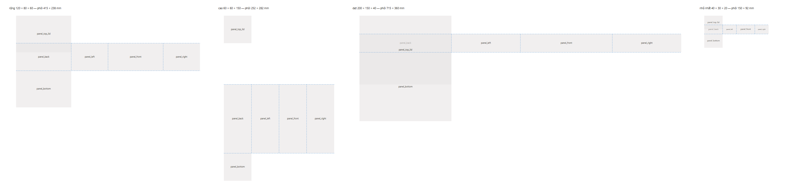
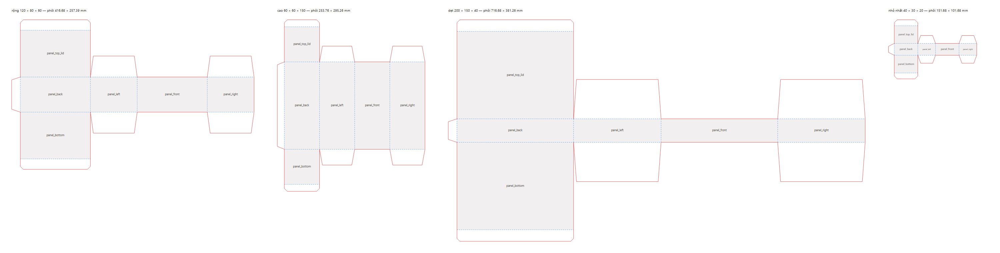
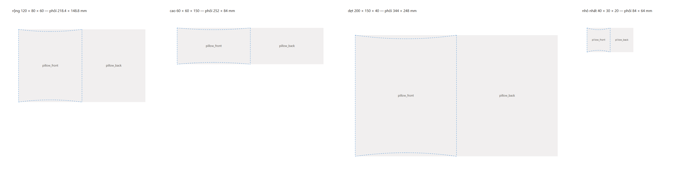
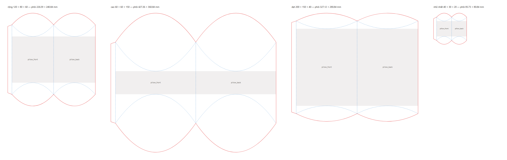
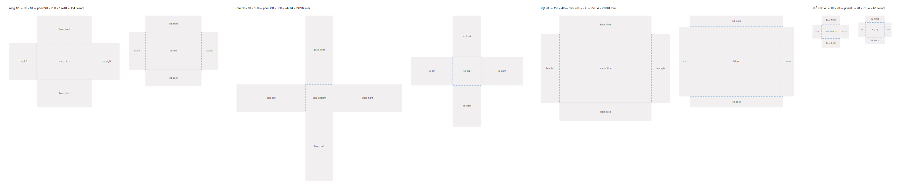
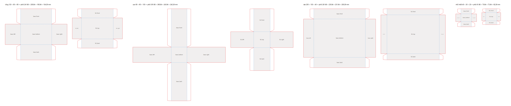
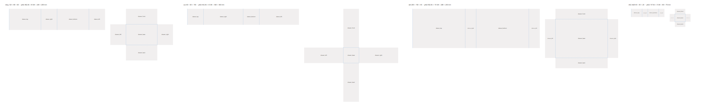
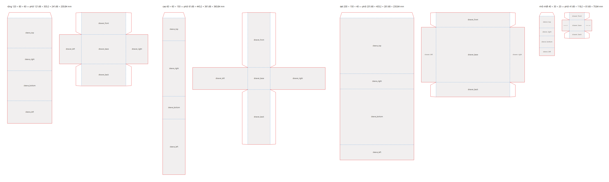

# 14 — Rà soát công thức hộp (Phase 8)

> Kế hoạch: docs/12 Phase 8 (mục H1–H11, việc 8.1–8.11). Phiên S10, bắt đầu 2026-10-12.
> Mã: `shared/src/parametric/**`, test `be/src/projects/domain/dieline-geometry.spec.ts`.

## 1. Cách kiểm

- **Vẽ phôi bằng code**: `npm run build:shared && node shared/scripts/render-dielines.mjs <thư mục> --versions=1,3`
  vẽ 4 cấu trúc × 4 cỡ (rộng 120 × 80 × 60, cao 60 × 60 × 150, dẹt 200 × 150 × 40, nhỏ nhất 40 × 30 × 20, `t` = 0,42)
  thành SVG rồi PNG (Chrome headless). Đỏ: nét cắt; xanh đứt: nét gấp; xám: mặt in được kèm id. Ảnh ở `docs/assets/14/`.
- **Gấp thử bằng code**: mỗi mặt của bản 3 khai báo bản lề (`PanelFace.fold`: mặt cha, cạnh chung, góc gấp);
  `shared/src/parametric/fold.ts` gấp phôi thành 3D. Test đo khối gấp xong so với L × W × H và kiểm mọi góc mặt khớp
  với góc của một mặt khác (không hở).
- **File in**: `be/src/export/rendering/print-rendering.spec.ts` dựng file in của 4 cấu trúc và kiểm mỗi mảnh có đúng
  **một** đường cắt khép kín (cách xưởng làm khuôn bế đọc file).
- Cấu trúc đối chiếu: hộp nắp gài hai đầu cùng phía (straight tuck end: nắp và đáy cùng gắn vào mặt sau), hộp gối
  (hai mặt cong, đầu gập theo nếp cong hình thấu kính), khay một tờ có tai dán góc (đáy + nắp âm dương, khay bao diêm),
  vỏ bao ống hở hai đầu.

## 2. Quy ước kích thước và công thức bản 3

L × W × H là **lòng trong**; `t` = độ dày giấy (≈ GSM × 0,0014). Nét gấp nằm giữa bề dày giấy. Bảng dưới là kích thước
**từ nét gấp tới nét gấp** (hoặc tới mép) trên phôi.

| Cấu trúc | Mảnh | Mặt | Tai / phần phụ |
|---|---|---|---|
| Nắp gài | Thân | sau, trước: (L + t) × (H + t); hông: (W + t) × (H + t); nắp, đáy: (L + t) × (W + t) | tai gài `min(20, max(12, 0,15L), H/2)` (hai tai gài không chồng nhau trong mặt trước); tai chống bụi `min(max(8, 0,45W), L/2 − t)` (hai tai không chạm nhau); tai dán `min(15, max(10, 0,2W), W − 2)` |
| Gối | Thân | mỗi mặt: cung(W + t, (H + t)/2) × L | nếp cong sâu d = (H + t)/2 vào mỗi mặt, nét cắt đối xứng (cánh thấu kính); thân dài L + 2d giữa hai đầu nhọn; tai dán `min(12, max(8, 0,1 × mặt))` |
| Âm dương | Đáy | đáy (L + 3t) × (W + t); thành cao H + t/2 | 4 tai dán góc trên thành trước / sau, dán vào trong thành trái / phải, rộng `min(15, 0,8 × thành, W/2 − 2)`, vát hai đầu |
| | Nắp | mặt nắp (ngoài đáy + 1 + 3t) × (ngoài đáy + 1 + t); vách cao `min(H + t/2, max(15, 0,6H))` | như đáy |
| Bao diêm | Khay | như đáy âm dương | như đáy âm dương |
| | Vỏ | trên, đáy: L' × W'; hông: L' × H'. L' = ngoài khay; W', H' = ngoài khay + 1 + t | tai dán ở cạnh trên của mặt trên, dán vào trong mặt hông trái; khay rút theo chiều L |

"Ngoài đáy / khay" = kích thước giữa giấy + t (theo L, W) hoặc + t/2 (theo chiều cao, phần đáy).

## 3. Bảng kiểm H1–H11

| # | Nơi | Kết quả rà soát | Trạng thái |
|---|---|---|---|
| H1 | Công thức 4 cấu trúc | **Bản 1–2**: gối, âm dương, bao diêm không có nét cắt (lớp cắt file in trống); âm dương và khay không có tai dán góc; vỏ bao diêm quấn quanh mặt cắt L × H nên khay rút theo W, trong khi mô hình 3D rút theo L; hộp gối: mặt rộng W + 0,4H (ước lượng; đúng phải là chiều dài cung), mặt in lấn ¼ độ sâu nếp cong vào cánh; nắp gài bản 2 không cộng `t`; tai chống bụi theo W có thể dài hơn L/2 (hai tai đụng nhau khi W > L); tai gài có thể dài hơn H/2. **Bản 3** sửa hết (bảng §2); hộp gối với H > W cho cánh rất lớn (ảnh cỡ "cao"), cần giới hạn tỉ lệ (H2) | Đã sửa (bản 3), trừ giới hạn tỉ lệ |
| H2 | Giới hạn kích thước | Cả 4 cấu trúc chung L 40–600, W 30–600, H 20–600; không kiểm tỉ lệ; phôi có thể vượt khổ máy in | Chưa (8.5) |
| H3 | FitCheck | Chỉ lề an toàn 3 mm và DPI; thiếu bleed, phần tử ngoài mặt, xoay, tai dán | Chưa (8.5) |
| H4 | File in | Nét cắt đi theo `segments` nên đủ khi H1 đủ (test: mỗi mảnh 1 đường cắt khép kín, 4 cấu trúc). DXF trước thay đường cong bằng dây cung, nay lấy điểm trên đường cong cách ≤ 0,1 mm (`segmentPoints`). Cỡ chữ, font, lớp: xong ở Phase 9 | Đã sửa (đường cong DXF); xuất thử bằng worker: 8.6 |
| H5 | Canvas 2D | Đường cong (`pathString`) vẽ thiếu lề 35 mm của khung nhìn: nếp cong hộp gối lệch khỏi phôi trên màn hình | Đã sửa (`transform`) |
| H6 | Mô hình 3D | Tự dựng hình, không đọc dieline; âm dương nắp `max(16, 0,5H)`, bao diêm dư 2 mm; nắp gài là khay có nắp, không phải ống dán | Chưa (8.7): dựng từ `panelTransforms` của bản 3 |
| H7 | Ảnh xem trước, thumbnail | Thumbnail chỉ vẽ mảnh đầu | Chưa (8.8) |
| H8 | Số liệu hiển thị | Khổ trải phẳng `2L + 2W + 30` cứng | Chưa (8.8) |
| H9 | Vật liệu, độ dày | Bảng GSM / caliper khác nhau; mặc định backend `caliper: 0,35` cho 300 GSM (đúng: 0,42) | Chưa (8.8) |
| H10 | Gợi ý của Gói | Auto-fix chỉ đẩy về mép trái / trên | Chưa (8.5) |
| H11 | Mã không dùng | `shared/src/exporter/pdf-export.ts` (bộ xuất cũ, không ai gọi) đã xoá; `core/contracts.ts` giữ (AGENTS.md trỏ tới) nhưng ghi rõ là phác thảo, không export; `PanelFace.hingeAxis` / `hingeOffset` (không dùng) thay bằng `fold` | Đã sửa |

## 4. Ảnh phôi

Bản 1 (dự án cũ) và bản 3 (dự án mới), cùng 4 cỡ:

| Cấu trúc | Bản 1 | Bản 3 |
|---|---|---|
| Nắp gài |  |  |
| Gối |  |  |
| Âm dương |  |  |
| Bao diêm |  |  |

## 5. Test

`be/src/projects/domain/dieline-geometry.spec.ts` (75 ca): mọi phiên bản đang dùng (1, 2, 3) × 4 cấu trúc × 4 cỡ —
mặt không chồng nhau, mọi nét (kể cả điểm trên đường cong) nằm trong khổ; bản 3 — gấp lại đúng lòng trong ± 0,5 mm
(nắp gài, đáy âm dương, khay), nắp / vỏ rộng hơn đáy / khay 0,5–1,5 mm, vỏ dài bằng khay, mọi góc mặt khớp nhau sau khi
gấp, mặt hộp gối rộng đúng một cung và không chạm nếp cong, id mặt giữ như bản 2; bản 1–2 — khổ phôi không đổi.
`print-rendering.spec.ts`: mỗi mảnh của 4 cấu trúc có đúng một đường cắt khép kín; đường cong hộp gối thành nhiều điểm.
