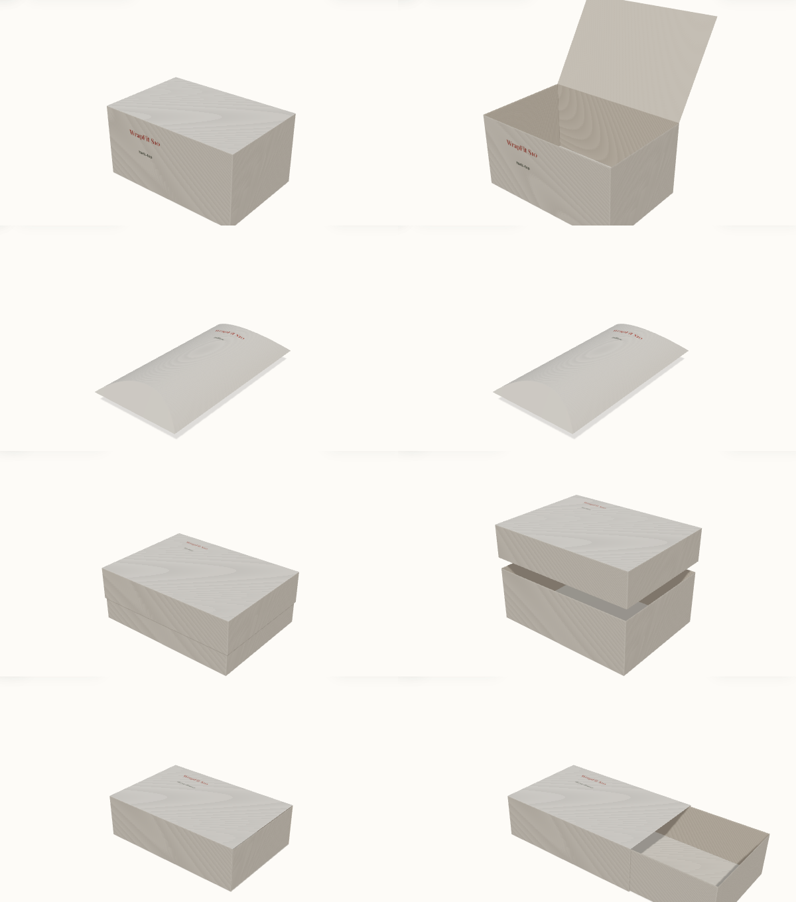

# 14 — Rà soát công thức hộp (Phase 8)

> Kế hoạch: docs/12 Phase 8 (mục H1–H11, việc 8.1–8.11). Phiên S10, bắt đầu 2026-10-12.
> Mã: `shared/src/parametric/**`, test `be/src/projects/domain/dieline-geometry.spec.ts`.

## 1. Cách kiểm

- **Vẽ phôi bằng code**: `npm run build:shared && node shared/scripts/render-dielines.mjs <thư mục> --versions=1,3`
  vẽ 4 cấu trúc × 4 cỡ (rộng 120 × 80 × 60, cao 60 × 60 × 150, dẹt 200 × 150 × 40, nhỏ nhất 40 × 30 × 20, `t` = 0,42)
  thành SVG rồi PNG (Chrome headless). Đỏ: nét cắt; xanh đứt: nét gấp; xám: mặt in được kèm id. Ảnh ở `docs/assets/14/`.
- **Gấp thử bằng code**: mỗi mặt của bản 3 khai báo bản lề (`PanelFace.fold`: mặt cha, cạnh chung, góc gấp);
  `shared/src/parametric/fold.ts` gấp phôi thành 3D. Test đo khối gấp xong so với L × W × H và kiểm mọi góc mặt khớp
  với góc của một mặt khác (không hở).
- **File in**: `be/src/export/rendering/print-rendering.spec.ts` dựng file in của 4 cấu trúc và kiểm mỗi mảnh có đúng
  **một** đường cắt khép kín (cách xưởng làm khuôn bế đọc file).
- Cấu trúc đối chiếu: hộp nắp gài hai đầu cùng phía (straight tuck end: nắp và đáy cùng gắn vào mặt sau), hộp gối
  (hai mặt cong, đầu gập theo nếp cong hình thấu kính), khay một tờ có tai dán góc (đáy + nắp âm dương, khay bao diêm),
  vỏ bao ống hở hai đầu.

## 2. Quy ước kích thước và công thức bản 3

L × W × H là **lòng trong**; `t` = độ dày giấy (≈ GSM × 0,0014). Nét gấp nằm giữa bề dày giấy. Bảng dưới là kích thước
**từ nét gấp tới nét gấp** (hoặc tới mép) trên phôi.

| Cấu trúc | Mảnh | Mặt | Tai / phần phụ |
|---|---|---|---|
| Nắp gài | Thân | sau, trước: (L + t) × (H + t); hông: (W + t) × (H + t); nắp, đáy: (L + t) × (W + t) | tai gài `min(20, max(12, 0,15L), H/2)` (hai tai gài không chồng nhau trong mặt trước); tai chống bụi `min(max(8, 0,45W), L/2 − t)` (hai tai không chạm nhau); tai dán `min(15, max(10, 0,2W), W − 2)` |
| Gối | Thân | mỗi mặt: cung(W + t, (H + t)/2) × L | nếp cong sâu d = (H + t)/2 vào mỗi mặt, nét cắt đối xứng (cánh thấu kính); thân dài L + 2d giữa hai đầu nhọn; tai dán `min(12, max(8, 0,1 × mặt))` |
| Âm dương | Đáy | đáy (L + 3t) × (W + t); thành cao H + t/2 | 4 tai dán góc trên thành trước / sau, dán vào trong thành trái / phải, rộng `min(15, 0,8 × thành, W/2 − 2)`, vát hai đầu |
| | Nắp | mặt nắp (ngoài đáy + 1 + 3t) × (ngoài đáy + 1 + t); vách cao `min(H + t/2, max(15, 0,6H))` | như đáy |
| Bao diêm | Khay | như đáy âm dương | như đáy âm dương |
| | Vỏ | trên, đáy: L' × W'; hông: L' × H'. L' = ngoài khay; W', H' = ngoài khay + 1 + t | tai dán ở cạnh trên của mặt trên, dán vào trong mặt hông trái; khay rút theo chiều L |

"Ngoài đáy / khay" = kích thước giữa giấy + t (theo L, W) hoặc + t/2 (theo chiều cao, phần đáy).

## 3. Bảng kiểm H1–H11

| # | Nơi | Kết quả rà soát | Trạng thái |
|---|---|---|---|
| H1 | Công thức 4 cấu trúc | **Bản 1–2**: gối, âm dương, bao diêm không có nét cắt (lớp cắt file in trống); âm dương và khay không có tai dán góc; vỏ bao diêm quấn quanh mặt cắt L × H nên khay rút theo W, trong khi mô hình 3D rút theo L; hộp gối: mặt rộng W + 0,4H (ước lượng; đúng phải là chiều dài cung), mặt in lấn ¼ độ sâu nếp cong vào cánh; nắp gài bản 2 không cộng `t`; tai chống bụi theo W có thể dài hơn L/2 (hai tai đụng nhau khi W > L); tai gài có thể dài hơn H/2. **Bản 3** sửa hết (bảng §2); hộp gối với H > W cho cánh rất lớn (ảnh cỡ "cao") nên thêm quy tắc tỉ lệ (H2) | Đã sửa |
| H2 | Giới hạn kích thước | Cả 4 cấu trúc chung L 40–600, W 30–600, H 20–600; không kiểm tỉ lệ; phôi có thể vượt khổ máy in. **Sửa**: quy tắc tỉ lệ `dimensionRuleErrors` (hộp gối `H ≤ W/2`; API 400, editor hiện câu tiếng Việt và khoá nút); phôi lớn hơn B1 1020 × 720 mm là cảnh báo FitCheck | Đã sửa |
| H3 | FitCheck | Chỉ lề an toàn 3 mm và DPI, bỏ qua xoay; editor và server mỗi bên tự gộp các mảnh. **Sửa**: một hàm `checkBox` cho cả hai; khung đã xoay; phân biệt nét cắt / nếp gấp (`CUT_OVERLAP` / `CREASE_OVERLAP`); hoa văn không cần lề nhưng chạm nét cắt phải tràn 2 mm (`BLEED_INSUFFICIENT`); tai dán không có mực (`GLUE_CONTAMINATED`, vùng `glueAreas` của bản 3); mặt không tồn tại (`NO_PANEL`); phôi quá B1; DPI cho cả ảnh và hoa văn. Điểm giữ 100 − 30 × lỗi − 10 × cảnh báo. Chưa kiểm: chữ tràn khung (cần số đo font; editor tự xuống dòng trong khung) | Đã sửa |
| H4 | File in | Nét cắt đi theo `segments` nên đủ khi H1 đủ (test: mỗi mảnh 1 đường cắt khép kín, 4 cấu trúc). DXF trước thay đường cong bằng dây cung, nay lấy điểm trên đường cong cách ≤ 0,1 mm (`segmentPoints`). Cỡ chữ, font, lớp: xong ở Phase 9. Xuất thật bằng worker: §6 | Đã sửa |
| H5 | Canvas 2D | Đường cong (`pathString`) vẽ thiếu lề 35 mm của khung nhìn: nếp cong hộp gối lệch khỏi phôi trên màn hình | Đã sửa (`transform`) |
| H6 | Mô hình 3D | Tự dựng hình, không đọc dieline: âm dương nắp `max(16, 0,5H)`, bao diêm dư 2 mm, nắp gài là khay có nắp (không phải ống dán); in `content` của mọi phần tử thành chữ (cả URL ảnh) trên một texture chung, kèm logo "WrapFit" và dòng kích thước giả. **Sửa**: `fe/.../three/boxModel.ts` dựng mỗi mặt in được từ phôi và gấp theo bản lề (`panelTransforms`, `boxFrameOf` của shared), cùng kích thước với file in (test `foldedSize`; mặt in hướng ra ngoài, chữ đọc xuôi); hộp gối dựng từ `pillowShapeOf`; mỗi mặt một texture vẽ đúng phần tử của mặt đó (chữ theo `layoutTextBox`, ảnh / logo / hoa văn giữ tỉ lệ, xoay quanh tâm); dự án bản 1–2 xem 3D bằng công thức hiện tại (id mặt như nhau). Trang công khai hiện cả ảnh. Trang chủ / intro (không có thiết kế) vẫn có trang trí "WrapFit". Ảnh §4b | Đã sửa |
| H7 | Ảnh xem trước, thumbnail | Thumbnail chỉ vẽ mảnh đầu. `BoxPreview` (phác thảo isometric khi chưa có thumbnail) vẽ theo L : W : H thật, cạnh ngắn tối thiểu ¼ cạnh dài nhất cho dễ nhìn (cố ý, giữ). **Sửa**: thumbnail vẽ mọi mảnh cạnh nhau | Đã sửa |
| H8 | Số liệu hiển thị | Khổ trải phẳng `2L + 2W + 30` cứng, "bù 2t"; số nếp gấp cứng ở bước 1; kích thước mặt hiện 15 chữ số thập phân khi có bù `t`. **Sửa**: khổ phôi lấy từ `totalBoundingBox` của từng mảnh, "bù t mỗi mặt" (công thức cũ: không bù); số nếp gấp đếm trên phôi; `formatMm` (1 chữ số thập phân); canvas 2D đánh dấu phần tử theo báo cáo FitCheck (trước: chỉ xét mép trái / trên) và không còn vẽ phần tử của mảnh kia ở góc phôi | Đã sửa |
| H9 | Vật liệu, độ dày | Ba bảng GSM / độ dày khác nhau (0,38 / 0,42 / 0,45 / 0,52 cho cùng loại giấy); mặc định backend `caliper: 0,35` cho 300 GSM. **Sửa**: `caliperOf(gsm)` = GSM × 0,0014 cho mọi bảng và mặc định (300 GSM = 0,42) | Đã sửa |
| H10 | Gợi ý của Gói | Auto-fix chỉ đẩy về mép trái / trên. **Sửa**: `autoFixElements` của shared (mọi mép, khung đã xoay, thu nhỏ phần tử lớn hơn mặt, kéo hoa văn ra bleed); hoa văn AI phủ kín mặt + tràn 2 mm ở mép cắt. `AiCopilotAssistant` (preset kích thước) không màn nào dùng | Đã sửa |
| H11 | Mã không dùng | `shared/src/exporter/pdf-export.ts` (bộ xuất cũ) và `FoldingBox3D.tsx` (không màn nào dùng) đã xoá; `core/contracts.ts` giữ (AGENTS.md trỏ tới) nhưng ghi rõ là phác thảo, không export; `PanelFace.hingeAxis` / `hingeOffset` (không dùng) thay bằng `fold` | Đã sửa |

## 4. Ảnh phôi

Bản 1 (dự án cũ) và bản 3 (dự án mới), cùng 4 cỡ:

| Cấu trúc | Bản 1 | Bản 3 |
|---|---|---|
| Nắp gài |  |  |
| Gối |  |  |
| Âm dương |  |  |
| Bao diêm |  |  |

**4b. Mô hình 3D bản 3** (dự án thử, studio bước 4, Chrome headless 1440 px): nắp gài, gối, âm dương, bao diêm; trái
đóng hẳn, phải mở nắp / nhấc nắp / rút khay. Chữ trên mặt in đọc xuôi từ phía trước.

Ghi chú thiết kế: phần tử in theo hướng của phôi, nên trên hộp thật (và trong 3D) chữ ở thành sau của khay, nắp trên
của hộp nắp gài và mặt hông trái của vỏ bao diêm nằm ngược chiều khi nhìn từ trước, đúng như khi gấp tờ in. Bản 3 đặt
vách trước của nắp âm dương dưới mặt nắp và cho mặt hông phải của vỏ bao diêm quay ra trước để các mặt chính đọc xuôi.

## 5. Test

`be/src/projects/domain/dieline-geometry.spec.ts` (78 ca): mọi phiên bản đang dùng (1, 2, 3) × 4 cấu trúc × 4 cỡ —
mặt không chồng nhau, mọi nét (kể cả điểm trên đường cong) nằm trong khổ; bản 3 — gấp lại đúng lòng trong ± 0,5 mm
(nắp gài, đáy âm dương, khay), nắp / vỏ rộng hơn đáy / khay 0,5–1,5 mm, vỏ dài bằng khay, mọi góc mặt khớp nhau sau khi
gấp, mặt in hướng ra ngoài và đọc xuôi, mặt hộp gối rộng đúng một cung và không chạm nếp cong, id mặt giữ như bản 2;
bản 1–2 — khổ phôi không đổi. `print-rendering.spec.ts`: mỗi mảnh của 4 cấu trúc có đúng một đường cắt khép kín;
đường cong hộp gối thành nhiều điểm. `fitcheck.spec.ts` (13 ca): từng quy tắc FitCheck, điểm, server = editor,
auto-fix, quy tắc tỉ lệ.

## 6. Xuất thật bằng worker (8.6)

Dự án thử bản 3 (chữ trên mặt chính), worker `node be/dist/worker.js`, 2026-10-12. Đọc lại file bằng script:

| Cấu trúc | PDF (`TrimBox`, pt) | SVG lớp `cut` | DXF lớp CUT |
|---|---|---|---|
| Nắp gài 120 × 80 × 60 | `[56.693 56.693 1237.833 786.291]`, màu pha `CutContour` | 1 đường khép kín | 1 POLYLINE (44 đỉnh cả file) |
| Gối 120 × 80 × 30 | `[56.693 56.693 579.846 569.31]` | 1 đường khép kín có `Q` | 1 POLYLINE (385 đỉnh cả file: đường cong lấy điểm) |
| Âm dương 160 × 120 × 60 | `[56.693 56.693 1580.655 739.389]` | 2 đường khép kín (đáy, nắp) | 2 POLYLINE |
| Bao diêm 140 × 90 × 40 | `[56.693 56.693 1143.383 859.465]` | 2 đường khép kín (vỏ, khay) | kiểm ở unit test |

Chưa làm: mở file bằng Illustrator / Inkscape / viewer DXF (máy local không có), in thử 1 : 1 và gấp tay.
