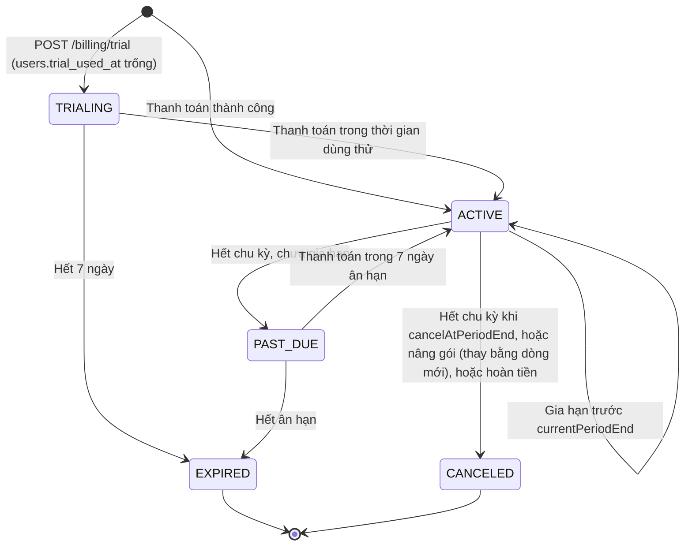

# 💳 ĐẶC TẢ GÓI DỊCH VỤ, HẠN MỨC & BILLING (PRICING ENTITLEMENTS SPEC)

> **Dành cho**: IT 3 (backend, CSDL), IT 1 (frontend), IT 2 (`@wrapfit/shared`, watermark trong file in).
> **Trạng thái (2026-10-30)**: **một phần P1 đã triển khai** cho bản demo CP4 Path 2 (docs/17 S1–S8, nhánh `feat/path2-mvp`), xem bảng "Đã triển khai" ngay dưới. Phần còn lại vẫn là đặc tả cho bản phát hành thương mại. Mỗi mục ghi rõ phần nào đã có trong code, phần nào phải sửa, phần nào làm mới.
> **Nguồn quyết định kinh doanh**: chiến lược định giá (4 gói Free · Lượt xuất · Pro · Business, credit AI, quy tắc nghiệp vụ). Con số giá và hạn mức có thể đổi; khi đổi chỉ sửa **một file** (`shared/src/billing/entitlements.ts`, Mục 3).
> **Không thuộc phạm vi tài liệu này**: chợ in ấn và gói đối tác xưởng in, chợ mẫu cao cấp (sẽ có tài liệu riêng). Bảng hạn mức đã chừa khóa `print.discountPercent` cho chúng.

### Đã triển khai (Path 2, docs/17)

| Mục | Đã có trong code | Còn lại / làm gọn so với đặc tả |
| :--- | :--- | :--- |
| 2, 3.2 Gói, giá, hạn mức | `shared/src/billing/` (`resolvePlan`, `requiredPlanFor`, `ENTITLEMENTS`, `EXPORT_PACKS`, `PRO_MONTH`); trang giá đọc giá từ shared; `storage.bytes` nối vào hạn mức dung lượng | Hạn mức `projects.max`, `collections.max`, `snapshots.maxManualPerProject` chưa nối vào service; ghi đè theo tài khoản (3.3) chưa có |
| 4 Credit AI | **Thay bằng xu Wrap** ([docs/19](19_XU_WRAP_SPEC.md)): lô `credit_lots` kind `XU`, allowance mỗi kỳ, gói nạp `XU_*`, hoa văn 1 / 65 xu, ảnh AI, `AI_MONTHLY_BUDGET_USD` + `AiCostGuard`. `DAILY_AI_LIMIT` và cổng `403` premium đã bỏ | Mục 4 dưới đây là đặc tả cũ, giữ để tham khảo; số liệu đúng ở docs/19 §2–§3 |
| 5.1–5.4 Lượt xuất, mở khóa, hoàn lượt, watermark | `credit_lots` / `credit_debits` (sổ cái), `export_unlocks` 7 ngày theo `(project, version)`, `402 EXPORT_CREDIT_REQUIRED` / `INSUFFICIENT_CREDITS`, hoàn lượt khi job lỗi lần cuối, watermark ở tai dán của PDF A4 | 5.5 giữ file in theo gói chưa làm |
| 6 Schema | Migration `20261030000100_billing_core` (`payments`, `credit_lots`, `credit_debits`, `export_unlocks`, `subscriptions`), `20261030000500_payments` (FK đơn in) | Bảng `invoices`, `coupons`, `referrals`, workspace (6.4) chưa có |
| 7.1 Vòng đời gói | Pro 30 ngày qua `subscriptions` (`ACTIVE` / `EXPIRED`), gia hạn nối thêm 30 ngày, `PlanService.sync` lười | Dùng thử, `PAST_DUE`, ân hạn, nhắc gia hạn, hạ gói (7.2) chưa làm |
| 8.2 Endpoint | `GET /billing/me`, `POST /admin/users/:id/credits`, `POST /payments`, `GET /payments/:id`, `POST /payments/:id/simulate-confirm`, `GET /projects/:id/exports/access` (docs/03) | Webhook ngân hàng, MoMo / thẻ, hóa đơn, hoàn tiền chưa làm (M1) |
| Thanh toán | VietQR EMVCo tự dựng, hạn 15 phút, xác nhận **mô phỏng** khi `PAYMENT_SIMULATION=true` (docs/17 M5, M6) | Xác nhận thật qua webhook ngân hàng |

---

## Mục lục

1. [Nguyên tắc kỹ thuật](#1-nguyên-tắc-kỹ-thuật)
2. [Gói và ánh xạ enum hiện có](#2-gói-và-ánh-xạ-enum-hiện-có)
3. [Bảng hạn mức (entitlements)](#3-bảng-hạn-mức-entitlements)
4. [Credit AI](#4-credit-ai)
5. [Lượt xuất file và watermark](#5-lượt-xuất-file-và-watermark)
6. [Schema Prisma](#6-schema-prisma)
7. [Quy tắc nghiệp vụ → hiện thực](#7-quy-tắc-nghiệp-vụ--hiện-thực)
8. [API mới và thay đổi, mã lỗi](#8-api-mới-và-thay-đổi-mã-lỗi)
9. [Điểm chèn kiểm tra trong backend](#9-điểm-chèn-kiểm-tra-trong-backend)
10. [Cron và sự kiện](#10-cron-và-sự-kiện)
11. [Frontend](#11-frontend)
12. [Lộ trình triển khai và kiểm thử](#12-lộ-trình-triển-khai-và-kiểm-thử)
13. [Câu hỏi mở cho nhóm Kinh tế](#13-câu-hỏi-mở-cho-nhóm-kinh-tế)

---

## 1. Nguyên tắc kỹ thuật

1. **Một nguồn sự thật cho con số.** Giá, hạn mức và chi phí credit nằm trong `@wrapfit/shared` (`shared/src/billing/`). Backend dùng để chặn, frontend dùng để hiển thị trang giá, đồng hồ dung lượng, hộp thoại nâng gói. Bỏ hai bản chép hiện tại: `STORAGE_QUOTA_BYTES` ([storage.rules.ts](../be/src/storage/storage.rules.ts)), `DAILY_AI_LIMIT` ([ai-pattern.service.ts](../be/src/ai/ai-pattern.service.ts)) và `PLANS` ([fe/src/features/pricing/plans.ts](../fe/src/features/pricing/plans.ts)).
2. **Chỉ backend quyết định.** Frontend ẩn / khóa nút cho dễ hiểu, nhưng mọi giới hạn đều được kiểm lại ở API. Không có quyền nào chỉ dựa vào giao diện.
3. **Vai trò khác gói.** `users.role` (`MAKER`, `PRO_ARTISAN`, `PRINT_SHOP`, `ADMIN`) chọn giao diện và quyền quản trị; `users.subscription_tier` chọn hạn mức. Không kiểm `role` để mở tính năng trả phí.
4. **`users.subscription_tier` là gói hiệu lực đã tính sẵn** (cache), được `BillingService` ghi lại sau mỗi sự kiện thanh toán và `PlanSyncTask` mỗi giờ. Code hiện có đọc cột này vẫn chạy đúng; nguồn gốc thật là bảng `subscriptions` và `credit_lots` (Mục 6).
5. **Credit là sổ cái (ledger).** Lượt xuất và credit AI được cấp theo **lô** (`credit_lots`, mỗi lô có hạn dùng) và trừ bằng dòng `credit_debits`. Trừ credit luôn trong transaction có khóa dòng; không bao giờ cộng trừ một con số "số dư" trên `users`.
6. **Không xóa dữ liệu người dùng vì hạ gói.** Hạ gói chỉ chặn tạo mới, khóa sửa phần vượt hạn mức, và trả trang mở hộp về giao diện cơ bản. **Mã QR đã in không bao giờ ngừng hoạt động.**
7. **Kiểm hạn mức ở chủ sở hữu tài nguyên**, không ở người đang thao tác: dự án của Business dùng gói Business kể cả khi thành viên trong nhóm ở gói Free (Phase 3, Mục 6.4).

---

## 2. Gói và ánh xạ enum hiện có

Giữ nguyên giá trị enum `SubscriptionTier` trong CSDL và code (tránh migration đổi tên, FE đã dùng); chỉ đổi tên hiển thị.

| Enum (giữ nguyên) | Tên hiển thị mới | Cách có được gói | Giá |
| :--- | :--- | :--- | :--- |
| `FREE` | **Miễn phí** | Mặc định | 0đ |
| `PAY_PER_EXPORT` | **Lượt xuất** | Có ít nhất một lô lượt xuất **đã mua** còn hạn (12 tháng kể từ ngày mua), kể cả khi đã dùng hết lượt | 19.000đ / 1 lượt · 79.000đ / 5 lượt · 199.000đ / 15 lượt |
| `STARTER` | **Pro** | Subscription `STARTER` ở trạng thái `TRIALING`, `ACTIVE` hoặc `PAST_DUE` | 99.000đ / tháng · 948.000đ / năm (79.000đ/tháng) · 249.000đ / 3 tháng (gói mùa) |
| `PRO_BUSINESS` | **Business** | Subscription `PRO_BUSINESS` ở trạng thái như trên | 299.000đ / tháng · 2.868.000đ / năm (239.000đ/tháng) · 749.000đ / 3 tháng · thêm ghế 59.000đ / người / tháng |

**Gói hiệu lực** (hàm thuần `resolvePlan` trong `shared/src/billing/plans.ts`, backend gọi khi đồng bộ):

```ts
// Ưu tiên: subscription còn hiệu lực > lượt xuất đã mua còn hạn > FREE.
export function resolvePlan(input: {
  subscription: { plan: 'STARTER' | 'PRO_BUSINESS'; status: SubscriptionStatus } | null;
  hasUnexpiredPurchasedExportLot: boolean;
}): SubscriptionTier {
  const live = input.subscription && ['TRIALING', 'ACTIVE', 'PAST_DUE'].includes(input.subscription.status);
  if (live) return input.subscription!.plan;
  if (input.hasUnexpiredPurchasedExportLot) return 'PAY_PER_EXPORT';
  return 'FREE';
}
```

Người dùng chỉ có **một** subscription còn hiệu lực tại một thời điểm (unique index một phần, Mục 6.3).

---

## 3. Bảng hạn mức (entitlements)

### 3.1 Bảng đầy đủ

`null` = không giới hạn. Cột **Hiện trạng**: ✅ đã có, chỉ đổi nguồn con số · 🔧 có code nhưng phải sửa logic · 🆕 làm mới.

| Khóa | Kiểu | Free | Lượt xuất | Pro | Business | Kiểm ở đâu | Hiện trạng |
| :--- | :--- | :--- | :--- | :--- | :--- | :--- | :--- |
| `projects.max` | số dự án chưa ở thùng rác (ACTIVE + ARCHIVED) | 10 | 30 | `null` | `null` | `ProjectsService.create`, `copy` (nhân bản, Remix), khôi phục từ thùng rác | 🆕 |
| `snapshots.maxManualPerProject` | mốc thủ công / dự án | 5 | 10 | 50 | 100 | `SnapshotsService.create` | 🔧 (`MAX_SNAPSHOTS_PER_PROJECT = 50`) |
| `trash.retentionDays` | ngày | 30 | 30 | 30 | 90 | `TrashPurgeTask` | 🔧 (cứng 30) |
| `collections.max` | thư mục | 3 | 10 | 100 | `null` | `CollectionsService.create` | 🔧 (`MAX_COLLECTIONS_PER_USER = 100`) |
| `sizeVariants.maxPerProject` | biến thể kích thước | 0 | 0 | 5 | `null` | `VariantsService.create` | 🆕 Phase 3 |
| `export.mode` | `FREE_A4` \| `CREDIT` \| `UNLIMITED` | `FREE_A4` | `CREDIT` | `UNLIMITED` | `UNLIMITED` | `ExportService.request` (Mục 5) | 🆕 |
| `export.unlockDays` | ngày tải lại miễn phí cùng một bản | — | 7 | — | — | `ExportService.request` | 🆕 |
| `export.priority` | ưu tiên hàng đợi | `false` | `false` | `false` | `true` | `ExportService.request` (BullMQ `priority`) | 🆕 |
| `export.fileRetentionDays` | ngày giữ file in đã xuất | 90 | 90 | `null` | `null` | `ExportRetentionTask` | 🆕 |
| `ai.monthlyCredits` | credit AI cấp mỗi chu kỳ | 20 | 50 | 300 | 1.000 (cả nhóm) | `CreditsService` (cấp khi dùng lần đầu trong chu kỳ) | 🆕 (thay `DAILY_AI_LIMIT`) |
| `ai.premium` | được dùng AI Cao cấp | `false` | `true` | `true` | `true` | `AiPatternService.generate` | 🆕 |
| `brandKits.max` | Brand Kit | 0 | 1 | 1 | 5 | `BrandKitsService` / `PATCH /users/me/brand-kit` | 🆕 |
| `customFonts` | upload font riêng (purpose `FONT`) | `false` | `false` | `true` | `true` | `StorageService.presignUpload` | 🆕 |
| `storage.bytes` | byte | 100 MB | 500 MB | 2 GB | 20 GB (cả nhóm) | `StorageService.assertQuota` | ✅ (đổi số Pro 1 → 2 GB, Business 10 → 20 GB) |
| `embed` | iframe nhúng trang 3D | `false` | `false` | `true` | `true` | `PublicProjectsService.view` khi `embed=1` | 🆕 |
| `unboxing.max` | trải nghiệm mở hộp | 1 | 3 | 30 | `null` | `UnboxingService.save` (lần tạo) | 🆕 |
| `unboxing.effects` | hiệu ứng được chọn | `confetti`, `hearts`, `none` | tất cả 6 | tất cả | tất cả | `UnboxingService.save` | 🆕 |
| `unboxing.customAudio` | upload nhạc (purpose `AUDIO`) | `false` | `true` | `true` | `true` | `StorageService.presignUpload`, `UnboxingService.save` | 🆕 |
| `unboxing.hideBranding` | ẩn logo WrapFit trên trang mở hộp | `false` | `false` | `true` | `true` | `UnboxingService.publicView` (**tính lúc xem**) | 🆕 |
| `unboxing.customBranding` | logo và tên miền riêng | `false` | `false` | `false` | `true` | `UnboxingService.publicView` | 🆕 Phase 3 |
| `unboxing.analytics` | `NONE` \| `TOTAL` \| `DETAILED` | `NONE` | `NONE` | `TOTAL` | `DETAILED` | `GET /projects/:id/unboxing/stats` | 🆕 |
| `mockups.maxPerMonth` | ảnh mockup / tháng | 10 | 20 | 30 | `null` | `MockupsService.create` | 🆕 |
| `mockups.maxWidthPx` | độ phân giải | 2048 | 2048 | 4096 | 4096 | `MockupsService.create` | 🆕 |
| `mockups.watermark` | dấu WrapFit trên mockup | `true` | `false` | `false` | `false` | Studio (render phía client) | 🆕 |
| `team.seatsIncluded` | ghế có sẵn | 1 | 1 | 1 | 3 | `WorkspacesService.invite` | 🆕 Phase 3 |
| `team.collaboration` | bình luận, duyệt thiết kế | `false` | `false` | `false` | `true` | `CommentsService` | 🆕 Phase 3 |
| `community.commercialUse` | dùng thương mại bản Remix | `false` | `false` | `true` | `true` | Ghi `fork_license` lúc Remix | 🆕 |
| `community.defaultAllowFork` | giá trị `allowFork` khi tạo dự án | `true` | `true` | `true` | `false` | `ProjectsService.create` | 🔧 (Prisma default `true`) |
| `print.discountPercent` | giảm giá đơn in | 0 | 0 | 5 | 10 | `OrdersService` (khi đơn in lưu CSDL) | 🆕 tài liệu chợ in |
| `sessions.max` | phiên đăng nhập cùng lúc / người | 3 | 3 | 3 | 3 | `AuthService` khi cấp refresh token | 🆕 |

**Dùng thử Pro (7 ngày)** dùng gói `STARTER` với 2 ghi đè: `ai.monthlyCredits = 50` và `export.mode = CREDIT` kèm lô 3 lượt xuất nguồn `TRIAL`. Lý do: nếu dùng thử cho xuất sạch không giới hạn, gói Lượt xuất mất ý nghĩa (đăng ký, xuất hết, bỏ đi). Xem câu hỏi mở 1.

### 3.2 File cấu hình

`shared/src/billing/entitlements.ts` (export qua `shared/src/index.ts`; không import gì của trình duyệt hay Node):

```ts
import type { SubscriptionTier } from '../core/contracts';

const MB = 1024 * 1024;
const GB = 1024 * MB;

export type ExportMode = 'FREE_A4' | 'CREDIT' | 'UNLIMITED';
export type UnboxingAnalytics = 'NONE' | 'TOTAL' | 'DETAILED';
export const ALL_PARTICLE_EFFECTS = ['confetti', 'fireworks', 'hearts', 'petals', 'snow', 'none'] as const;

export interface Entitlements {
  projects: { max: number | null };
  snapshots: { maxManualPerProject: number };
  trash: { retentionDays: number };
  collections: { max: number | null };
  sizeVariants: { maxPerProject: number | null };
  export: { mode: ExportMode; unlockDays: number; priority: boolean; fileRetentionDays: number | null };
  ai: { monthlyCredits: number; premium: boolean };
  brandKits: { max: number };
  customFonts: boolean;
  storage: { bytes: number };
  embed: boolean;
  unboxing: {
    max: number | null;
    effects: readonly string[];
    customAudio: boolean;
    hideBranding: boolean;
    customBranding: boolean;
    analytics: UnboxingAnalytics;
  };
  mockups: { maxPerMonth: number | null; maxWidthPx: number; watermark: boolean };
  team: { seatsIncluded: number; collaboration: boolean };
  community: { commercialUse: boolean; defaultAllowFork: boolean };
  print: { discountPercent: number };
  sessions: { max: number };
}

export const ENTITLEMENTS: Record<SubscriptionTier, Entitlements> = {
  FREE: {
    projects: { max: 10 },
    snapshots: { maxManualPerProject: 5 },
    trash: { retentionDays: 30 },
    collections: { max: 3 },
    sizeVariants: { maxPerProject: 0 },
    export: { mode: 'FREE_A4', unlockDays: 7, priority: false, fileRetentionDays: 90 },
    ai: { monthlyCredits: 20, premium: false },
    brandKits: { max: 0 },
    customFonts: false,
    storage: { bytes: 100 * MB },
    embed: false,
    unboxing: { max: 1, effects: ['confetti', 'hearts', 'none'], customAudio: false, hideBranding: false, customBranding: false, analytics: 'NONE' },
    mockups: { maxPerMonth: 10, maxWidthPx: 2048, watermark: true },
    team: { seatsIncluded: 1, collaboration: false },
    community: { commercialUse: false, defaultAllowFork: true },
    print: { discountPercent: 0 },
    sessions: { max: 3 },
  },
  PAY_PER_EXPORT: { /* như bảng 3.1 */ } as Entitlements,
  STARTER: { /* như bảng 3.1 */ } as Entitlements,
  PRO_BUSINESS: { /* như bảng 3.1 */ } as Entitlements,
};

/** Gói rẻ nhất thỏa điều kiện: dùng cho trường `requiredPlan` của lỗi 403 và nút "Nâng lên …" ở FE. */
export function requiredPlanFor(check: (e: Entitlements) => boolean): SubscriptionTier | null {
  return (['FREE', 'PAY_PER_EXPORT', 'STARTER', 'PRO_BUSINESS'] as const).find((t) => check(ENTITLEMENTS[t])) ?? null;
}

/** Gói + ghi đè riêng của tài khoản (bảng entitlement_overrides). Ghi đè thắng, gộp sâu theo khóa. */
export function resolveEntitlements(plan: SubscriptionTier, overrides: DeepPartial<Entitlements> = {}): Entitlements;
```

Giá và gói lượt nằm cạnh đó, trong `shared/src/billing/plans.ts`:

```ts
export const PLAN_LABELS = { FREE: 'Miễn phí', PAY_PER_EXPORT: 'Lượt xuất', STARTER: 'Pro', PRO_BUSINESS: 'Business' } as const;

/** VNĐ, đã gồm VAT (giá B2C). */
export const SUBSCRIPTION_PRICES = {
  STARTER: { MONTH: 99_000, QUARTER: 249_000, YEAR: 948_000 },
  PRO_BUSINESS: { MONTH: 299_000, QUARTER: 749_000, YEAR: 2_868_000 },
} as const;
export const EXTRA_SEAT_PRICE = { MONTH: 59_000 } as const; // giá năm: câu hỏi mở 3

export const EXPORT_PACKS = [
  { id: 'export-1', credits: 1, price: 19_000 },
  { id: 'export-5', credits: 5, price: 79_000 },
  { id: 'export-15', credits: 15, price: 199_000 },
] as const;
export const AI_PACKS = [{ id: 'ai-300', credits: 300, price: 49_000 }] as const;

export const PURCHASED_LOT_VALID_MONTHS = 12;
export const TRIAL_DAYS = 7;
export const GRACE_DAYS = 7;
```

### 3.3 Ghi đè theo tài khoản

Bảng `entitlement_overrides` (Mục 6.2) cho các trường hợp: khách Enterprise, bồi thường sự cố, dùng thử, tài khoản giảng viên chấm bài. Admin sửa qua `PUT /api/admin/users/:id/entitlement-overrides`. Mỗi ghi đè có `expires_at` (có thể `null`) và `reason`; mọi thay đổi ghi vào `billing_events`.

### 3.4 "Đã dùng" được đếm thế nào

| Khóa | Cách đếm | Ghi chú |
| :--- | :--- | :--- |
| `projects.max` | `count(packaging_projects where user_id = owner and status <> 'DELETED')` | Lưu trữ vẫn tính, tránh né bằng cách lưu trữ rồi tạo tiếp |
| `snapshots.maxManualPerProject` | `countManual(projectId)` (đã có) | Mốc tự động không tính, như hiện nay |
| `collections.max` | `count(project_collections where user_id)` (đã có) | |
| `storage.bytes` | `StorageService.usage()` (đã có) | Không đổi cách tính |
| `ai.monthlyCredits` | Số dư lô `kind = AI` còn hạn | Mục 4 |
| `unboxing.max` | `count(unboxing_experiences join packaging_projects where user_id = owner and status <> 'DELETED')` | Chỉ kiểm khi **tạo**; sửa lời chúc không bị chặn |
| `mockups.maxPerMonth` | `count(social_mockups where user_id and created_at >= đầu tháng (Asia/Ho_Chi_Minh))` | |
| `brandKits.max` | `count(brand_kits where owner)` | |

Kiểm và ghi nằm trong **cùng một transaction** (như `assertQuota` của storage) để hai request song song không cùng vượt.

---

## 4. Credit AI

> **Đã thay bằng xu Wrap (2026-10-31).** Credit AI được làm thành đồng xu chung cho mọi tác vụ AI: xem [docs/19](19_XU_WRAP_SPEC.md) (quyết định §2, bảng giá §3, thiết kế §4). Các con số dưới đây (20 / 50 / 300 credit, premium 25 credit, `AI_PACKS`, không cộng dồn) **không còn đúng**: hạn mức là Free 50, Lượt xuất 100, Pro 1.000, Business 3.500 xu, dồn tối đa một kỳ; hoa văn premium 65 xu.

### 4.1 Chất lượng, model và giá credit

| `quality` (DTO) | Model | Chi phí ước tính / lượt | Credit | Ai được dùng |
| :--- | :--- | :--- | :--- | :--- |
| `procedural` | Không gọi AI (`ProceduralPatternGenerator`, đã có) | 0đ | 0 | Mọi gói, không giới hạn |
| `fast` (mặc định) | `AI_MODEL_FAST`, mặc định `claude-haiku-5-5` | ~50đ | 1 | Mọi gói |
| `premium` | `AI_MODEL_PREMIUM`, mặc định `claude-opus-5-5` | ~1.000–2.500đ | 25 | `ai.premium = true` |

Hằng số trong shared: `AI_CREDIT_COST = { procedural: 0, fast: 1, premium: 25 }`. Chi phí ước tính lấy theo giá $0,10 / $0,50 (Haiku 5.5) và $4 / $20 (Opus 5.5) mỗi 1 triệu token vào / ra; đối chiếu lại bằng cột `input_tokens`, `output_tokens` của `ai_generations` sau khi chạy thật.

### 4.2 Cấp credit theo chu kỳ (lười, không cần cron)

- Khi người dùng gọi AI hoặc xem số dư, `CreditsService.ensureAllowance(userId, 'AI')` tạo lô `source = PLAN_ALLOWANCE` cho **chu kỳ hiện tại** nếu chưa có. Unique `(user_id, kind, source, period_key)` chặn cấp hai lần.
- `period_key`:
  - Free, Lượt xuất: tháng dương lịch theo giờ Việt Nam, ví dụ `2026-11`.
  - Pro, Business: `<subscriptionId>:<số thứ tự tháng kể từ ngày bắt đầu>` (gói năm vẫn cấp từng tháng).
- Lô allowance hết hạn ở cuối chu kỳ: credit tháng **không cộng dồn**.
- Gói mua thêm (`AI_PACKS`): lô `source = PURCHASE`, hết hạn sau 12 tháng.
- Trừ theo thứ tự: lô sắp hết hạn trước (`expires_at asc nulls last, created_at asc`).

### 4.3 Luồng `POST /api/ai/pattern`

```text
1. Throttle 5 / phút (giữ nguyên @Throttle).
2. quality = dto.quality ?? 'fast'.
   - 'procedural' → sinh thuật toán, không đụng credit, trả kết quả.
   - 'premium' mà !ent.ai.premium → 403 PLAN_FEATURE_REQUIRED { feature: 'ai.premium', requiredPlan: 'PAY_PER_EXPORT' }.
3. Chưa cấu hình AI (ANTHROPIC_API_KEY trống) hoặc đã chạm ngân sách tháng (AI_MONTHLY_BUDGET_USD) → sinh thuật toán, không trừ.
4. Transaction: ensureAllowance + debit(cost, reason AI_GENERATION) → thiếu → 402 INSUFFICIENT_CREDITS { kind: 'AI', balance, cost }.
5. Gọi model. Lỗi hoặc AI từ chối → refund(operationId), sinh thuật toán (đúng hành vi "luôn có kết quả" hiện nay), source = 'procedural'.
6. Thành công → ghi ai_generations { quality, credits: cost, model, tokens, debit_operation_id }.
7. Trả thêm usage: { balance, allowanceRemaining, resetsAt }.
```

Bỏ cửa sổ 24 giờ `DAILY_AI_LIMIT`. Trần chống lạm dụng còn lại là throttle 5 lượt / phút.

### 4.4 Cầu chì chi phí toàn hệ thống

`AI_MONTHLY_BUDGET_USD` (biến môi trường mới, trống = không giới hạn). `AiCostGuard` cộng chi phí ước tính tháng hiện tại từ `ai_generations` (token × bảng giá model trong `be/src/ai/ai-pricing.ts`), cache 5 phút. Vượt ngân sách → mọi request tự chuyển sang thuật toán, ghi log `error` để admin biết. Không trừ credit của người dùng trong lúc này.

---

## 5. Lượt xuất file và watermark

### 5.1 Khái niệm "mở khóa bản thiết kế"

- **1 lượt xuất = 1 bản thiết kế đã khóa**: cặp `(project_id, variant_id, project_version)`. `packaging_projects.version` đã tăng mỗi khi nội dung đổi, nên dùng luôn làm số phiên bản.
- Một lần mở khóa (`export_unlocks`) cho xuất **cả 4 định dạng không watermark** của đúng bản đó, trong `export.unlockDays` (7) ngày. Sửa thiết kế → `version` tăng → bản mới cần lượt mới.
- Pro và Business (`UNLIMITED`) không tạo dòng mở khóa.

### 5.2 Luồng `POST /api/projects/:id/exports`

Body mới: `{ fileType, variantId?, useCredit? }`. Các bước 1–3 đã có trong [export.service.ts](../be/src/export/export.service.ts).

```text
1. Storage chưa cấu hình → 503; dự án ở thùng rác → 409.            (đã có)
2. FitCheck lại trên server, lỗi mức error → 422.                    (đã có)
3. ent = entitlements(chủ dự án).
4. ent.export.mode = UNLIMITED → watermarked = false.
5. Ngược lại, tìm unlock còn hạn của (project, variant, version):
   - có → watermarked = false.
   - không có, fileType = PDF_A4_PRINT, useCredit != true → watermarked = true (miễn phí, mọi gói).
   - không có, còn lại:
       * useCredit != true → 402 EXPORT_CREDIT_REQUIRED { balance }   (FE hỏi "Dùng 1 lượt? Còn N lượt")
       * useCredit = true → transaction: debit 1 EXPORT + tạo export_unlocks; hết lượt → 402 INSUFFICIENT_CREDITS.
6. Tạo export_jobs { watermarked, unlock_id }, đẩy vào hàng đợi với priority = ent.export.priority ? 1 : undefined.
7. Trả 202 { jobId, status, fitCheck, watermarked, charged: boolean, exportCredits: { balance } }.
```

Gói Free cũng gửi được `useCredit: true` nếu đã mua lượt: khi đó người dùng thực chất đã ở gói Lượt xuất.

### 5.3 Hoàn lượt khi xuất lỗi

Trong `ExportProcessor`, lần thử **cuối cùng** thất bại (job thành `FAILED`): nếu job có `unlock_id` và unlock đó **chưa có job nào `COMPLETED`** → `CreditsService.refund(debit_operation_id)` và đánh dấu `export_unlocks.refunded_at`. Worker cần `BillingCoreModule` (Mục 9.1).

### 5.4 Watermark (IT 2 + IT 3)

- Chỉ áp cho job có `watermarked = true` (luôn là `PDF_A4_PRINT`).
- Nội dung: `Thiết kế bằng WrapFit · wrapfit.vn`, Inter 6 pt, màu `#7C8BA1`, nằm trên lớp Artwork.
- Vị trí: hàm mới `watermarkPlacement(pieces)` trong `shared/src/print/`:
  - Ưu tiên vùng **tai dán** (`DielineGeometry.glueAreas`, đã có ở hộp gối, bao diêm, khay): khi dán hộp lại thì chữ bị khuất, thiết kế không hỏng nhưng file chưa sạch để bán.
  - Cấu trúc không có tai dán (tem nhãn): dải dưới cùng của mặt lớn nhất, bên trong vùng an toàn 3 mm.
- Watermark **không** được FitCheck tính là vi phạm (nó không phải `CanvasElement`).

### 5.5 Giữ file in

`ExportRetentionTask` (02:30 hằng ngày): với chủ dự án có `export.fileRetentionDays` khác `null`, xóa file `EXPORT` quá hạn khỏi bucket và CSDL, ghi `export_jobs.file_deleted_at`. `GET /api/exports/:jobId` của job đó trả `410 EXPORT_FILE_EXPIRED`. Bản thiết kế vẫn còn nên xuất lại được (theo luồng 5.2, unlock đã hết hạn thì tốn lượt mới).

---

## 6. Schema Prisma

Theo quy ước [`02`](02_DATABASE_DESIGN.md) và [`10`](10_DB_HARDENING_DESIGN.md): `uuid(7)`, `timestamptz(3)`, tên snake_case, index cho mọi khóa ngoại, CHECK chỉ nằm trong migration. Tiền là `Int` đơn vị **đồng** (không có số lẻ).

### 6.1 Enum mới và enum thay đổi

```prisma
enum SubscriptionStatus {
  TRIALING // Dùng thử 7 ngày
  ACTIVE // Đã thanh toán, trong chu kỳ
  PAST_DUE // Hết chu kỳ chưa gia hạn: còn GRACE_DAYS ngày giữ quyền lợi
  CANCELED // Người dùng hủy (hết chu kỳ) hoặc đã thay bằng gói khác
  EXPIRED // Hết ân hạn không thanh toán, hoặc hết dùng thử
}

enum BillingPeriod {
  MONTH
  QUARTER // Gói mùa 3 tháng, không gia hạn tự động
  YEAR
}

enum PaymentProvider {
  VIETQR // Chuyển khoản, đối soát qua dịch vụ báo biến động số dư
  MOMO
  ZALOPAY
  CARD // Cổng thẻ nội địa / quốc tế
  MANUAL // Admin ghi nhận (Enterprise, bồi thường, chuyển khoản lệch nội dung)
}

enum PaymentStatus {
  PENDING
  SUCCEEDED
  FAILED
  EXPIRED // PENDING quá 24 giờ
  REFUNDED
}

enum PaymentProductType {
  SUBSCRIPTION
  EXPORT_PACK
  AI_PACK
  EXTRA_SEATS
}

enum CreditKind {
  EXPORT
  AI
}

enum CreditSource {
  PLAN_ALLOWANCE // Cấp theo chu kỳ gói (AI)
  PURCHASE // Mua gói lượt / gói credit
  TRIAL // Dùng thử Pro
  PROMO // Khuyến mãi, KOC
  ADMIN // Admin cấp tay
  REFUND // Hoàn lại khi lô gốc đã hết hạn
}

enum CreditDebitReason {
  EXPORT_UNLOCK
  AI_GENERATION
  ADMIN_ADJUSTMENT
}

enum AiQuality {
  PROCEDURAL
  FAST
  PREMIUM
}

enum CouponKind {
  PROMO
  REFERRAL // Giảm 10% chu kỳ đầu cho người được giới thiệu
  EDU // Giảm 50% Pro cho sinh viên / giảng viên
}

enum CommissionStatus {
  PENDING // Chờ hết 7 ngày được hoàn tiền
  APPROVED
  PAID
  CLAWED_BACK // Khách được hoàn tiền
}

enum ReportStatus {
  OPEN
  RESOLVED_HIDDEN
  RESOLVED_KEPT
}

// Thêm vào enum hiện có:
enum FilePurpose {
  // ... LOGO, IMAGE, THUMBNAIL, AVATAR, QR_CODE, EXPORT (giữ nguyên)
  FONT // Font riêng (woff2 / ttf / otf, tối đa 5 MB): cần customFonts
  AUDIO // Nhạc trang mở hộp (mp3 / m4a / ogg, tối đa 10 MB): cần unboxing.customAudio
  MOCKUP // Ảnh mockup mạng xã hội (PNG / JPEG / WebP, tối đa 8 MB)
}
```

### 6.2 Bảng mới (Phase 1–2)

```prisma
// Một hợp đồng gói trả phí. Đổi gói giữa chu kỳ = đóng dòng cũ (CANCELED) và mở dòng mới.
model Subscription {
  id                    String             @id @default(uuid(7)) @db.Uuid
  userId                String             @map("user_id") @db.Uuid // Người trả tiền (chủ workspace với Business)
  workspaceId           String?            @map("workspace_id") @db.Uuid // Phase 3
  plan                  SubscriptionTier // Chỉ STARTER | PRO_BUSINESS (CHECK)
  period                BillingPeriod
  status                SubscriptionStatus
  seats                 Int                @default(1) // Business: số ghế đã trả, gồm 3 ghế có sẵn
  currentPeriodStart    DateTime           @map("current_period_start") @db.Timestamptz(3)
  currentPeriodEnd      DateTime           @map("current_period_end") @db.Timestamptz(3)
  graceEndsAt           DateTime?          @map("grace_ends_at") @db.Timestamptz(3) // = currentPeriodEnd + GRACE_DAYS khi PAST_DUE
  cancelAtPeriodEnd     Boolean            @default(false) @map("cancel_at_period_end")
  pendingPlan           SubscriptionTier?  @map("pending_plan") // Hạ gói: áp dụng ở kỳ sau
  pendingPeriod         BillingPeriod?     @map("pending_period")
  trialEndsAt           DateTime?          @map("trial_ends_at") @db.Timestamptz(3)
  endedAt               DateTime?          @map("ended_at") @db.Timestamptz(3)
  createdAt             DateTime           @default(now()) @map("created_at") @db.Timestamptz(3)
  updatedAt             DateTime           @updatedAt @map("updated_at") @db.Timestamptz(3)

  user     User      @relation(fields: [userId], references: [id], onDelete: Cascade)
  payments Payment[]

  @@index([userId])
  @@index([status, currentPeriodEnd]) // PlanSyncTask
  @@map("subscriptions")
}

model Payment {
  id              String             @id @default(uuid(7)) @db.Uuid
  userId          String             @map("user_id") @db.Uuid
  subscriptionId  String?            @map("subscription_id") @db.Uuid
  productType     PaymentProductType @map("product_type")
  product         Json // { plan, period, seats } | { packId, credits }: chụp lại lúc mua
  provider        PaymentProvider
  status          PaymentStatus      @default(PENDING)
  amount          Int // Số tiền khách trả (đã trừ giảm giá, đã gồm VAT)
  listAmount      Int                @map("list_amount") // Giá niêm yết
  discountAmount  Int                @default(0) @map("discount_amount") // Coupon + phần bù khi nâng gói
  couponId        String?            @map("coupon_id") @db.Uuid
  transferContent String?            @unique @map("transfer_content") // VietQR: "WF7K2Q9D", khớp sao kê
  providerRef     String?            @map("provider_ref") // Mã giao dịch phía cổng: chống xử lý webhook 2 lần
  expiresAt       DateTime           @map("expires_at") @db.Timestamptz(3) // PENDING quá hạn → EXPIRED
  paidAt          DateTime?          @map("paid_at") @db.Timestamptz(3)
  refundedAt      DateTime?          @map("refunded_at") @db.Timestamptz(3)
  createdAt       DateTime           @default(now()) @map("created_at") @db.Timestamptz(3)

  user         User          @relation(fields: [userId], references: [id], onDelete: Restrict) // Giữ chứng từ
  subscription Subscription? @relation(fields: [subscriptionId], references: [id], onDelete: SetNull)
  coupon       Coupon?       @relation(fields: [couponId], references: [id], onDelete: SetNull)
  invoice      Invoice?
  creditLots   CreditLot[]

  @@unique([provider, providerRef])
  @@index([userId, createdAt])
  @@index([subscriptionId])
  @@index([couponId])
  @@index([status, expiresAt]) // PaymentExpiryTask
  @@map("payments")
}

model Invoice {
  id          String   @id @default(uuid(7)) @db.Uuid
  paymentId   String   @unique @map("payment_id") @db.Uuid
  number      String   @unique // WF-2026-000123
  buyerName   String   @map("buyer_name")
  buyerEmail  String   @map("buyer_email")
  companyName String?  @map("company_name")
  taxCode     String?  @map("tax_code") // 10 số hoặc 10-3 số (CHECK)
  address     String?
  subtotal    Int // Trước VAT
  vatAmount   Int      @map("vat_amount")
  total       Int // = payments.amount
  einvoiceRef String?  @map("einvoice_ref") // Mã tra cứu của nhà cung cấp hóa đơn điện tử
  issuedAt    DateTime @default(now()) @map("issued_at") @db.Timestamptz(3)

  payment Payment @relation(fields: [paymentId], references: [id], onDelete: Restrict)

  @@map("invoices")
}

// Một lô credit có hạn dùng. Số dư = tổng remaining của các lô còn hạn.
model CreditLot {
  id             String       @id @default(uuid(7)) @db.Uuid
  userId         String       @map("user_id") @db.Uuid
  workspaceId    String?      @map("workspace_id") @db.Uuid // Phase 3: credit AI dùng chung của Business
  kind           CreditKind
  source         CreditSource
  amount         Int
  remaining      Int
  periodKey      String?      @map("period_key") // PLAN_ALLOWANCE: "2026-11" hoặc "<subscriptionId>:3"
  expiresAt      DateTime?    @map("expires_at") @db.Timestamptz(3)
  paymentId      String?      @map("payment_id") @db.Uuid
  note           String?
  createdAt      DateTime     @default(now()) @map("created_at") @db.Timestamptz(3)

  user    User          @relation(fields: [userId], references: [id], onDelete: Cascade)
  payment Payment?      @relation(fields: [paymentId], references: [id], onDelete: SetNull)
  debits  CreditDebit[]

  @@unique([userId, kind, source, periodKey]) // Cấp allowance một lần mỗi chu kỳ (periodKey null không bị ràng buộc)
  @@index([userId, kind, expiresAt])
  @@index([paymentId])
  @@map("credit_lots")
}

// Một lần trừ có thể lấy từ nhiều lô: các dòng cùng operationId.
model CreditDebit {
  id          String            @id @default(uuid(7)) @db.Uuid
  operationId String            @map("operation_id") @db.Uuid
  lotId       String            @map("lot_id") @db.Uuid
  userId      String            @map("user_id") @db.Uuid
  kind        CreditKind
  amount      Int
  reason      CreditDebitReason
  refId       String?           @map("ref_id") // export_unlocks.id / ai_generations.id
  refundedAt  DateTime?         @map("refunded_at") @db.Timestamptz(3)
  createdAt   DateTime          @default(now()) @map("created_at") @db.Timestamptz(3)

  lot CreditLot @relation(fields: [lotId], references: [id], onDelete: Cascade)

  @@index([operationId])
  @@index([lotId])
  @@index([userId, createdAt])
  @@map("credit_debits")
}

model ExportUnlock {
  id                String    @id @default(uuid(7)) @db.Uuid
  projectId         String    @map("project_id") @db.Uuid
  variantId         String?   @map("variant_id") @db.Uuid // Phase 3
  projectVersion    Int       @map("project_version")
  userId            String    @map("user_id") @db.Uuid // Người trả lượt
  debitOperationId  String    @map("debit_operation_id") @db.Uuid
  expiresAt         DateTime  @map("expires_at") @db.Timestamptz(3) // + export.unlockDays
  refundedAt        DateTime? @map("refunded_at") @db.Timestamptz(3)
  createdAt         DateTime  @default(now()) @map("created_at") @db.Timestamptz(3)

  project    PackagingProject @relation(fields: [projectId], references: [id], onDelete: Cascade)
  exportJobs ExportJob[]

  // Unique (project_id, variant_id, project_version) NULLS NOT DISTINCT: viết trong migration (PostgreSQL 16).
  @@index([projectId, projectVersion])
  @@index([userId])
  @@map("export_unlocks")
}

model EntitlementOverride {
  id        String    @id @default(uuid(7)) @db.Uuid
  userId    String    @unique @map("user_id") @db.Uuid
  overrides Json // DeepPartial<Entitlements>, kiểm bằng schema trước khi lưu
  reason    String
  expiresAt DateTime? @map("expires_at") @db.Timestamptz(3)
  createdBy String    @map("created_by") @db.Uuid
  createdAt DateTime  @default(now()) @map("created_at") @db.Timestamptz(3)
  updatedAt DateTime  @updatedAt @map("updated_at") @db.Timestamptz(3)

  user User @relation(fields: [userId], references: [id], onDelete: Cascade)

  @@map("entitlement_overrides")
}

model Coupon {
  id              String     @id @default(uuid(7)) @db.Uuid
  code            String     @unique // Viết hoa
  kind            CouponKind
  percentOff      Int        @map("percent_off") // 1–100 (CHECK)
  plans           SubscriptionTier[] // Rỗng = mọi gói trả phí
  firstPeriodOnly Boolean    @default(true) @map("first_period_only")
  maxRedemptions  Int?       @map("max_redemptions")
  validFrom       DateTime   @map("valid_from") @db.Timestamptz(3)
  validUntil      DateTime?  @map("valid_until") @db.Timestamptz(3)
  affiliateId     String?    @map("affiliate_id") @db.Uuid // Mã giới thiệu của đối tác
  createdAt       DateTime   @default(now()) @map("created_at") @db.Timestamptz(3)

  payments    Payment[]
  redemptions CouponRedemption[]

  @@index([affiliateId])
  @@map("coupons")
}

model CouponRedemption {
  id        String   @id @default(uuid(7)) @db.Uuid
  couponId  String   @map("coupon_id") @db.Uuid
  userId    String   @map("user_id") @db.Uuid
  paymentId String   @unique @map("payment_id") @db.Uuid
  createdAt DateTime @default(now()) @map("created_at") @db.Timestamptz(3)

  coupon Coupon @relation(fields: [couponId], references: [id], onDelete: Cascade)

  @@unique([couponId, userId]) // Mỗi người dùng một mã một lần
  @@index([userId])
  @@map("coupon_redemptions")
}

model AffiliateAccount {
  id          String   @id @default(uuid(7)) @db.Uuid
  userId      String   @unique @map("user_id") @db.Uuid
  status      String   @default("APPLIED") // APPLIED | APPROVED | SUSPENDED (CHECK)
  channel     String // Nhóm Facebook, TikTok, lớp học...
  payoutInfo  Json?    @map("payout_info") // Ngân hàng, số tài khoản: chỉ admin đọc
  approvedAt  DateTime? @map("approved_at") @db.Timestamptz(3)
  createdAt   DateTime @default(now()) @map("created_at") @db.Timestamptz(3)

  user        User         @relation(fields: [userId], references: [id], onDelete: Cascade)
  commissions Commission[]

  @@map("affiliate_accounts")
}

model Commission {
  id          String           @id @default(uuid(7)) @db.Uuid
  affiliateId String           @map("affiliate_id") @db.Uuid
  refereeId   String           @map("referee_id") @db.Uuid
  paymentId   String           @unique @map("payment_id") @db.Uuid
  amount      Int // = round(payment.amount × 15%)
  status      CommissionStatus @default(PENDING)
  availableAt DateTime         @map("available_at") @db.Timestamptz(3) // paidAt + 7 ngày
  paidAt      DateTime?        @map("paid_at") @db.Timestamptz(3)
  createdAt   DateTime         @default(now()) @map("created_at") @db.Timestamptz(3)

  affiliate AffiliateAccount @relation(fields: [affiliateId], references: [id], onDelete: Cascade)

  @@index([affiliateId, status])
  @@index([refereeId])
  @@map("commissions")
}

// Thống kê lượt quét QR (unboxing.analytics). Ghi cùng lúc tăng viewsCount (đã chống đếm trùng 10 phút).
model UnboxingView {
  id           String   @id @default(uuid(7)) @db.Uuid
  experienceId String   @map("experience_id") @db.Uuid
  deviceType   String?  @map("device_type") // mobile | desktop | tablet, từ User-Agent
  country      String? // Mã quốc gia nếu proxy cung cấp; không lưu IP
  viewedAt     DateTime @default(now()) @map("viewed_at") @db.Timestamptz(3)

  experience UnboxingExperience @relation(fields: [experienceId], references: [id], onDelete: Cascade)

  @@index([experienceId, viewedAt])
  @@map("unboxing_views")
}

model ContentReport {
  id          String       @id @default(uuid(7)) @db.Uuid
  projectId   String       @map("project_id") @db.Uuid
  reporterId  String?      @map("reporter_id") @db.Uuid // null = khách chưa đăng nhập
  reason      String // COPYRIGHT | OFFENSIVE | SPAM | OTHER (CHECK)
  details     String?
  status      ReportStatus @default(OPEN)
  resolvedBy  String?      @map("resolved_by") @db.Uuid
  resolvedAt  DateTime?    @map("resolved_at") @db.Timestamptz(3)
  createdAt   DateTime     @default(now()) @map("created_at") @db.Timestamptz(3)

  project PackagingProject @relation(fields: [projectId], references: [id], onDelete: Cascade)

  @@index([status, createdAt])
  @@index([projectId])
  @@map("content_reports")
}

// Nhật ký chỉ ghi thêm: mọi thay đổi gói, credit, ghi đè, hoàn tiền (ai làm, lúc nào, vì sao).
model BillingEvent {
  id        String   @id @default(uuid(7)) @db.Uuid
  userId    String   @map("user_id") @db.Uuid
  actorId   String?  @map("actor_id") @db.Uuid // null = hệ thống / webhook
  type      String // subscription.activated, plan.changed, credits.granted, payment.refunded, override.updated...
  payload   Json
  createdAt DateTime @default(now()) @map("created_at") @db.Timestamptz(3)

  @@index([userId, createdAt])
  @@map("billing_events")
}

model BrandKit {
  id         String   @id @default(uuid(7)) @db.Uuid
  userId     String   @map("user_id") @db.Uuid
  workspaceId String? @map("workspace_id") @db.Uuid // Phase 3
  name       String
  logoKey    String?  @map("logo_key")
  colors     String[] // 3–5 màu #RRGGBB
  fonts      Json     @default("[]") // ≤ 3, có thể trỏ file FONT đã upload
  slogan     String?
  isDefault  Boolean  @default(false) @map("is_default")
  createdAt  DateTime @default(now()) @map("created_at") @db.Timestamptz(3)
  updatedAt  DateTime @updatedAt @map("updated_at") @db.Timestamptz(3)

  user User @relation(fields: [userId], references: [id], onDelete: Cascade)

  @@index([userId])
  @@map("brand_kits")
}
```

### 6.3 Cột thêm vào bảng hiện có

| Bảng | Cột mới | Mục đích |
| :--- | :--- | :--- |
| `users` | `trial_used_at timestamptz` | Dùng thử Pro một lần |
| `users` | `edu_verified_until timestamptz` | Ưu đãi giáo dục, xác minh lại mỗi năm |
| `users` | `dormant_at timestamptz` | Tài khoản Free không đăng nhập 12 tháng (không xóa) |
| `users` | `last_active_at timestamptz` | Cập nhật tối đa 1 lần / ngày khi refresh token |
| `packaging_projects` | `locked_at timestamptz` | Khóa sửa vì vượt `projects.max` sau khi hạ gói |
| `packaging_projects` | `hidden_at timestamptz` | Admin ẩn khỏi thư viện cộng đồng |
| `packaging_projects` | `fork_license text` | `PERSONAL` \| `COMMERCIAL`: chụp lúc Remix theo `community.commercialUse` của người Remix |
| `unboxing_experiences` | `hide_branding boolean default false` | Người dùng chọn ẩn logo; chỉ có tác dụng khi gói lúc xem cho phép |
| `export_jobs` | `watermarked boolean default false`, `unlock_id uuid`, `file_deleted_at timestamptz` | Mục 5 |
| `ai_generations` | `quality "AiQuality" default 'PREMIUM'`, `credits int default 0`, `debit_operation_id uuid` | Mục 4; dòng cũ là Opus nên mặc định `PREMIUM`, `credits = 0` |

**CHECK trong migration** (theo quy ước `chk_*`):

- `subscriptions`: `plan IN ('STARTER','PRO_BUSINESS')`, `seats >= 1`, `current_period_end > current_period_start`.
- `payments`: `amount >= 0`, `list_amount >= 0`, `discount_amount >= 0`, `amount = list_amount - discount_amount`.
- `credit_lots`: `amount > 0`, `remaining BETWEEN 0 AND amount`.
- `credit_debits`: `amount > 0`.
- `coupons`: `percent_off BETWEEN 1 AND 100`.
- `invoices`: `tax_code ~ '^\d{10}(-\d{3})?$'`, `subtotal + vat_amount = total`.
- `export_unlocks`: unique `(project_id, variant_id, project_version) NULLS NOT DISTINCT`.
- `subscriptions`: unique index một phần `(user_id) WHERE status IN ('TRIALING','ACTIVE','PAST_DUE')`: mỗi người một gói còn hiệu lực.
- `users.subscription_tier`: không thêm CHECK, nhưng chỉ `BillingService.syncPlan` được ghi cột này (review code).

### 6.4 Phase 3: workspace và biến thể kích thước

```prisma
enum WorkspaceRole {
  OWNER // Thanh toán, mời / xóa thành viên
  EDITOR // Sửa, xuất, chia sẻ
  VIEWER // Xem, bình luận, duyệt
}

model Workspace {
  id        String   @id @default(uuid(7)) @db.Uuid
  name      String
  ownerId   String   @map("owner_id") @db.Uuid
  unboxBranding Json? @map("unbox_branding") // { logoKey, displayName, customDomain }: unboxing.customBranding
  createdAt DateTime @default(now()) @map("created_at") @db.Timestamptz(3)

  members WorkspaceMember[]
  @@index([ownerId])
  @@map("workspaces")
}

model WorkspaceMember {
  workspaceId String        @map("workspace_id") @db.Uuid
  userId      String        @map("user_id") @db.Uuid
  role        WorkspaceRole
  joinedAt    DateTime      @default(now()) @map("joined_at") @db.Timestamptz(3)

  workspace Workspace @relation(fields: [workspaceId], references: [id], onDelete: Cascade)
  @@id([workspaceId, userId])
  @@index([userId])
  @@map("workspace_members")
}

model ProjectSizeVariant {
  id         String   @id @default(uuid(7)) @db.Uuid
  projectId  String   @map("project_id") @db.Uuid
  label      String // "Hũ 200g"
  dimensions Json // { length, width, height, paperThickness }
  fitcheckScore Int?  @map("fitcheck_score")
  createdAt  DateTime @default(now()) @map("created_at") @db.Timestamptz(3)

  @@index([projectId])
  @@map("project_size_variants")
}

model ProjectComment {
  id         String    @id @default(uuid(7)) @db.Uuid
  projectId  String    @map("project_id") @db.Uuid
  authorId   String    @map("author_id") @db.Uuid
  panelId    String?   @map("panel_id")
  x          Float? // Tọa độ mm trên phôi
  y          Float?
  body       String
  resolvedAt DateTime? @map("resolved_at") @db.Timestamptz(3)
  createdAt  DateTime  @default(now()) @map("created_at") @db.Timestamptz(3)

  @@index([projectId, createdAt])
  @@map("project_comments")
}
```

Thêm `workspace_id uuid null` vào `packaging_projects`, `project_collections`, `stored_files`, `brand_kits`, `credit_lots`, `subscriptions`. `ProjectOwnerGuard` đổi thành `ProjectAccessGuard(minRole)`: chủ dự án, hoặc thành viên workspace có vai trò đủ. Hạn mức `storage.bytes` và `ai.monthlyCredits` của Business tính chung theo `workspace_id`.

### 6.5 Thứ tự migration và chuyển dữ liệu

1. `billing_core`: enum mới, `subscriptions`, `payments`, `invoices`, `credit_lots`, `credit_debits`, `entitlement_overrides`, `billing_events`, cột `users.*`.
2. `export_unlocks`: bảng, cột `export_jobs.*`, cột `ai_generations.*`.
3. **Chuyển dữ liệu** (script `be/prisma/scripts/backfill-subscriptions.ts`, chạy một lần):
   - Tài khoản đang `STARTER` / `PRO_BUSINESS` → tạo subscription `ACTIVE`, `provider MANUAL`, hết hạn sau 30 ngày (để admin chốt lại), ghi `billing_events`.
   - Tài khoản đang `PAY_PER_EXPORT` → tạo lô `EXPORT` `source ADMIN` 1 lượt, hết hạn 12 tháng.
4. `brand_kits`: bảng mới, chép `users.brand_kit` thành dòng `is_default = true`. Giữ cột `users.brand_kit` một bản phát hành (đọc tương thích) rồi mới xóa.
5. `plan_limits_projects`: `locked_at`, `hidden_at`, `fork_license`, `unboxing_experiences.hide_branding`, `unboxing_views`, `content_reports`, enum `FilePurpose` thêm `FONT`, `AUDIO`, `MOCKUP` (cập nhật CHECK `*_key` nếu có ràng buộc theo purpose).
6. `coupons_affiliate`: `coupons`, `coupon_redemptions`, `affiliate_accounts`, `commissions`.
7. Phase 3: `workspaces`, `workspace_members`, `project_size_variants`, `project_comments`, cột `workspace_id`.

Tài khoản đang có hơn 10 dự án ở gói Free **không bị khóa ngay khi deploy**: chạy `PlanLockTask` ở chế độ `--dry-run`, báo số tài khoản bị ảnh hưởng, gửi email báo trước 14 ngày rồi mới khóa (câu hỏi mở 7).

---

## 7. Quy tắc nghiệp vụ → hiện thực

### 7.1 Vòng đời gói



| Tình huống | Hiện thực |
| :--- | :--- |
| Dùng thử | `POST /api/billing/trial`: chỉ khi `trial_used_at` trống và chưa từng có subscription. Tạo `TRIALING` gói `STARTER`, `trial_ends_at = now + TRIAL_DAYS`, ghi đè AI 50 credit, lô 3 lượt xuất `source TRIAL` hết hạn cùng dùng thử. Không cần phương thức thanh toán; hết hạn tự về gói thấp hơn, không trừ tiền. |
| Thanh toán lần đầu | Webhook → `payments.SUCCEEDED` → tạo `subscriptions.ACTIVE` (`current_period_start = paidAt`, `end = start + period`) → `syncPlan` → phát `plan.changed`. Gói đang `TRIALING` chuyển thẳng sang `ACTIVE`, chu kỳ tính từ ngày trả tiền. |
| Gia hạn | VietQR không tự trừ tiền: `RenewalReminderTask` gửi email và thông báo trước 7, 3, 1 ngày kèm link thanh toán. Trả trước hạn → chu kỳ mới nối tiếp `current_period_end`. Trả trong ân hạn → nối tiếp `current_period_end` cũ (không "tặng" ngày ân hạn). |
| Nâng gói (Pro → Business, tháng → năm) | Hiệu lực ngay. `credit = round(giá kỳ cũ × số ngày còn lại / số ngày của kỳ)`, đưa vào `payments.discount_amount` của lần mua mới. Thanh toán xong: dòng cũ `CANCELED` (`ended_at = now`), dòng mới bắt đầu từ hôm nay. |
| Hạ gói | Ghi `pending_plan` / `pending_period`; `PlanSyncTask` áp dụng ở `current_period_end`. Business → Pro: thành viên ngoài chủ mất quyền truy cập workspace ở kỳ sau (Phase 3). |
| Hủy | `POST /billing/subscription/cancel` → `cancel_at_period_end = true`. Dùng hết kỳ đã trả rồi `CANCELED`. `resume` trước hạn để bỏ hủy. |
| Ân hạn | Hết `current_period_end` chưa trả → `PAST_DUE`, `grace_ends_at = end + GRACE_DAYS`, quyền lợi giữ nguyên. Hết ân hạn → `EXPIRED` → `syncPlan` (về `PAY_PER_EXPORT` nếu còn lô lượt mua, nếu không về `FREE`). |
| Gói mùa (`QUARTER`) | Như gói tháng nhưng thời hạn 3 tháng; nhắc gia hạn đề xuất gói tháng hoặc gói năm. |
| Hoàn tiền thuê bao | `POST /billing/payments/:id/refund-request`, admin duyệt. Tự kiểm điều kiện: `paidAt` ≤ 7 ngày **và** không có `export_jobs` `COMPLETED`, `watermarked = false` của chủ tài khoản kể từ `paidAt`. Duyệt → `payments.REFUNDED`, subscription `CANCELED` ngay, `syncPlan`, hoa hồng `CLAWED_BACK`. |
| Hoàn tiền gói lượt / credit | Chỉ khi lô chưa dùng (`remaining = amount`) và trong 7 ngày. Lô bị xóa remaining về 0 cùng transaction. |
| Hóa đơn | Tạo `invoices` khi `SUCCEEDED`. Giá niêm yết đã gồm VAT: `subtotal = round(total / (1 + VAT_RATE))`, `vat_amount = total - subtotal`. Có `taxCode` → xuất hóa đơn công ty. Gửi email qua `MailModule` (đã có). |

**Thanh toán VietQR** (`PaymentGateway` port trong `be/src/billing/gateways/`, một adapter mỗi nhà cung cấp):

1. `POST /billing/checkout` tạo `payments.PENDING`, `transfer_content = "WF" + 6 ký tự ngẫu nhiên` (không chứa email hay tên), `expires_at = now + 24h`, trả dữ liệu dựng mã VietQR (BIN ngân hàng, số tài khoản, số tiền, nội dung).
2. Dịch vụ báo biến động số dư gọi `POST /api/billing/webhooks/vietqr` (Public, xác thực chữ ký HMAC `BILLING_WEBHOOK_SECRET_VIETQR`).
3. Khớp theo `transfer_content` **và** `amount`. Lệch số tiền hoặc sai nội dung → ghi `billing_events` loại `payment.unmatched` để admin xử lý tay (`provider MANUAL`).
4. Webhook gọi lại nhiều lần chỉ xử lý một lần: `@@unique([provider, providerRef])` và cập nhật có điều kiện `WHERE status = 'PENDING'`.
5. Thành công → phát Socket.IO `billing.payment` vào phòng `user:<id>` (EventsGateway đã có) để trang checkout tự chuyển bước; FE vẫn hỏi `GET /billing/payments/:id` mỗi 5 giây làm dự phòng.

### 7.2 Hạ gói và vượt hạn mức

| Tài nguyên | Khi vượt sau hạ gói | Hiện thực |
| :--- | :--- | :--- |
| Dự án | Giữ N dự án sửa gần nhất có thể sửa, còn lại **chỉ đọc** (vẫn xem, vẫn xuất) | Listener `plan.changed` trong `ProjectsModule` đặt `locked_at` cho dự án vượt `projects.max` (sắp theo `updated_at desc`). Nâng gói → xóa mọi `locked_at`. Người dùng đổi dự án được mở: `PATCH /projects/:id/lock { locked }` (mở chỉ khi số dự án đang mở < hạn mức). Sửa dự án bị khóa → `409 PROJECT_LOCKED_BY_PLAN`. |
| Dung lượng | Chặn upload mới, file cũ giữ nguyên | `assertQuota` đã làm; thêm `code: STORAGE_QUOTA_EXCEEDED`. File in do worker sinh **không** bị chặn (không bao giờ chặn in vì dung lượng). |
| Thư mục, mốc phiên bản, Brand Kit, trải nghiệm mở hộp | Giữ hết, chặn tạo mới; Brand Kit vượt số → chỉ đọc | Kiểm khi tạo (Mục 9.2). |
| Trang mở hộp QR | **Luôn chạy.** Ẩn logo, logo riêng, nhạc tải lên trở về mặc định | `publicView` tính quyền lợi theo gói của chủ **lúc xem**; `hide_branding` chỉ được tôn trọng khi `unboxing.hideBranding`. Nhạc `AUDIO` không bị xóa, chỉ không phát khi gói không còn `customAudio` (dùng nhạc mặc định). |
| Iframe nhúng | Iframe hiện thông báo "Chủ thiết kế cần gói Pro để nhúng" và link sang `/p/[slug]` | `GET /public/projects/:slug?embed=1` → `403 PLAN_FEATURE_REQUIRED`. |
| Credit | Lô đã cấp dùng đến hết hạn của lô | Không thu hồi. |
| Tài khoản Free không hoạt động 12 tháng | Email báo trước 30 ngày, rồi đặt `dormant_at`; ảnh có thể chuyển lớp lưu trữ lạnh. **Không xóa**, trang QR vẫn chạy | `DormantAccountTask` hằng tháng, dựa vào `last_active_at`. |

### 7.3 Xuất file

Đã đặc tả ở Mục 5. Tóm tắt quy tắc để kiểm thử:

- 1 lượt = 1 `(project, variant, version)`, xuất lại mọi định dạng trong 7 ngày không tốn thêm.
- Job `FAILED` ở lần thử cuối → hoàn lượt nếu unlock chưa có bản nào thành công.
- Lô lượt mua hết hạn sau 12 tháng, không chuyển nhượng (`credit_lots.user_id` không đổi được qua API).
- FitCheck có lỗi mức error → không xuất ở mọi gói (giữ nguyên).
- Free / Lượt xuất: file in giữ 90 ngày; Pro / Business: giữ khi gói còn hiệu lực. Hết gói → áp hạn 90 ngày tính từ ngày hết gói.

### 7.4 Cộng đồng, Remix, bản quyền

| Quy tắc | Hiện thực |
| :--- | :--- |
| Dự án mới mặc định Riêng tư | Đã có (`visibility` default `PRIVATE`). |
| Business mặc định tắt Remix | `ProjectsService.create` đặt `allowFork = ent.community.defaultAllowFork` thay vì dựa vào default của Prisma. |
| Bản Remix ghi tên tác giả gốc | Đã có (`forkedFrom`). |
| Dùng thương mại bản Remix cần Pro+ | `fork()` ghi `fork_license = ent.community.commercialUse ? 'COMMERCIAL' : 'PERSONAL'` theo gói người Remix tại thời điểm Remix. Nâng gói sau đó → `fork_license` của các bản Remix cũ được nâng lên `COMMERCIAL` (listener `plan.changed`). FE hiện nhãn giấy phép trong studio và ghi vào metadata PDF (`/Keywords`). Đây là ràng buộc theo điều khoản sử dụng, không chặn xuất. |
| Lên thư viện cộng đồng | Đã có: `PUBLIC`, `ACTIVE`, `fitcheck_score >= 90`. Thêm điều kiện `hidden_at IS NULL`. |
| Báo cáo vi phạm | `POST /api/public/projects/:slug/report` (Public, throttle 5 / giờ / IP). Admin: `GET /api/admin/reports`, `PATCH /api/admin/reports/:id { action: HIDE \| KEEP }` → đặt `hidden_at`, gửi email cho chủ. Mục tiêu xử lý trong 48 giờ (theo dõi bằng `created_at` của báo cáo `OPEN`). |

### 7.5 Chống lạm dụng

| Quy tắc | Hiện thực |
| :--- | :--- |
| Dùng thử một lần | `users.trial_used_at`. Email là duy nhất sẵn; theo số điện thoại cần thu thập số (câu hỏi mở 9). |
| Giới hạn tần suất | Giữ nguyên: xuất 10 / phút, AI 5 / phút, upload 30 / phút, đăng nhập (`AUTH_THROTTLE`). Thêm checkout 10 / giờ / người, webhook không throttle nhưng kiểm chữ ký. |
| Tối đa 3 phiên đăng nhập | Khi `AuthService` cấp refresh token mới trong lần **đăng nhập** (không phải lần xoay vòng): đếm token còn hiệu lực (`revoked_at IS NULL AND replaced_by_id IS NULL AND expires_at > now`), vượt `sessions.max` → thu hồi token cũ nhất, phát `SESSIONS_REVOKED` cho đúng phiên đó. |
| Trừ credit song song | `CreditsService.debit` khóa các lô bằng `SELECT … FOR UPDATE` trong transaction rồi mới trừ; kiểm thử: 2 request xuất cùng lúc với 1 lượt → đúng một request được tính, request kia `402`. |
| Webhook giả | Chữ ký HMAC theo từng nhà cung cấp, IP allowlist nếu nhà cung cấp có, không bao giờ kích hoạt gói từ dữ liệu trình duyệt gửi lên. |

### 7.6 Affiliate, mã giảm giá, ưu đãi giáo dục

| Quy tắc | Hiện thực |
| :--- | :--- |
| Ghi nhận giới thiệu 30 ngày | FE lưu cookie `wf_ref=<code>` 30 ngày khi mở link `?ref=`. `POST /auth/register` và luồng Google OAuth (qua `state`) gửi `referralCode`. Backend đặt `users.referred_by_id` (cột đã có) nếu mã thuộc `affiliate_accounts.APPROVED` và không phải chính mình. Không ghi đè nếu đã có. |
| Người được giới thiệu giảm 10% chu kỳ đầu | Coupon `kind REFERRAL` của đối tác (`coupons.affiliate_id`), tự áp khi checkout lần đầu nếu `referred_by_id` có. |
| Hoa hồng 15% trong 12 tháng | Listener `payment.succeeded` (module `affiliate`): `productType IN (SUBSCRIPTION, EXTRA_SEATS)`, người mua có `referred_by_id`, `paidAt` ≤ 12 tháng kể từ lần thanh toán đầu tiên của người đó → `commissions { amount = round(amount × 0,15), availableAt = paidAt + 7 ngày }`. **Không** tính gói lượt, credit AI, đơn in. |
| Trả hoa hồng | `CommissionMaturityTask` hằng ngày: `PENDING` quá `availableAt` → `APPROVED`. Ngày 5 hằng tháng admin xem tổng `APPROVED` của từng đối tác, đối tác từ 200.000đ trở lên được chuyển khoản tay rồi đánh dấu `PAID` (`POST /api/admin/affiliate/payouts`). |
| Thu hồi | Listener `payment.refunded` → hoa hồng của payment đó `CLAWED_BACK` (nếu đã `PAID` thì trừ vào kỳ sau: ghi hoa hồng âm, cho phép `amount < 0` chỉ với dòng thu hồi). |
| Tự giới thiệu | Chặn cùng `user_id`; nghi vấn (cùng `transfer_content` người trả, cùng thiết bị) để admin xem, không tự chặn. |
| Ưu đãi giáo dục | Xác minh email `.edu.vn` bằng link một lần (`AuthToken` purpose mới `VERIFY_EDU`), đặt `edu_verified_until = now + 1 năm`. Checkout gói Pro tự áp coupon `kind EDU` 50% khi còn hạn xác minh. |

---

## 8. API mới và thay đổi, mã lỗi

### 8.1 Mã lỗi mới

Bộ lọc lỗi hiện tại đã cho phép trường bổ sung ngoài `statusCode / error / message / path / timestamp`.

| HTTP | `code` | Trường bổ sung | Khi nào |
| :--- | :--- | :--- | :--- |
| 403 | `PLAN_FEATURE_REQUIRED` | `feature`, `requiredPlan` | Tính năng gói hiện tại không có (AI Cao cấp, iframe, font riêng...) |
| 403 | `PLAN_LIMIT_REACHED` | `limitKey`, `limit`, `used`, `requiredPlan` | Đã chạm hạn mức đếm được (dự án, thư mục, mốc, mở hộp, mockup) |
| 403 | `STORAGE_QUOTA_EXCEEDED` | `usedBytes`, `quotaBytes`, `requiredPlan` | Thay message hiện tại của `assertQuota`, giữ status 403 |
| 402 | `EXPORT_CREDIT_REQUIRED` | `balance` | Cần xác nhận dùng 1 lượt (`useCredit: true`) |
| 402 | `INSUFFICIENT_CREDITS` | `kind`, `balance`, `cost`, `packs` | Hết lượt xuất hoặc credit AI |
| 409 | `PROJECT_LOCKED_BY_PLAN` | `limit` | Sửa dự án bị khóa sau hạ gói |
| 410 | `EXPORT_FILE_EXPIRED` | — | Tải file in đã quá hạn giữ |
| 409 | `TRIAL_ALREADY_USED` | — | Gọi dùng thử lần hai |
| 400 | `COUPON_INVALID` | `reason` | Mã hết hạn, sai gói, đã dùng |

`requiredPlan` lấy bằng `requiredPlanFor()` của shared, FE dùng để hiện nút "Nâng lên Pro".

### 8.2 Endpoint mới

| Method | Đường dẫn | Quyền | Mô tả |
| :--- | :--- | :--- | :--- |
| `GET` | `/api/billing/plans` | Public | Giá, gói lượt, gói credit, bảng quyền lợi (từ shared) |
| `GET` | `/api/billing/me` | Đã đăng nhập | `{ plan, subscription, entitlements, usage: { projects, collections, storageBytes, aiCredits: { balance, allowanceRemaining, resetsAt }, exportCredits: { balance, nextExpiry }, unboxings, mockupsThisMonth } }` |
| `POST` | `/api/billing/trial` | Đã đăng nhập | Bắt đầu dùng thử Pro 7 ngày |
| `POST` | `/api/billing/checkout` | Đã đăng nhập | `{ product: { type: 'SUBSCRIPTION', plan, period, seats? } \| { type: 'EXPORT_PACK' \| 'AI_PACK', packId }, couponCode?, provider, invoice?: { buyerName, companyName?, taxCode?, address? } }` → `{ paymentId, amount, listAmount, discountAmount, expiresAt, vietqr?: { bankBin, accountNo, accountName, transferContent, amount }, redirectUrl? }` |
| `GET` | `/api/billing/payments/:id` | Chủ payment | Trạng thái thanh toán |
| `POST` | `/api/billing/webhooks/:provider` | Public (chữ ký) | Webhook cổng thanh toán, luôn `200` khi chữ ký đúng |
| `POST` | `/api/billing/subscription/change` | Đã đăng nhập | `{ plan, period }`: nâng → trả checkout có phần bù; hạ → ghi `pending_plan` |
| `POST` | `/api/billing/subscription/cancel` · `/resume` | Đã đăng nhập | Hủy cuối kỳ / bỏ hủy |
| `POST` | `/api/billing/payments/:id/refund-request` | Chủ payment | Yêu cầu hoàn tiền (Mục 7.1) |
| `GET` | `/api/billing/invoices` · `/api/billing/invoices/:id/pdf` | Chủ hóa đơn | Danh sách / tải hóa đơn |
| `POST` | `/api/billing/coupons/validate` | Đã đăng nhập | `{ code, product }` → giá sau giảm |
| `POST` | `/api/billing/edu/verify` · `/api/billing/edu/confirm` | Đã đăng nhập | Gửi link xác minh `.edu.vn` / xác nhận |
| `POST` · `GET` | `/api/affiliate/apply` · `/api/affiliate/me` | Đã đăng nhập | Đăng ký đối tác / số liệu, hoa hồng |
| `PATCH` | `/api/projects/:id/lock` | Chủ dự án | `{ locked }` đổi dự án được mở (Mục 7.2) |
| `GET` | `/api/projects/:id/unboxing/stats` | Chủ dự án | `TOTAL`: `{ viewsCount }`; `DETAILED`: theo ngày, thiết bị; `?format=csv` |
| `GET` · `POST` | `/api/projects/:id/mockups` | Chủ dự án | Danh sách / ghi mockup `{ presetName, renderUrl, widthPx }` (file đã upload purpose `MOCKUP`) |
| `POST` | `/api/public/projects/:slug/report` | Public | Báo cáo vi phạm |
| `GET` · `POST` · `PATCH` · `DELETE` | `/api/brand-kits` · `/api/brand-kits/:id` | Đã đăng nhập | Nhiều Brand Kit (Business) |
| `GET` | `/api/admin/billing/payments` · `/api/admin/billing/revenue` | ADMIN | Giao dịch / doanh thu theo tháng, gói (thay màn hình mẫu `/admin/revenue`, `/admin/ledger`) |
| `POST` | `/api/admin/users/:id/subscription` | ADMIN | Cấp / gia hạn gói tay (`provider MANUAL`, `reason` bắt buộc) |
| `POST` | `/api/admin/users/:id/credits` | ADMIN | `{ kind, amount, expiresAt?, note }` |
| `PUT` | `/api/admin/users/:id/entitlement-overrides` | ADMIN | Ghi đè quyền lợi (Mục 3.3) |
| `POST` | `/api/admin/payments/:id/refund` · `/api/admin/payments/:id/match` | ADMIN | Duyệt hoàn tiền / gán giao dịch chuyển khoản lệch nội dung |
| `GET` · `PATCH` | `/api/admin/reports` · `/api/admin/reports/:id` | ADMIN | Kiểm duyệt nội dung |
| `GET` · `PATCH` · `POST` | `/api/admin/affiliates` · `/:id` · `/api/admin/affiliate/payouts` | ADMIN | Duyệt đối tác, trả hoa hồng |

Phase 3: `/api/workspaces`, `/api/workspaces/:id/members`, `/api/workspaces/:id/invites`, `/api/projects/:id/variants`, `/api/projects/:id/comments`.

### 8.3 Endpoint thay đổi

| Endpoint | Thay đổi |
| :--- | :--- |
| `POST /api/projects/:id/exports` | Body thêm `variantId?`, `useCredit?`; response thêm `watermarked`, `charged`, `exportCredits`; lỗi `402` (Mục 5.2) |
| `GET /api/exports/:jobId` | Thêm `watermarked`; `410 EXPORT_FILE_EXPIRED` |
| `POST /api/ai/pattern` | Body thêm `quality?: 'procedural' \| 'fast' \| 'premium'` (mặc định `fast`); `usage` đổi thành `{ balance, cost, allowanceRemaining, resetsAt }`; `402` thay cho `429` khi hết lượt |
| `GET /api/ai/usage` | Giữ `{ tier, aiEnabled }`, thêm `{ balance, allowanceRemaining, resetsAt, costs }`; bỏ `used` / `limit` theo 24 giờ sau một bản phát hành |
| `GET /api/storage/usage` | Không đổi hình dạng; `quotaBytes` lấy từ entitlements |
| `POST /api/storage/presigned-upload` | `purpose` thêm `FONT`, `AUDIO`, `MOCKUP`, mỗi loại kiểm quyền lợi tương ứng |
| `POST /api/projects`, `/duplicate`, `/public/projects/:slug/fork`, `PATCH /projects/:id/status` (khôi phục) | `403 PLAN_LIMIT_REACHED` khi chạm `projects.max` |
| `POST /api/projects/:id/snapshots` | Hạn mức theo gói thay cho 50 cứng |
| `POST /api/collections` | Hạn mức theo gói thay cho 100 cứng |
| `POST /api/projects/:id/unboxing` | Kiểm `unboxing.max` (lần tạo), `unboxing.effects`, `audioTrackUrl` file `AUDIO` cần `customAudio`; body thêm `hideBranding?` |
| `GET /api/public/unboxing/:slug` | Thêm `branding: { showWrapFit, logoUrl?, displayName? }` tính theo gói lúc xem; ghi `unboxing_views` |
| `GET /api/public/projects/:slug` | Thêm `?embed=1` (kiểm `embed` của chủ) |
| `PATCH /api/users/me/brand-kit` | Thành alias của Brand Kit mặc định; `403 PLAN_FEATURE_REQUIRED` khi `brandKits.max = 0` |
| `PATCH /api/users/:id` (admin) | Giữ `role`, `isActive`; đổi gói đi qua `POST /api/admin/users/:id/subscription` (có nhật ký) |
| `POST /api/auth/register` | Body thêm `referralCode?` |
| `GET /api/auth/me` | Thêm `planLabel`, `subscription: { status, currentPeriodEnd, cancelAtPeriodEnd } \| null` |

---

## 9. Điểm chèn kiểm tra trong backend

### 9.1 Module mới

| Đường dẫn | Nội dung | Ghi chú cấu trúc |
| :--- | :--- | :--- |
| `be/src/billing/` | `BillingModule` (API): `billing.controller.ts`, `webhooks.controller.ts`, `admin-billing.controller.ts`; `subscriptions.service.ts`, `checkout.service.ts`, `payments.service.ts`, `invoices.service.ts`, `coupons.service.ts`; `gateways/` (port `PAYMENT_GATEWAYS`, adapter `vietqr`, `momo`, `card`); `tasks/` (Mục 10) | Không import module tính năng nào. Báo thay đổi gói qua sự kiện `plan.changed` (`be/src/common/events/billing.events.ts`). |
| `be/src/billing/core/` | `BillingCoreModule` (không controller, không cron): `EntitlementsService`, `CreditsService`, `syncPlan()` | Được `ExportModule`, `ExportWorkerModule`, `AiModule`, `StorageModule`, `ProjectsModule`, `CollectionsModule`, `UnboxingModule`, `UsersModule`, `AuthModule` import qua `../billing`. |
| `be/src/affiliate/` | `AffiliateModule`: đăng ký đối tác, ghi nhận giới thiệu, hoa hồng | Nghe `payment.succeeded`, `payment.refunded`. |
| `be/src/mockups/` | `MockupsModule` (bảng `social_mockups` đã có) | |

`EntitlementsService.for(ownerId)`: đọc `users.subscription_tier` + `entitlement_overrides` còn hạn → `resolveEntitlements()`; cache trong bộ nhớ 30 giây theo `userId`, xóa cache khi nhận `plan.changed`. Hàm tiện ích: `assertFeature(ownerId, key)`, `assertLimit(ownerId, key, used)`.

**Cấu hình mới** (`be/src/config/env.validation.ts` → `envs/default.ts`, đọc bằng `ConfigService` của `common`): `AI_MODEL_FAST` (mặc định `claude-haiku-5-5`), `AI_MODEL_PREMIUM` (mặc định = `AI_MODEL` hiện tại, `claude-opus-5-5`), `AI_MONTHLY_BUDGET_USD`, `VAT_RATE` (mặc định `0.1`, câu hỏi mở 4), `BILLING_VIETQR_BANK_BIN`, `BILLING_VIETQR_ACCOUNT_NO`, `BILLING_VIETQR_ACCOUNT_NAME`, `BILLING_WEBHOOK_SECRET_VIETQR`, `MOMO_PARTNER_CODE`, `MOMO_ACCESS_KEY`, `MOMO_SECRET_KEY`. Giá và hạn mức **không** để trong biến môi trường (nằm ở shared).

### 9.2 Sửa file hiện có

| File | Thay đổi |
| :--- | :--- |
| [`be/src/storage/storage.rules.ts`](../be/src/storage/storage.rules.ts) | Xóa `STORAGE_QUOTA_BYTES`; thêm luật upload cho `FONT`, `AUDIO`, `MOCKUP` |
| [`be/src/storage/storage.service.ts`](../be/src/storage/storage.service.ts) | `usage()` lấy `quotaBytes` từ `EntitlementsService`; `assertQuota` thêm `code`; `presignUpload` kiểm `customFonts` / `unboxing.customAudio` theo purpose; bổ sung xóa file `EXPORT` quá hạn cho `ExportRetentionTask` |
| [`be/src/storage/asset-keys.ts`](../be/src/storage/asset-keys.ts) | `isAllowedMediaUrl` chấp nhận file `AUDIO` của chính chủ dự án |
| [`be/src/ai/ai-pattern.service.ts`](../be/src/ai/ai-pattern.service.ts) | Xóa `DAILY_AI_LIMIT`; luồng Mục 4.3; `quota()` → số dư credit |
| `be/src/ai/ai.module.ts`, `pattern/claude-pattern.generator.ts` | Hai generator (fast, premium) với model riêng; thêm `be/src/ai/ai-pricing.ts`, `ai-cost.guard.ts` |
| `be/src/ai/dto/generate-pattern.dto.ts` | Thêm `quality` |
| [`be/src/export/export.service.ts`](../be/src/export/export.service.ts) | `request()` theo Mục 5.2; `view()` thêm `watermarked`, xử lý `file_deleted_at` |
| [`be/src/export/export.processor.ts`](../be/src/export/export.processor.ts) | Truyền `watermarked` cho renderer; hoàn lượt ở lần thử cuối thất bại (Mục 5.3) |
| `be/src/export/rendering/print-renderers.ts` | Vẽ watermark ở PDF A4 (`watermarkPlacement` của shared) |
| `be/src/export/dto/create-export.dto.ts` | Thêm `variantId?`, `useCredit?` |
| [`be/src/projects/application/projects.service.ts`](../be/src/projects/application/projects.service.ts) | `create`, `copy`, `changeStatus` (khôi phục): kiểm `projects.max`; `create` đặt `allowFork` theo gói; `update` từ chối dự án có `locked_at`; listener `plan.changed` khóa / mở khóa; `fork` ghi `fork_license` |
| `be/src/projects/domain/*` | `canEdit(status)` → `canEdit(project)` tính cả `locked_at` |
| [`be/src/projects/application/snapshots.service.ts`](../be/src/projects/application/snapshots.service.ts) | `MAX_SNAPSHOTS_PER_PROJECT` → `ent.snapshots.maxManualPerProject` của chủ dự án |
| [`be/src/projects/presentation/trash-purge.task.ts`](../be/src/projects/presentation/trash-purge.task.ts) | Hạn xóa theo `trash.retentionDays` của chủ (2 truy vấn: 30 và 90 ngày) |
| [`be/src/collections/collections.service.ts`](../be/src/collections/collections.service.ts) | `MAX_COLLECTIONS_PER_USER` → `ent.collections.max` |
| [`be/src/unboxing/unboxing.service.ts`](../be/src/unboxing/unboxing.service.ts) | `save()` kiểm `unboxing.max` khi tạo mới, hiệu ứng, nhạc; `publicView()` tính `branding`, ghi `unboxing_views` cùng lúc tăng `viewsCount` |
| `be/src/public-showcase/public-projects.service.ts` | `view(embed)` kiểm `embed`; lọc `hidden_at`; endpoint báo cáo |
| `be/src/templates/templates.service.ts` (hub `community`) | Thêm `hidden_at IS NULL` |
| [`be/src/users/users.service.ts`](../be/src/users/users.service.ts) | `updateBrandKit` → Brand Kit mặc định, kiểm `brandKits.max` |
| `be/src/auth/auth.service.ts` | Giới hạn `sessions.max` khi đăng nhập; nhận `referralCode`; cập nhật `last_active_at` |
| `be/src/users/user.select.ts` | Thêm trường subscription tóm tắt cho `/auth/me` |
| `be/prisma/seed.ts` | Seed coupon mẫu, tài khoản demo mỗi gói, subscription cho admin |

---

## 10. Cron và sự kiện

Cron chỉ chạy trong process API (`@nestjs/schedule`), giờ Việt Nam.

| Task | Lịch | Việc |
| :--- | :--- | :--- |
| `PlanSyncTask` | Mỗi giờ | Hết dùng thử → `EXPIRED`; hết chu kỳ → `PAST_DUE`; hết ân hạn → `EXPIRED`; `cancel_at_period_end` → `CANCELED`; áp `pending_plan`; lô lượt mua hết hạn; ghi đè hết hạn → `syncPlan`, phát `plan.changed` |
| `RenewalReminderTask` | 09:00 hằng ngày | Email + thông báo còn 7, 3, 1 ngày; ngày đầu và ngày cuối ân hạn |
| `PaymentExpiryTask` | 15 phút | `PENDING` quá `expires_at` → `EXPIRED` |
| `ExportRetentionTask` | 02:30 hằng ngày | Xóa file in quá hạn giữ (Mục 5.5), theo lô 500 |
| `TrashPurgeTask` (đã có) | 02:00 hằng ngày | Hạn theo gói |
| `CommissionMaturityTask` | 03:30 hằng ngày | Hoa hồng `PENDING` → `APPROVED` |
| `DormantAccountTask` | 04:00 ngày 1 hằng tháng | Báo trước 30 ngày, đặt `dormant_at` |
| `PlanLockTask` | Khi deploy (thủ công) và nghe `plan.changed` | Khóa dự án vượt hạn mức (Mục 6.5, 7.2) |

| Sự kiện (`be/src/common/events/`) | Phát bởi | Nghe bởi |
| :--- | :--- | :--- |
| `plan.changed { userId, from, to }` | `BillingCoreModule.syncPlan` | `ProjectsModule` (khóa / mở khóa, nâng `fork_license`), `EntitlementsService` (xóa cache), `EventsGateway` (đẩy `billing.plan` cho FE) |
| `payment.succeeded { paymentId, userId }` | `PaymentsService` | `AffiliateModule`, `InvoicesService`, `EventsGateway` |
| `payment.refunded { paymentId, userId }` | `PaymentsService` | `AffiliateModule`, `SubscriptionsService` |
| `export.completed` (đã có) | `ExportProcessor` | Không đổi |

---

## 11. Frontend

| Khu vực | Thay đổi |
| :--- | :--- |
| `fe/src/features/pricing/plans.ts` | Chỉ còn re-export từ `@wrapfit/shared` (`PLAN_LABELS`, giá, `ENTITLEMENTS`); xóa bản chép con số |
| `/pricing` ([content.ts](../fe/src/components/pricing/content.ts)) | Dựng bảng so sánh từ `ENTITLEMENTS`; sửa câu "Free xuất PDF CMYK · SVG · DXF" thành "PDF A4 in tại nhà" |
| `/checkout/step-1..3` | Gọi `POST /billing/checkout`, hiện mã VietQR, nghe `billing.payment` qua Socket.IO, dự phòng hỏi trạng thái 5 giây; nhập coupon; thông tin hóa đơn gửi thật |
| `/dashboard/billing` | Gói hiện tại, ngày hết hạn, nút gia hạn / nâng / hạ / hủy, đồng hồ dung lượng, credit AI, lượt xuất, lịch sử hóa đơn |
| Bộ xử lý lỗi API (`fe/src/services/api`) | Ánh xạ `PLAN_FEATURE_REQUIRED`, `PLAN_LIMIT_REACHED`, `STORAGE_QUOTA_EXCEEDED`, `INSUFFICIENT_CREDITS` sang một `UpgradeDialog` dùng chung (dùng `Dialog` của `@/components/ui`), nút "Nâng lên {requiredPlan}" hoặc "Mua thêm" |
| `ExportDialog` | Hiện "Bản này cần 1 lượt (còn N lượt)" và gửi `useCredit: true` sau khi người dùng xác nhận; ghi chú watermark cho PDF A4 miễn phí; Business hiện nhãn "Ưu tiên" |
| `AiPatternPanel` | Chọn chất lượng Thuật toán / Nhanh / Cao cấp kèm số credit; hiện số dư và ngày cấp lại |
| Thẻ dự án, studio | Nhãn "Chỉ đọc theo gói" cho dự án `locked_at`, nút đổi dự án được mở |
| `UnboxingDialog` | Khóa hiệu ứng / nhạc / ẩn logo theo gói; xem thống kê |
| `ShareDialog` | Nút "Nhúng iframe" chỉ mở với Pro+ |
| `/admin/revenue`, `/admin/ledger`, `/admin/vault-quotas` | Nối `GET /admin/billing/*`; bảng hạn mức đọc từ shared |
| `/affiliate` | Form đăng ký gọi `POST /affiliate/apply`; trang số liệu cho đối tác |

---

## 12. Lộ trình triển khai và kiểm thử

| Phase | Phạm vi | Đủ để |
| :--- | :--- | :--- |
| **P1 — Thu tiền được** | Shared `billing/` (Mục 3.2), migration 1–3, `BillingCoreModule`, subscription + payment + invoice, VietQR checkout + webhook, credit ledger, gating xuất file + watermark, credit AI + tách model, hạn mức dự án / thư mục / mốc / dung lượng, admin cấp gói tay, `UpgradeDialog`, `PlanSyncTask`, `RenewalReminderTask`, `PaymentExpiryTask` | Mở bán Lượt xuất, Pro, Business (một người dùng) |
| **P2 — Đủ quy tắc** | Khóa dự án khi hạ gói, giữ file in theo gói, thùng rác theo gói, gating mở hộp + thống kê + ẩn logo, iframe, upload font / nhạc, mockup, coupon, ưu đãi giáo dục, dùng thử, hoàn tiền, affiliate, kiểm duyệt nội dung, giới hạn phiên, cầu chì chi phí AI, MoMo / thẻ | Đủ mục 7 |
| **P3 — Business nhóm** | Workspace, ghế, bình luận / duyệt, nhiều Brand Kit, biến thể kích thước, hàng đợi ưu tiên, thương hiệu riêng trang mở hộp, thống kê chi tiết + CSV, giảm giá đơn in (khi đơn in lưu CSDL) | Bán Business cho nhóm |

**Kiểm thử bắt buộc** (unit `*.spec.ts` cạnh file, e2e trong `be/test/e2e/`):

- [ ] `resolvePlan`, `resolveEntitlements` (ghi đè sâu, ghi đè hết hạn), `requiredPlanFor`. *(Path 2 S1: `resolvePlan`, `requiredPlanFor` có test; chưa có ghi đè)*
- [x] Hai request xuất song song với 1 lượt: đúng một request bị trừ, request còn lại `402`. *(Path 2 S1 / S2)*
- [x] Xuất lại định dạng khác cùng `version` trong 7 ngày không trừ lượt; sau khi sửa thiết kế thì trừ. *(Path 2 S1 / S2)*
- [x] Job xuất thất bại 3 lần → lượt được hoàn; job thành công rồi job khác lỗi → không hoàn. *(Path 2 S1 / S2)*
- [x] PDF A4 của Free có chữ watermark trên lớp Artwork, nằm trong `glueAreas`; FitCheck không báo lỗi vì watermark. *(Path 2 S1 / S2)*
- [ ] AI lỗi → credit được hoàn, kết quả `procedural`; Free gọi `premium` → `403`. *(Path 2 S3: Free + `premium` → `403` có test; chưa có credit AI)*
- [ ] Webhook gửi 2 lần cùng `providerRef` → kích hoạt 1 lần; sai chữ ký → `401`; lệch số tiền → `payment.unmatched`.
- [ ] Vòng đời: dùng thử → hết hạn → Free; Pro → hết kỳ → `PAST_DUE` (quyền lợi giữ) → hết ân hạn → `EXPIRED`.
- [ ] Hạ gói Pro → Free với 15 dự án: 10 dự án sửa được, 5 dự án `409 PROJECT_LOCKED_BY_PLAN`, vẫn xem và xuất được; nâng lại → mở hết.
- [ ] Sau hạ gói, `GET /public/unboxing/:slug` vẫn `200`, `branding.showWrapFit = true`.
- [ ] Hoàn tiền Pro có bản xuất sạch sau ngày trả → bị từ chối; không có → được duyệt, hoa hồng `CLAWED_BACK`.
- [ ] Tự giới thiệu chính mình không tạo `referred_by_id`.

---

## 13. Câu hỏi mở cho nhóm Kinh tế

Các câu trả lời chỉ đổi con số trong `shared/src/billing/` hoặc một nhánh logic nhỏ, không đổi schema.

1. **Dùng thử Pro**: 3 lượt xuất sạch (đặc tả hiện tại) hay xuất không giới hạn? Không giới hạn dễ chuyển đổi hơn nhưng làm gói Lượt xuất mất ý nghĩa.
2. **Gói Lượt xuất giữ quyền lợi** (500 MB, 50 credit AI / tháng) trong 12 tháng kể từ lần mua cuối, kể cả khi đã dùng hết lượt: giữ hay chỉ khi còn lượt?
3. **Giá ghế Business theo năm**: 59.000đ × 12 hay có giảm như giá gói năm (−20%)?
4. **VAT** dịch vụ phần mềm: 10% hay mức khác, nhà cung cấp hóa đơn điện tử nào?
5. **Cổng thanh toán**: dịch vụ đối soát VietQR nào (ví dụ Casso, SePay), có cần thẻ quốc tế ở P1 không?
6. **Ưu đãi giáo dục** khi sinh viên không có email `.edu.vn` (FPT dùng `@fpt.edu.vn` thì được): có chấp nhận thẻ sinh viên duyệt tay không?
7. **Tài khoản hiện có vượt hạn mức Free khi ra mắt**: báo trước 14 ngày rồi khóa, hay miễn trừ vĩnh viễn cho người dùng sớm (early adopter)?
8. **Chữ watermark** và vị trí (tai dán) có được chấp nhận về mặt trải nghiệm không?
9. **Số điện thoại**: có thu thập để chống lạm dụng dùng thử và affiliate không (cần cập nhật chính sách bảo mật `/legal/privacy`)?
