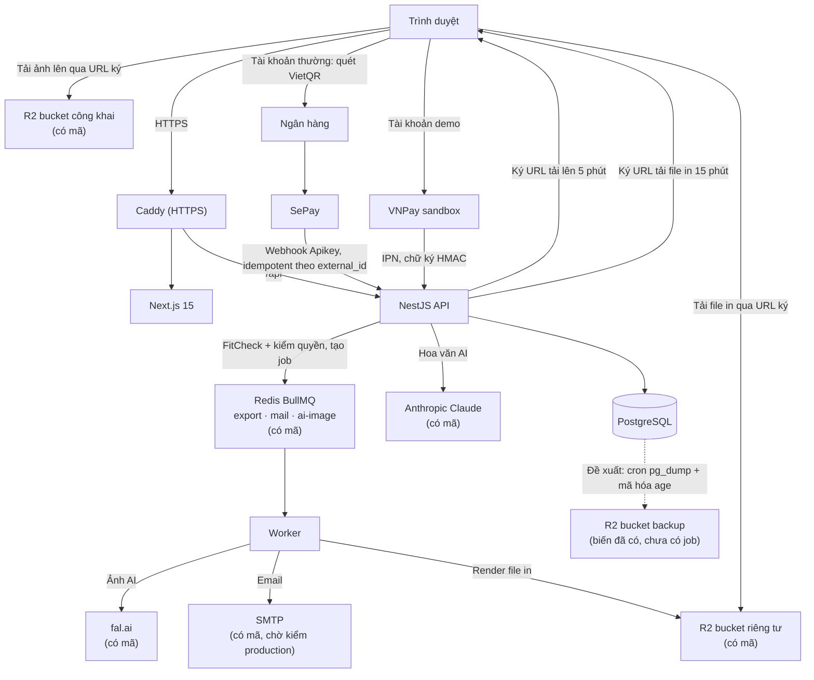

# WRAPFIT PLATFORM — BẢN PHÂN TÍCH KIẾN TRÚC & GIẢI PHÁP AN TOÀN DỮ LIỆU
> **Dự án**: WrapFit Platform (Packaging Personalization & Intelligence Platform)  
> **Tài liệu tham khảo**: Mã nguồn `minhduyhodev/NasaFilm` & Báo cáo phản biện 3 lỗ hổng hệ thống.  
> **Đối chiếu với mã**: 19/11/2026, `develop` tại fb720a9. Tên biến môi trường lấy từ [`env.validation.ts`](../be/src/config/env.validation.ts), [`be/.env.example`](../be/.env.example) và [`.env.example`](../.env.example).
>
> Bản đầu của tài liệu này là **đề xuất** viết trước khi có mã. Từ bản cập nhật ngày 19/11/2026, mỗi mục có nhãn trạng thái theo ba mức:
> - **Có mã trên `develop`**: đã có trong mã nguồn.
> - **Đã kiểm bằng test/E2E (ngày)**: có test tự động chạy qua vào ngày ghi.
> - **Chờ kiểm thực tế (vai trò)**: cần người giữ tài khoản hoặc người vận hành kiểm trên môi trường thật.
>
> Phần chưa có mã ghi nhãn **Đề xuất**. Các phương án cũ không còn dùng (Cloudinary, PayOS/Stripe, mã hóa trường dữ liệu, kịch bản backup) được gom ở [mục 6](#6-quyết-định-cũ--cần-xác-nhận).

---

## 0. TÓM TẮT TRẠNG THÁI (19/11/2026)

| Hạng mục | Đang vận hành | Trạng thái |
| :--- | :--- | :--- |
| **Xác thực** | JWT access 15 phút + refresh 7 ngày xoay vòng trong bảng `refresh_tokens`, `users.session_version`, cookie `httpOnly` + `SameSite=Lax` (+ `Secure` khi `COOKIE_SECURE=true`), Google OAuth, `POST /auth/logout-all` | Có mã trên `develop`. Đã kiểm bằng E2E (19/11/2026) |
| **Lưu trữ file** | S3/R2 qua `StorageService`: bucket công khai cho ảnh tải lên, ảnh AI, thumbnail; bucket riêng tư cho file xuất in. Dev dùng SeaweedFS | Có mã trên `develop`. Đã kiểm bằng E2E với SeaweedFS (19/11/2026). R2 production: chờ kiểm thực tế (người vận hành VPS) |
| **Thanh toán** | Tài khoản thường: VietQR, SePay gọi webhook khi tiền về. Tài khoản demo (`users.is_demo`): VNPay sandbox. Giả lập chỉ mở khi `PAYMENT_SIMULATION=true` | Có mã trên `develop`. Đã kiểm bằng E2E (19/11/2026). Tiền thật qua SePay và VNPay sandbox thật: chờ kiểm thực tế (người giữ tài khoản ngân hàng, SePay, VNPay) |
| **Xử lý bất đồng bộ** | Redis + BullMQ, worker riêng với ba hàng đợi `export`, `mail`, `ai-image`. Redis bật AOF và `noeviction` | Có mã trên `develop`. Đã kiểm bằng E2E (19/11/2026) |
| **Email** | SMTP qua nodemailer, gửi ở worker. Dev dùng Mailpit | Có mã trên `develop`. Nhà cung cấp SMTP production: chờ kiểm thực tế (người vận hành VPS) |
| **Backup CSDL** | Biến `STORAGE_BACKUP_BUCKET` đã có, chỉ `npm run storage:check` đọc. **Repo chưa có job backup** | Bucket backup: chờ kiểm thực tế (người vận hành VPS tạo bucket và đặt biến). Job backup và diễn tập khôi phục: **Đề xuất**, chưa kiểm khôi phục lần nào |
| **Dữ liệu cá nhân** | SĐT, địa chỉ người nhận lưu dạng chữ thường trong bảng `orders`. Tài khoản có lịch sử tài chính bị ẩn danh hóa thay vì xóa. Sau 10 năm, tác vụ `invoice-retention` xóa dữ liệu cá nhân còn trên chứng từ của tài khoản đã xóa | Có mã trên `develop`. Mã hóa trường dữ liệu: **Đề xuất** |
| **Giám sát** | Log JSON (`LOG_FORMAT`), không có Sentry | Sentry/Logtail: **Đề xuất** |

> **Đọc kỹ**: "bucket backup đã cấu hình" **không** có nghĩa là "đã có bản backup" hay "đã kiểm khôi phục". Đến 19/11/2026, chưa có job nào ghi vào bucket này và chưa có lần khôi phục thử nào.

---

## 1. ĐỐI CHIẾU & HỌC HỎI TỪ MÃ NGUỒN `NasaFilm`

Dự án **NasaFilm** (hệ thống rạp chiếu phim trực tuyến) giải quyết tốt bài toán phân cấp dịch vụ và luồng thanh toán / lưu trữ đa tầng. Khi đối chiếu với đặc thù của **WrapFit**, ta rút ra các bài học kiến trúc quan trọng:

| Hạng mục | Triển khai ở NasaFilm | Áp dụng cho WrapFit | Trạng thái ở WrapFit |
| :--- | :--- | :--- | :--- |
| **Authentication & Tokens** | JWT Access (15m) + Refresh (7d) trong DB, Google OAuth. | WrapFit có `session_version` và `refresh_tokens` xoay vòng trong DB, cookie `httpOnly + Secure + SameSite=Lax`. | Có mã trên `develop` |
| **Lưu trữ nhị phân (Storage)** | **Hybrid**: Cloudinary (Poster/Avatar) + AWS S3 (Media/Video VOD có Presigned URL TTL 900s). | WrapFit **không dùng Cloudinary** (quyết định ngày 16/11/2026). Mọi file nằm trên S3/R2: bucket công khai và bucket riêng tư cho file in. Link tải file in hết hạn sau 15 phút. | Có mã trên `develop` |
| **Cổng thanh toán** | **Hybrid 2 cổng**: Stripe (Quốc tế) + VietQR MB Bank (Nội địa). | WrapFit dùng **VietQR + SePay** cho tài khoản thường và **VNPay sandbox** cho tài khoản demo. Stripe và PayOS không dùng. | Có mã trên `develop`. Tiền thật: chờ kiểm thực tế (người giữ tài khoản ngân hàng và SePay) |
| **Xử lý bất đồng bộ** | API đồng bộ + Cron job kiểm tra. | WrapFit dùng **Redis + BullMQ** cho worker render file in, gửi email, sinh ảnh AI. Redis bật AOF để không mất job. | Có mã trên `develop` |

---

## 2. DANH MỤC BIẾN MÔI TRƯỜNG (.ENV) PRODUCTION

Danh sách dưới chỉ gồm biến mà mã đang đọc. Giá trị mẫu là chỗ trống, không phải khóa thật. Mô tả đầy đủ và giá trị mặc định ở [`be/.env.example`](../be/.env.example). Trong production, [`docker-compose.prod.yml`](../docker-compose.prod.yml) đọc file `.env` ở thư mục gốc (mẫu: [`.env.example`](../.env.example)) và đặt sẵn `COOKIE_SECURE`, `TRUST_PROXY`, `CORS_ORIGINS`, `FRONTEND_URL` theo `APP_DOMAIN`.

```bash
# ==============================================================================
# 1. CORE SERVER & DATABASE (POSTGRESQL & REDIS)
# ==============================================================================
NODE_ENV=production
PORT=8080                       # API, prefix /api
FRONTEND_URL=https://<domain>
CORS_ORIGINS=https://<domain>
TRUST_PROXY=true                # Sau Caddy
DATABASE_URL="postgresql://<user>:<password>@postgres:5432/<db>"
REDIS_URL="redis://:<password>@redis:6379"
THROTTLE_TTL_SECONDS=60
THROTTLE_LIMIT=100
LOG_FORMAT=                     # Trống = json khi NODE_ENV=production
SWAGGER_ENABLED=false

# ==============================================================================
# 2. CRYPTOGRAPHY, AUTHENTICATION & SESSION KEYS (TUYỆT ĐỐI KHÔNG LỘ)
# ==============================================================================
# Sinh bằng: openssl rand -base64 64
JWT_ACCESS_SECRET="<bí mật>"
JWT_REFRESH_SECRET="<bí mật>"
AUTH_TOKEN_SECRET="<bí mật>"    # Ký link xác minh email / đặt lại mật khẩu. Trống = dùng JWT_REFRESH_SECRET
JWT_ACCESS_TTL_SECONDS=900      # 15 phút
JWT_REFRESH_TTL_SECONDS=604800  # 7 ngày
COOKIE_SECURE=true
BCRYPT_ROUNDS=10

# Google OAuth (đặt cả hai hoặc để trống cả hai)
GOOGLE_CLIENT_ID="<id>.apps.googleusercontent.com"
GOOGLE_CLIENT_SECRET="<bí mật>"
GOOGLE_CALLBACK_URL="https://<domain>/api/auth/google/callback"

# ==============================================================================
# 3. STORAGE: S3-COMPATIBLE (CLOUDFLARE R2 Ở PRODUCTION)
# ==============================================================================
STORAGE_ENDPOINT="https://<account-id>.r2.cloudflarestorage.com"
STORAGE_REGION="auto"
STORAGE_ACCESS_KEY_ID="<khóa>"
STORAGE_SECRET_ACCESS_KEY="<bí mật>"
STORAGE_BUCKET="<bucket công khai>"          # Ảnh tải lên, ảnh AI, thumbnail
STORAGE_PUBLIC_URL="https://<domain ảnh>"
STORAGE_PRIVATE_BUCKET="<bucket riêng tư>"   # File xuất in, chỉ tải qua link ký 15 phút
STORAGE_BACKUP_BUCKET="<bucket backup>"      # Bản dump CSDL đã mã hóa. Hiện chỉ storage:check đọc, chưa có job ghi
STORAGE_PUBLIC_ENDPOINT=                     # Chỉ cần khi endpoint trình duyệt thấy khác endpoint nội bộ
STORAGE_FORCE_PATH_STYLE=false

# ==============================================================================
# 4. PAYMENT GATEWAYS (VIETQR + SEPAY, VNPAY SANDBOX)
# ==============================================================================
VIETQR_BANK_BIN="<mã BIN ngân hàng>"
VIETQR_ACCOUNT_NO="<số tài khoản nhận>"
VIETQR_ACCOUNT_NAME="<TÊN CHỦ TÀI KHOẢN>"
SEPAY_WEBHOOK_API_KEY="<khóa webhook SePay>"  # So bằng timingSafeEqual

VNPAY_TMN_CODE="<mã sandbox>"                 # Chỉ dùng cho tài khoản demo
VNPAY_HASH_SECRET="<bí mật sandbox>"
VNPAY_PAY_URL="https://sandbox.vnpayment.vn/paymentv2/vpcpay.html"
VNPAY_RETURN_URL=                             # Trống = ${FRONTEND_URL}/payments/vnpay-return. IPN: https://<api>/api/payments/vnpay/ipn

PAYMENT_SIMULATION=false        # true: mở nút giả lập. Tài khoản thường chỉ giả lập được khi VIETQR_* trống

# ==============================================================================
# 5. AI ENGINE & PATTERN GENERATION
# ==============================================================================
ANTHROPIC_API_KEY="<khóa>"      # Hoa văn AI. Trống = hoa văn thuật toán
AI_MODEL_FAST=<model>
AI_MODEL_PREMIUM=<model>
AI_MONTHLY_BUDGET_USD=<ngân sách>
AI_TIMEOUT_MS=<ms>
USD_VND_RATE=<tỉ giá>
FAL_KEY="<khóa fal.ai>"         # Job ảnh AI (Xu Wrap)
AI_IMAGE_PROVIDER=fal
AI_IMAGE_MODELS=<danh sách>
AI_IMAGE_CONCURRENCY=<số job>
AI_IMAGE_TIMEOUT_MS=<ms>
PEXELS_API_KEY="<khóa>"         # Ảnh stock trong thư viện
EXPORT_CONCURRENCY=<số job>

# ==============================================================================
# 6. TRANSACTIONAL EMAIL (SMTP)
# ==============================================================================
SMTP_HOST=<host>
SMTP_PORT=587
SMTP_SECURE=false
SMTP_USER=<user>
SMTP_PASS=<mật khẩu>
MAIL_FROM="WrapFit <no-reply@<domain>>"
```

Biến chỉ dùng cho seed (chạy mỗi lần container backend khởi động): `SEED_ADMIN_EMAIL`, `SEED_ADMIN_PASSWORD`, `SEED_DEMO_EMAIL`, `SEED_DEMO_PASSWORD`. Biến của Docker Compose ở thư mục gốc: `APP_DOMAIN`, `ACME_EMAIL`, `POSTGRES_*`, `REDIS_PASSWORD`, `EXTRA_CORS_ORIGINS`.

---

## 3. KIẾN TRÚC DỊCH VỤ BÊN THỨ BA ĐANG VẬN HÀNH

Nét liền là luồng có mã trên `develop`. Nét đứt là **đề xuất**, chưa có mã.



1. **Cổng thanh toán (Payment Gateway)** — có mã trên `develop`, đã kiểm bằng E2E (19/11/2026):
   - **Tài khoản thường**: VietQR. Mỗi thanh toán có mã tham chiếu `WF…` trong nội dung chuyển khoản. SePay gọi webhook khi tiền vào tài khoản. Webhook xác thực bằng khóa `Apikey` (so bằng `timingSafeEqual`). Mỗi giao dịch lưu một dòng trong `bank_transactions` theo `external_id` duy nhất, nên SePay gửi lại cũng không tạo thêm dòng. Giao dịch không khớp (lệch tiền, thiếu mã) nằm trong hàng đợi đối soát để admin gán tay (`be/src/payments/admin/`).
   - **Tài khoản demo**: VNPay sandbox, xác thực chữ ký HMAC.
   - **Giả lập**: chỉ mở khi máy chủ bật `PAYMENT_SIMULATION=true`. Tài khoản demo luôn được giả lập. Tài khoản thường chỉ được giả lập khi máy chủ chưa cấu hình `VIETQR_*`. Có tài khoản VietQR thật thì tài khoản thường giả lập → `403 SIMULATION_DEMO_ONLY`.
   - Tiền thật qua SePay: chờ kiểm thực tế (người giữ tài khoản ngân hàng và SePay).

2. **Lưu trữ (Storage Strategy)** — có mã trên `develop`:
   - Mọi file nằm trên S3/R2 qua `StorageService`. Ảnh của chính trang web nằm trong `fe/public`. Không dùng CDN ảnh bên thứ ba.
   - Cloudflare R2 tương thích S3 và không tính phí băng thông tải về.

3. **Email xác thực & thông báo** — có mã trên `develop`:
   - Gửi bằng SMTP (nodemailer) ở worker. Nhà cung cấp SMTP production chưa chốt: chờ kiểm thực tế (người vận hành VPS).

4. **Giám sát** — **Đề xuất**:
   - Hiện có log JSON và request id. Chưa tích hợp Sentry hay dịch vụ gom log.

---

## 4. CHIẾN LƯỢC PHÂN LOẠI & LƯU TRỮ DỮ LIỆU (KHÔNG LƯU HẾT VÀO DB)

| Nơi Lưu Trữ | Dạng Dữ Liệu | Cơ Chế Bảo Mật & Tối Ưu | Trạng thái |
| :--- | :--- | :--- | :--- |
| **PostgreSQL** | 32 bảng. Dữ liệu quan hệ cốt lõi: tài khoản (`users`), dự án (`packaging_projects`), đơn in mẫu (`orders`, `order_items`, `order_status_history`), thanh toán (`payments`, `bank_transactions`), danh mục file (`stored_files`). | - Chỉ lưu key của file, không lưu file nhị phân.<br>- Thiết kế canvas lưu dạng JSONB.<br>- Tối đa 50 mốc snapshot thủ công, giữ 20 mốc tự động mới nhất.<br>- Dự án trong thùng rác bị xóa sau 30 ngày, trừ dự án đang nằm trong đơn còn hiệu lực. | Có mã trên `develop`. Đã kiểm bằng E2E (19/11/2026) |
| **R2 bucket công khai** | Ảnh tải lên (logo, ảnh), ảnh AI, thumbnail dự án. | - Tải lên qua URL ký hết hạn sau 5 phút, có kiểm quyền sở hữu dự án.<br>- Tác vụ dọn file mồ côi. | Có mã trên `develop` |
| **R2 bucket riêng tư** | File xuất in. | - Không có URL công khai.<br>- Chỉ tải qua **Pre-signed URL** hết hạn sau 15 phút.<br>- Thiếu `STORAGE_PRIVATE_BUCKET` thì file in rơi vào bucket công khai và API ghi cảnh báo khi khởi động. | Có mã trên `develop`. Bucket production: chờ kiểm thực tế (người vận hành VPS) |
| **R2 bucket backup** | Bản dump CSDL đã mã hóa. | - Không có URL công khai.<br>- Nên dùng API token riêng chỉ có quyền ghi và lifecycle xóa sau 30 ngày (xem [`be/README.md`](../be/README.md)). | Biến đã có. Job backup: **Đề xuất**. Chưa kiểm khôi phục |
| **Redis** | Hàng đợi BullMQ (xuất in, gửi email, ảnh AI), bộ đếm rate limit, đẩy thông báo từ worker sang API. | - Bật `appendonly yes` (AOF) và `noeviction` ở cả dev và production, để Redis khởi động lại không mất job đang chờ.<br>- Production đặt mật khẩu (`REDIS_PASSWORD`). | Có mã trên `develop` |
| **Trình duyệt (Client)** | Cookie phiên `httpOnly`, cài đặt giao diện, trạng thái tour hướng dẫn. | - **Không lưu Access/Refresh Token trong LocalStorage** (chống lỗ hổng XSS).<br>- Không lưu dữ liệu cá nhân (SĐT, địa chỉ, thẻ) trong LocalStorage. | Có mã trên `develop` |

---

## 5. GIẢI QUYẾT TRIỆT ĐỂ 3 NHÓM RỦI RO LỚN

### 1. RỦI RO MẤT DỮ LIỆU & SẬP SERVER PHẢI ĐỀN BÙ KHÁCH HÀNG

#### A. Khai tử biến RAM `SAMPLE_ORDERS` — đã xong

- **Vấn đề cũ**: `orders.service.ts` từng giữ đơn trong một `Map` trong RAM. Máy chủ restart là mất đơn.
- **Hiện tại** (có mã trên `develop`, đã kiểm bằng E2E 19/11/2026): đơn nằm trong các bảng `orders`, `order_items`, `order_status_history` của [`schema.prisma`](../be/prisma/schema.prisma). Tài khoản có đơn hoặc thanh toán không bị xóa cứng mà bị ẩn danh hóa, vì khóa ngoại của các bảng tài chính là `ON DELETE RESTRICT`.
- **Còn mở** (**Đề xuất**): danh sách xưởng in vẫn là hằng `PARTNERS` trong `be/src/print-shops/print-shops.service.ts`. Chưa có bảng `print_shops`; bảng `print_shop_members` chỉ gán tài khoản xưởng vào mã xưởng.

#### B. Sao lưu CSDL

- **Hiện tại**: biến `STORAGE_BACKUP_BUCKET` và hướng dẫn tạo bucket đã có. Repo **chưa có job backup**, chưa có bản backup nào được kiểm khôi phục.
- **Việc cần làm trước khi coi là "có backup"**:
  1. Người vận hành VPS tạo bucket backup và đặt biến (chờ kiểm thực tế).
  2. Thêm job backup hằng đêm (**Đề xuất**, phương án ở mục 6).
  3. Khôi phục thử một bản dump vào CSDL tạm và ghi ngày kiểm (chờ kiểm thực tế, người vận hành VPS).

#### C. Sao lưu file thiết kế của khách hàng — **Đề xuất**

- Không backup toàn bộ. Chỉ cần backup ảnh gốc khách tải lên.
- File xuất in và thumbnail không cần backup, vì worker dựng lại được từ thiết kế lưu trong CSDL.

---

### 2. RỦI RO LỖI HỆ THỐNG, CRASH CODE & TRANH CHẤP THANH TOÁN

1. **Đối soát thanh toán** (có mã trên `develop`, đã kiểm bằng E2E 19/11/2026):
   - Webhook SePay lưu mọi giao dịch đến. Giao dịch khớp mã `WF…` và đủ tiền thì thanh toán chuyển sang đã trả. Giao dịch lệch tiền hoặc không có mã nằm trong hàng đợi để admin gán tay.
   - Phương án cũ là cron gọi API của PayOS/Stripe để hỏi trạng thái. Phương án này không dùng vì WrapFit không dùng hai cổng đó (mục 6).
2. **Chống ghi nhận trùng**:
   - `bank_transactions.external_id` là khóa idempotency: SePay gửi lại cùng giao dịch thì không thêm dòng.
   - Mã đơn in có dạng `WF-<năm>-<6 chữ số>`, thanh toán có `reference` duy nhất.

---

### 3. RỦI RO BẢO MẬT & XÂY DỰNG NIỀM TIN CHO NGƯỜI DÙNG (COMPLIANCE)

Khách hàng thiết kế bao bì là các xưởng sản xuất, chủ shop handmade, thương hiệu mỹ phẩm/trang sức. Họ rất sợ:
- Mẫu thiết kế độc quyền bị lộ ra ngoài trước ngày ra mắt.
- Đội ngũ Admin hoặc lập trình viên lén xem và sao chép tác phẩm.
- Lộ số điện thoại và địa chỉ khách nhận quà.

#### Giải pháp:

1. **Bảo mật file thiết kế** (có mã trên `develop`):
   - File xuất in nằm trong bucket riêng tư, chỉ tải qua Pre-signed URL 15 phút.
   - API kiểm quyền sở hữu dự án trước khi ký URL tải lên và trước khi tạo job xuất.

2. **Dữ liệu cá nhân trong đơn**:
   - Hiện tại (có mã trên `develop`): SĐT và địa chỉ người nhận lưu dạng chữ thường trong `orders`. Chứng từ kế toán được giữ ít nhất 10 năm (Luật Kế toán 2015). Sau thời hạn đó, tác vụ `invoice-retention` xóa tên, SĐT, địa chỉ, ghi chú trên đơn và thông tin hóa đơn của các tài khoản đã xóa.
   - Mã hóa cột bằng AES-256-GCM: **Đề xuất** (mục 6).

3. **Nhật ký kiểm toán** — **Đề xuất**:
   - Chưa có bảng `audit_events`. Hiện có `order_status_history` (ai đổi trạng thái đơn, lúc nào) và `bank_transactions.resolved_by` (admin nào gán giao dịch).
   - Đề xuất ghi thêm: admin mở dự án của người khác, xuất file in, hoàn tiền.

4. **Quyền của người dùng với dữ liệu** (Nghị định 13/2023/NĐ-CP & Luật Bảo vệ dữ liệu cá nhân 2025):
   - **Đăng xuất khỏi mọi thiết bị**: có mã trên `develop` (`POST /api/auth/logout-all`, thu hồi refresh token và tăng `session_version`).
   - **Xóa tài khoản**: có mã trên `develop` nhưng chỉ admin gọi được (`DELETE /api/users/:id`). Tài khoản không có lịch sử tài chính bị xóa hẳn. Tài khoản có lịch sử tài chính bị ẩn danh hóa. Tự xóa tài khoản với thời gian chờ 7 ngày: **Đề xuất**.
   - **Xuất toàn bộ dữ liệu (file ZIP)** và **xem danh sách phiên theo IP, thiết bị**: **Đề xuất**.

---

## 6. QUYẾT ĐỊNH CŨ / CẦN XÁC NHẬN

Các phương án dưới đây có trong bản đầu của tài liệu. Chúng **không** chạy trong hệ thống hiện tại. Giữ lại để tham khảo; muốn dùng lại thì chủ dự án phải xác nhận và mở việc mới.

| Phương án | Trạng thái | Ghi chú |
| :--- | :--- | :--- |
| **Cloudinary** cho ảnh công khai (`f_auto,q_auto`, biến `CLOUDINARY_*`) | Đã bỏ (16/11/2026) | Mọi file trên R2. Không cấu hình `CLOUDINARY_*` |
| **PayOS** cho VietQR (`PAYOS_CLIENT_ID`, `PAYOS_API_KEY`, `PAYOS_CHECKSUM_KEY`) | Không dùng | Thay bằng VietQR + SePay webhook |
| **Stripe** cho thẻ quốc tế (`STRIPE_*`) | Đề xuất, cần xác nhận | Chưa có nhu cầu bán ra nước ngoài |
| **Mã hóa SĐT, địa chỉ** bằng AES-256-GCM (`PII_ENCRYPTION_KEY`, cột `phone_encrypted`, `address_encrypted`) | Đề xuất, cần xác nhận | Cần đổi schema `orders` và có quy trình xoay khóa |
| **Tự xóa dữ liệu người nhận 30 ngày sau khi giao** | Cần xác nhận | Mâu thuẫn với nghĩa vụ giữ chứng từ 10 năm đang có trong mã |
| **Backup CSDL bằng cron trên VPS**: 02:00 hằng đêm, `pg_dump -Fc` → mã hóa bằng `age` → tải lên bucket backup; khôi phục thử mỗi tháng vào CSDL tạm. Nếu chuyển sang CSDL managed (Neon / Supabase) thì bật Point-in-Time Restore | Đề xuất | Bucket đã có biến. Job, khóa `age` và lịch khôi phục thử chưa có |
| **Resend** thay SMTP (`RESEND_API_KEY`) | Cần xác nhận | Mã hiện gửi qua SMTP, dùng được với mọi nhà cung cấp có SMTP |
| **Sentry, Logtail** (`SENTRY_DSN`, `LOGTAIL_SOURCE_TOKEN`) | Đề xuất | Chưa có mã |
| **Groq** làm AI dự phòng (`GROQ_API_KEY`) | Không dùng | Dự phòng hiện là hoa văn thuật toán, miễn phí |
| **`COOKIE_SECRET`** ký cookie | Không dùng | Cookie phiên là JWT đã ký bằng `JWT_*_SECRET` |
| Tên biến cũ `S3_*`, `APP_FRONTEND_URL`, `JWT_*_EXPIRATION`, `PORT=3001` | Đã thay | Tên đúng: `STORAGE_*`, `FRONTEND_URL`, `JWT_*_TTL_SECONDS`, `PORT=8080` (mục 2) |
